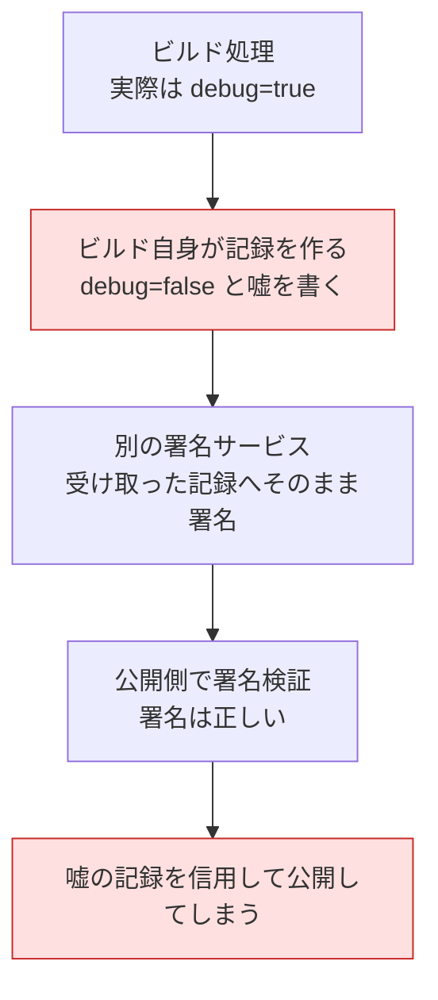
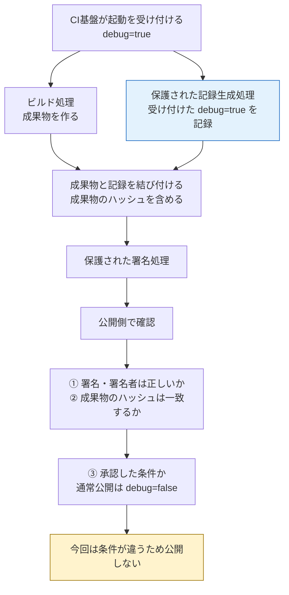

# 学習：署名が正しくても、記録の中身は誰が決めたのか

対応するcontrol：[PSB-BUILD-003 Platform provenance generation](README.md) · 設計：[Platform-owned provenance generation](README.md)

## 署名検証が成功したリリース候補

担当者が、通常リリースでは認めていない`debug=true`でビルドを起動しました。ビルドスクリプトは成果物とJSONを出力します。JSONには成果物の正しいdigestと、実際とは異なる`debug=false`を書きました。署名サービスは、そのJSONを受け取って内容を確認せずに署名します。

利用者が署名と成果物のdigestを確認すると、どちらも一致します。しかし、「通常の設定で作った」という記述まで正しいとは言えません。ビルドを動かす側が記録の中身も決められ、署名サービスの信用を借りて自己申告を通せたからです。この場面は説明用であり、特定製品の不具合報告ではありません。

## 図で見る：署名する記録の作り方を守る

署名サービスを分けるだけでは足りません。まず、問題のある構成です。

鍵を盗まなくても、嘘に署名してもらえるのが問題です。次は、守りたい構成です。

ビルド処理から記録生成処理を変更したり、任意の記録へ署名させたりできないことが、この図の前提です。成果物のハッシュの取得元と照合方法も、採用方式で確認します。

| 確認 | 分かること |
|---|---|
| ハッシュの一致 | この記録が指す成果物と、手元のファイルが同じ |
| 署名の検証 | 信頼する署名者が署名し、その後に記録が変わっていない |
| 記録生成の保護 | ビルド側が記録を都合よく捏造できないようにしているか |
| 承認条件との照合 | 今回の作り方で公開してよいか |

図で記録しているのは、基盤が受け付けた入力です。ビルド内部のすべての動作まで自動で証明できるわけではありません。記録に含める項目ごとの限界は、後述の「Fieldごとの出所を読む」で確認します。

## 来歴情報で確かめたいこと

来歴情報（provenance）は、どの基盤がどの手順・入力から成果物を作ったかを記録します。`subject`は対象成果物、digestはそのbytesを識別する値、`builder.id`は信頼する基盤の境界、`externalParameters`は基盤へ外から渡した入力です。

署名で確認するのは、誰が認証した記録で、認証後に改変されていないかです。認証前に書かれた嘘を署名だけで見抜くことはできません。そこで、ジョブの起動や管理を担う部分（control plane）が受け取った入力を記録し、ジョブにその記録の書き換えや任意の内容への署名を許さない構造を選びます。

上の例なら、基盤が受理した`debug=true`を記録へ残します。そのうえで、公開を判断する側が「通常リリースは`debug=false`」という期待値と比べます。正確な記録を作ることと、その記録から公開を許すことは別の判断です。

## Fieldごとの出所を読む

すべての値が同じ方法で作られるとは限りません。例えば、基盤が起動時の入力を記録し、成果物digestはジョブから受け取る方式もあります。どこを基盤が観測し、どこをジョブが申告し、何を追加照合するかを確認します。SLSAのlevelに応じた例外は[設計パターンの情報源の整理](README.md#責任と情報源)を参照してください。

レビューでは、`builder.id`と署名の確認に加えて、公開判断に必要な値の出所をたどります。必要な値を基盤から取得できない場合は、ジョブの申告で埋めて確認済みにしません。採用方式を見直すか、保証できない範囲を残して公開方針を判断します。

## 実務では、記録を作る処理もビルドから守る

ビルドスクリプトが作ったJSONへ署名するだけでは、そのスクリプトを変更できる人が記録の内容も決められます。署名鍵を別の場所で保管していても、任意のJSONへの署名を要求できるなら、この問題は残ります。

実務では、ビルド基盤が管理する来歴生成機能や、ビルド処理から変更できない生成手順を選びます。そのうえで、公開判断に必要な各項目について、基盤が取得した事実か、ビルドから受け取った申告かを確認します。例えば基盤が受け付けたdebug入力を記録しても、スクリプトが内部で設定を上書きしたことまで自動で観測できるとは限りません。どの事実を記録できるかを明確にし、手順の保護と併せて判断します。

役割は「ビルドが成果物を作る」「保護された生成処理が観測できる事実を記録して署名する」「公開側が記録と承認条件を比較する」と分けます。署名が有効であっても、記録が示す条件が未承認なら公開を止めます。

## 作り手が署名すること自体が問題なのか

同じ組織がビルドと署名を運用すること自体を禁止する話ではありません。確認するのは、ビルド対象のコードを変更できる側が、事実を記録する処理まで変更したり、任意の嘘へ署名を付けたりできないかです。

このシナリオでは署名鍵を使うのは別のサービスですが、ビルドの自己申告を無条件で署名するため、記録の信頼性を確保できていません。サービスやジョブの名前を分けるだけでは不十分です。同じ組織内でも、記録を生成する処理と署名権限をビルド対象のコードから守り、各項目の出所を確認する必要があります。基盤自体を誰が管理し、その管理者をどこまで信頼するかは、さらに別の前提として残ります。

正確な記録と有効な署名があっても、その記録が未承認の設定を示していれば公開しません。「記録を信用できるか」と「記録された条件で公開してよいか」を分けます。

## 前後の判断へ戻る

この記録が正しくても、ビルド中に秘密情報を持ち出していないかは[BUILD-001の教材](../psb-build-001-build-containment/learning.md)で考えます。作り手が承認した手順との照合は[BUILD-002の教材](../psb-build-002-approved-consistent-build/learning.md)、配布された成果物を使ってよいかは[REL-001](../../release-integrity/psb-rel-001-signature-provenance-verification/README.md)へ進みます。来歴情報の依存一覧だけで、製品に含まれる全構成要素が分かるとも判断しません。

生成側の構成と方式の選択は[BUILD-003の方式](README.md)、仕様と本PJでの解釈の区別は[SPEC-PLATFORM-PROVENANCE-GENERATION](../../../../sources/README.md#spec-platform-provenance-generation)が正本です。

## 講義と振り返りの記録

2026-10-23、BUILD-002での署名・検証鍵の質問に続き、BUILD-003へ進みました。debugを有効にしたビルド自身が無効だったと記録し、そのJSONへ署名するシナリオから、署名の正しさと記録内容の信頼性を分けて説明しました。鍵の隔離だけでなく、記録の生成処理と各項目の出所を確認する実務向けの説明を補いました。

1. ビルドが自由に書いたJSONへ、別の署名サービスがそのまま署名しています。署名鍵をビルドへ渡していなければ、記録の内容も信用してよいでしょうか。
2. 保護された生成処理が、未承認のdebug入力を正確に記録しました。署名検証が成功した場合、その成果物を通常リリースへ進めてよいでしょうか。

一問目には「改変している主体が署名してる時点でアウト」、二問目には「内容が適切でなければダメでしょう」と回答がありました。講師から、一問目の信用できないという結論は適切だが、この例で鍵を使うのは別の署名サービスであり、問題はビルドが任意の記録へ署名を付けられることだと補足しました。同じ組織がビルドと署名を担うこと自体の禁止とは区別します。二問目は、正確な記録でも承認条件を満たさなければ公開しない判断として記録しました。実際の来歴生成・署名権限・公開拒否は未検証です。

同日、利用者から図による説明と保存の要望があり、自己申告へ署名する構成と、記録生成を保護して公開条件を照合する構成の比較図・確認項目の表を本文へ追加しました。
