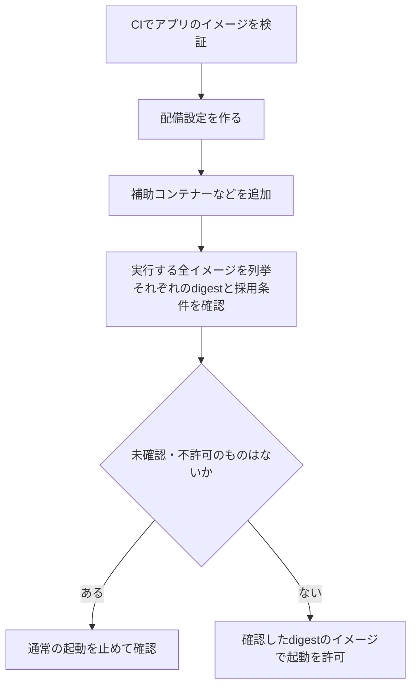

# 学習：公開されたイメージを、実行してよいか

対応するcontrol：[PSB-CONTAINER-001 Deployment artifact admission](README.md) · 設計：[Deployment artifact admission boundary](../../../../engineering/container-cloud-iac-security/deployment-artifact-admission-boundary/README.md)

## 同じ名前のイメージなのに中身が違う

架空の場面です。チームは`release`タグのイメージを使う設定を承認しました。その後、同じタグが別の内容へ付け替えられました。さらにPodの作成時には補助コンテナーが追加されます。CIで最初のイメージに「合格」と表示されていても、実行される二つのイメージを確認したことにはなりません。

タグは変えられる名前、ハッシュ値（digest）は特定の内容を指す値です。複数のOS・CPU向けのイメージを束ねた一覧（image index）には、一覧自体のハッシュ値と、実行先が選ぶ個別イメージの定義（manifest）のハッシュ値があります。どの値を確認し、実行先でどの定義が選ばれるかを追えないと、別のイメージの確認結果を取り違えます。

## 使用直前に問うこと

まず、最終的な設定から、主処理のコンテナー、初期化用（init）、補助処理用（sidecar）、調査用に追加するもの（ephemeral）など、実行するイメージをすべて列挙します。次に、それぞれの保管先とハッシュ値を特定し、現在の受入条件を満たすか確かめます。署名の有無だけでなく、ビルド基盤、ソース、判断に使った方針、許可の期限などを、同じ対象へ結び付けます。

[レジストリ](../psb-container-002-container-registry-publication-boundary/learning.md)に公開済みでも、まだ使用許可ではありません。過去の受入結果を再利用するなら、別の環境や別のハッシュ値へ使い回せないこと、使用停止や期限切れを反映できることが必要です。確認先に接続できない場合を「以前は通ったから許可」とは扱いません。

## この場面でどう判断するか

まず、変更後の`release`タグが指すイメージへ、以前のCIの合格結果を流用しません。確認した内容のハッシュ値を起動対象へ結び付け直します。新しい内容を使うなら、その内容について現在の受入条件で判断します。

追加された補助コンテナーも独立した実行対象です。主イメージが合格でも、補助イメージが未確認なら、その構成での起動は止めます。追加・差替えが終わった最終設定に対して、すべてのイメージと判断結果が対応していることを確かめます。CIで確認した設定だけを見ても、その後に加わるものは確認できません。

確認サービスが停止している場合は、不正なイメージだと断定せず「確認不能」として通常の起動を止めます。古い許可を無条件に使い回して通すことはしません。この判断は起動を許すかどうかであり、既に動いているコンテナーを停止した証拠にはなりません。

## 図で見る：最後に動かすものを確認する

実務では、アプリ本体だけでなく、ログ転送や初期化のために追加するイメージも対象へ含めます。配備直前の最終構成に対して確認を強制し、CI以外からの直接作成や更新も、その確認を通るようにします。確認した後で別のイメージを追加できる経路があれば、境界が抜けています。

REL-001は成果物の署名・来歴を使う採否判断でした。このcontrolでは、その判断を実行先で強制し、最終構成に含まれる全イメージと対応させます。起動が許可されたことだけで、コンテナーの実行権限や通信設定まで適切だとは判断しません。

## どこまで確かめたか

作成時だけでなく、更新、切り戻し、直接作成、補助コンテナー追加など、実行対象が変わる経路も確認します。許可後に実際どの内容が稼働したかは別の観測です。[GOV-005の復旧判断](../../governance-operations/psb-gov-005-deployed-artifact-recovery/learning.md)では、新しい成果物の公開、使用許可、稼働、古い成果物の非稼働を、各ハッシュ値と結び付けて確認します。

採用先で試す項目は[controlの診断観点](README.md#failure-checks)、資料の採否は[Sources](../../../../sources/README.md#ref-deployment-artifact-admission-001)にあります。

## 講義と振り返りの記録

2026-10-25、資料整理後にREL-005の二問を講師が解説し、CONTAINER-001へ進みました。CIで検証したアプリに、配備時に未確認の補助コンテナーが追加される場面を図で説明しました。最終構成の全イメージを対象に、実行直前の確認を迂回できないことを扱います。

1. アプリ本体のイメージは検証済みですが、配備時に追加されたログ転送用コンテナーは未確認です。本体が合格なら、そのまま全体を起動してよいでしょうか。
2. CI経由では不許可のイメージを止められますが、運用担当者の直接作成では起動できます。どこに確認を置く必要がありますか。

二問の回答はまだ得ていません。実クラスタの起動拒否・直接作成経路・実稼働イメージは未確認です。
