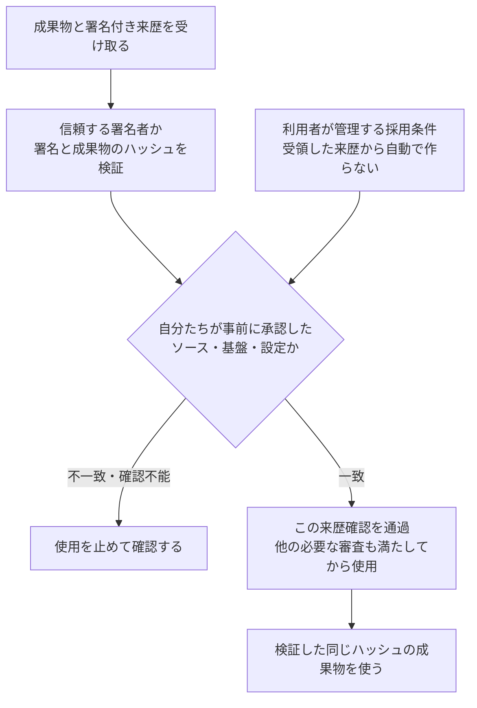

# 正しい署名でも、その成果物を使ってよいか

[コントロール記録](README.md) · [REL-001の方式](README.md)

## 正規の署名でも拒否する場面

利用者は製品のリリース成果物を取得しました。作られた経緯を示す来歴情報には、承認した鍵による有効な署名が付いています。実際に使うファイルのハッシュ値も、来歴に記された対象（subject）と一致しました。
しかし、来歴が示すソースは正規リポジトリではなく、その複製（fork）です。ビルド時の指定にも、レビューしていない機能の有効化が含まれています。署名が有効でも、**自分たちが使用を認めた条件で作られた成果物か**はまだ分かりません。

この場面では使用を止めます。利用者が事前に定めた正規リポジトリ、ビルド方式（build type）、外部から指定できる値（external parameters）と照合すれば、複製元の違いと未承認の指定を見つけられます。逆に「期待する値」を今回届いた来歴から作れば、想定外の値も一致してしまい、受入判断になりません。

未承認のforkを止める理由は、不正コードが見つかったからとは限りません。使用を認めたソースと違い、変更のレビューや管理を同じように信頼できるか未確認だからです。正規リポジトリにも不正な変更が入る可能性はあり、正規ソースとの一致だけでコードの安全性を保証するものではありません。

## 三つの判断を分ける

| 判断 | 問うこと | それだけでは分からないこと |
|---|---|---|
| ファイルの一致 | 実際に使うファイルは、署名を確認した来歴が指す対象と同じか | 誰が署名したか、中身が安全か |
| 署名の確認 | 利用者が承認した相手の署名か | 自分たちが認めた条件で作られたか |
| 使用の判断 | ビルド基盤、ソース、指定値が事前の期待値と合うか | 正規ソースに欠陥や悪意がないか |

三つを確認しても、脆弱性検査やコードレビューが不要になるわけではありません。
「署名が不正」と「検証器が起動できず確認できない」は理由が異なりますが、どちらも自動使用を止めます。再試行するときも署名不要の経路へ切り替えず、来歴の取得や検証機能を復旧します。

検証した後も、同じファイルを使う必要があります。実行時に同名のファイルや`latest`を取得し直せば、別の内容に変わる可能性があります。「検証成功」という表示だけを次へ渡さず、確認したファイルのハッシュ値、使った期待値、判断結果を実際の使用対象へ結び付けます。

## 図で見る：作り手の署名から、使う側の判断へ

BUILD-003では記録を作る側の責任を扱いました。ここでは、受け取った記録を使って、利用者が自分たちの採用条件を確認します。

署名やハッシュの検証が失敗した場合も、次の判断へ進めません。図の一致は、脆弱性がないという保証ではありません。

実務では、採用する製品ごとに信頼する署名者、正規ソース、許可するビルド条件を先に決め、利用前の確認へ組み込みます。配布先が提示した値を無条件に採用条件へ写すと、照合の意味がなくなります。条件を変更するときは、成果物の受領とは別に変更理由を確認します。

最後に、検証したファイルをそのまま使うか、検証したdigestで取得し使用する仕組みにします。検証後に`latest`などの可変名で取り直す構成では、確認したものと使用するものがずれる可能性があります。

## 初回に取得した値を基準にする方式の限界

最初に取得した値を基準にし、更新時の差分を監視する方式（Trust on first use）は、初回の値が正しいことを独立には保証しません。
採用するなら、初回承認と期待値の変更を誰が決めるか、差分を誰へ知らせるか、どの変更を許すかを明示します。
公開鍵と来歴を同じ侵害された配布先から取得し、その鍵を無条件で信頼する方式とは区別します。

[SLSA v1.2のverification仕様](https://slsa.dev/spec/v1.2/verifying-artifacts)を設計入力とし、上の架空シナリオはリポジトリでの解釈です。
[REF-PORTFOLIO-001](../../../../sources/README.md#ref-portfolio-001)では外部依存・プラットフォームから運用側へ期待値管理をつなぎます。
攻撃段階9から10の使用許可、12の拒否理由の調査へ責任を渡します。ここに確認方法を書いたことを、本番での使用拒否や対応の実施結果とは扱いません。

- [コントロール記録](README.md)
- [方式と確認方法](README.md)
- [署名する対象を承認する：REL-005の教材](../psb-rel-005-artifact-signing-generation/learning.md)
- [利用者が来歴を取得できるようにする：REL-002の教材](../psb-rel-002-provenance-distribution-availability/learning.md)
- [参照資料と採否](../../../../sources/README.md#spec-consumer-artifact-verification)

## 講義と振り返りの記録

2026-10-23、BUILD-003に続き、成果物を受け取る側の判断へ進みました。承認した署名者の署名とハッシュが正しくても、ソースが未承認のforkなら使用しないシナリオを説明しました。利用者が管理する採用条件と、検証した対象をそのまま使うことを図で補いました。

1. 署名とハッシュは正しくても、来歴のソースが許可していないforkでした。そのまま使用してよいでしょうか。
2. 検証したファイルを使わず、実行直前に`latest`で取り直しています。何を変える必要がありますか。

一問目には「ダメですね。不正なPRやコードが混ざる可能性がある」、二問目には「latestだと差し替えられる可能性がある。ハッシュ固定すべき」と回答がありました。講師から、未承認ソースは不正コードの発見を待たず使用を止めること、正規ソースにも欠陥や不正変更の可能性は残ることを補足しました。ハッシュ固定は任意の値ではなく、署名・来歴と採用条件を確認した成果物のdigestを使用まで維持する判断として記録しました。実環境の署名・来歴検証、使用拒否、検証対象と使用対象の一致は未確認です。
