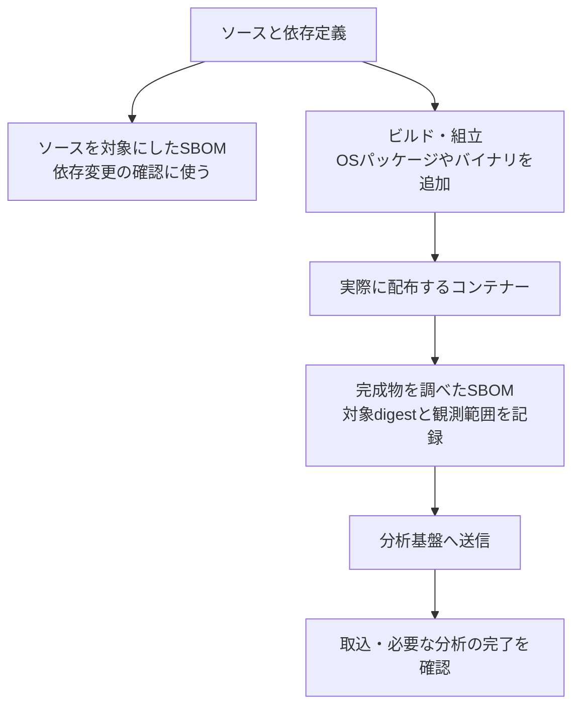

# 学習：そのSBOMは、どこを調べて作ったものか

対応するcontrol：[PSB-REL-003 Release SBOM identity and analysis](README.md) · 設計：[Release SBOM identity and analysis intake](../../../../engineering/release-integrity/release-sbom-identity-and-analysis/README.md)

## PRで作った部品表を、そのまま公開したら

あるチームはPRごとに依存関係の定義ファイルからSBOM（ソフトウェア部品表）を作っていました。リリース時にも同じSBOMを分析基盤へ送り、受付成功を見て作業を終えました。
しかし、受付後の形式検証は失敗しており、部品の取込と脆弱性分析は終わっていませんでした。

ところが、完成したコンテナーイメージには、base imageのOSパッケージや、ビルド中に取得したバイナリが加わっていました。PR時の一覧にはありません。後日、そのバイナリに脆弱性が報告されても、部品台帳の検索は0件でした。未収載なのに「影響なし」と判断しそうになったのです。

これは取得地点を考えるための架空の場面です。問題はファイルの有無だけでなく、何を調べた一覧なのかを、利用する判断へ結び付けなかったことにあります。

## 三つの地点で、答えられる問いが変わる

| 取得地点 | 主に分かること | それだけでは分からないこと |
|---|---|---|
| ソース・依存関係定義 | 開発時に採用を意図した依存と変更 | 後のビルドで加わる部品、最終的に配布する内容 |
| 完成物の組立後・公開前 | 配布するファイルやimageに含まれる部品 | ツールが観測できない部品、実際の配置先 |
| 配置時・稼働中 | どの成果物がどこに配置され、何が追加観測されたか | 未観測環境やメモリ上の全構成要素 |

この考え方は[利用者提供のSBOM lifecycle資料](../../../../sources/README.md#ref-release-sbom-lifecycle-001)を設計入力にしています。PRやimage build直後という特定のタイミングを全製品へ固定せず、成果物が生成・変化する場所を確認します。

ソースの観測は早い段階での修正に役立ちます。リリースの一覧は完成物へ結び、稼働環境の観測は配置先の調査に使います。同じ台帳へ集めても、元の記録を上書きせず、commit・成果物digest・配置先の識別子で関係付けます。

共通base imageや供給者から受け取るSBOMも入力の一つです。それを正しく受け入れる判断は[REL-004](../psb-rel-004-supplier-sbom-intake-trust/learning.md)で行い、追加・削除・更新後の最終製品を説明するSBOMとは分けます。

### リリースの部品表までのつながり

```text
ソース・依存関係定義からの早期観測
  → 完成した成果物を調べる
  → 成果物のdigestと、そのSBOMの識別子を結び付ける
  → 部品・関係・観測できなかった範囲を確認する
  → 成果物とSBOMを利用者へ渡す
  → 対象の製品・版へ取り込み、検証と分析の完了を確認する
  → 配置された成果物のdigestへ結び、影響調査に使う
```

早期観測の成功を、完成物の観測や分析の完了に読み替えません。リリース用のSBOMは、実際に配布する成果物を対象にします。ただし、完成物を調べたという記録だけで部品の網羅性が証明されるわけではありません。

## 図で見る：ソースの一覧と、配布するものの一覧



実務では、既存のPR時の依存チェックを残し、リリース用には実際に配布する完成物を対象にした部品表を用意します。完成物の調査だけでは見つからない部品がある場合は、ビルド時の情報や供給者のSBOMで補います。その際も、何から得た情報か、どの版を対象にしているかを残します。スキャンを一回増やすだけで網羅性が保証されるわけではありません。

生成後は、成果物のdigestとSBOMを対応付け、分析先の製品・版へ送ります。送信成功だけで作業を終えず、取込と必要な分析が完了したことを確認します。未収載の部品や分析失敗があると、検索0件は「影響なし」の根拠になりません。

## Hashが一致しても、観測した証明にはならない

Digestは内容から計算する識別値です。成果物とSBOMの対応を保つために使います。一方、ソースだけから作ったSBOMへ完成物のhashを追記しても、部品の見落としはなくなりません。`post-build`という観測段階のラベルだけを追記した場合も同じです。

確認するのは、生成ツールへ実際に何を入力したか、どの成果物を調べたか、対象に含まれる部品のうち何が見えないかです。[既存のhash照合スクリプト](../../../../engineering/release-integrity/release-sbom-identity-and-analysis/implementations/cyclonedx-artifact-binding/README.md)は文書の記述と実ファイルを比較しますが、この生成過程を証明する道具ではありません。

CycloneDXの形式に適合することと部品の網羅性も別です。`compositions`の`complete`・`incomplete`・`unknown`は、記載範囲の完全性についての表明です。生成ツールの対応範囲や除外条件を調べず、`complete`という値だけで完全と判断しません。

| 見た目の成功 | 残る問い |
|---|---|
| SBOMの形式が正しい | 生成ツールが最終成果物のどの部品・関係を観測できたか |
| `complete`と書かれている | その表明の根拠となる入力、除外条件、見えない範囲は何か |
| 成果物のhashがSBOMに書かれている | そのSBOMを作るとき、本当にその成果物を調べたか |

## 受付から分析までを一つの成功にしない

分析基盤が受け付けた後にも、形式の検証、部品の取込、脆弱性情報との照合が続きます。どのSBOMをどの製品・版へ送ったかを保持し、今回必要な処理が終わったかを確認します。製品の通知名と各処理の対応は[設計の状態表](../../../../engineering/release-integrity/release-sbom-identity-and-analysis/README.md#6-受付と処理完了を分ける)で扱います。

部品や脆弱性の検索が0件でも、SBOMの不足、処理失敗、古い脆弱性データ、検索結果の取り漏れである可能性があります。未確認の範囲を残したまま、部品から成果物、配置先、担当者へ辿ります。「一覧にない」と「製品に含まれない」を同じ結果にしないことが、この場面の判断基準です。

### 「検索0件」の問いを具体的に考える

ここでいう分析基盤は、SBOMを受け取り、記載された部品を脆弱性情報と照合するサービスです。送信後に処理する方式では、「アップロード成功」はファイルを受け付けたという意味にとどまります。

例えば、部品表を送った直後、画面の脆弱性一覧が0件だったとします。しかし、裏ではまだ部品表を読み込む順番待ちかもしれません。読み込みが失敗して、部品が登録されていない可能性もあります。この0件から「調べた結果、見つからなかった」とは判断できません。

確認するのは、今回送ったSBOMが対象の製品・版へ取り込まれ、必要な照合が完了したかです。そこまで確認できて初めて、「今回の分析範囲では検出0件」と説明できます。それでも未知の脆弱性や未収載の部品まで含めて「影響なし」と保証するものではありません。

## レビューで判断すること

- リリースのSBOMは、どの完成物を、いつ、何で調べたものか。生成ツールが見られない範囲は何か。
- 成果物とSBOMをそれぞれどのdigestや文書IDで識別し、どの部品・関係へ辿れるか。
- 成果物だけ公開できた場合、利用者がSBOMを取得できないまま公開完了としないか。
- 分析先の製品・版と送ったSBOMを結び、受付、形式検証、取込、分析完了を別々に確認できるか。
- 脆弱性情報が古い、結果の一部を取得できないなどの状態を、正常な0件と区別できるか。
- 部品から配布した成果物、配置先、担当者へ逆に辿れるか。観測失敗を「配置なし」にしていないか。

診断項目は[control](README.md#failure-checks)、生成・公開・分析の構成は[設計パターン](../../../../engineering/release-integrity/release-sbom-identity-and-analysis/README.md)、資料ごとの採否は[参照資料記録](../../../../sources/README.md#ref-release-sbom-lifecycle-001)へ戻れます。

## 講義と振り返りの記録

2026-10-25、REL-002に続き、SBOMの取得地点と配布する成果物の対応を扱いました。利用者提供のSBOM lifecycle資料へつながる既存の説明をもとに、ソースの一覧には組立時に追加した部品が載らない場合を図で補いました。送信受付と取込・分析完了の区別も説明しました。

1. ソースから作ったSBOMに、完成したコンテナーのハッシュを追記しました。これでOSパッケージなど、組立時に追加した部品も把握できたと言えるでしょうか。
2. SBOMのアップロードは成功しましたが、取込・分析の完了は未確認です。脆弱性の検索が0件なら、影響なしと判断してよいでしょうか。

一問目には「No」と回答がありました。二問目には問いの意味が分からないとの反応があり、講師から分析基盤の役割と、受付後に順番待ち・取込失敗があれば0件でも分析結果とは言えない例を補いました。二問目に利用者が正誤を回答したとは扱いません。また、利用者提供のSBOM lifecycle資料について、原文は旧リポジトリの固定commit、現PJの採否・利用先はSourcesで管理していることを案内しました。実際の生成範囲、分析基盤の処理完了、稼働環境との対応は未確認です。
