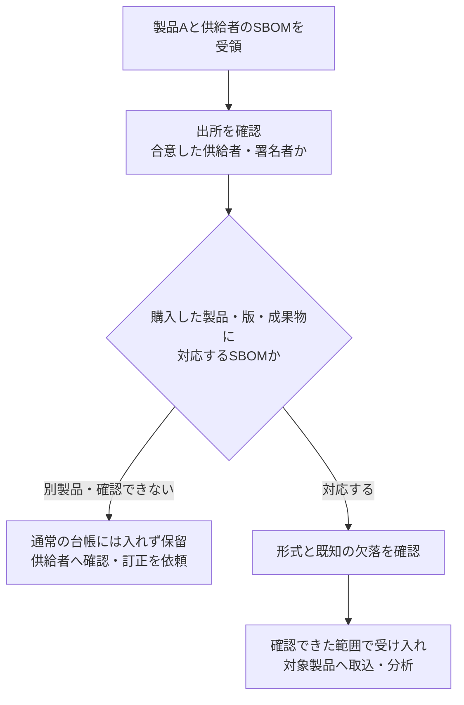

# 署名が正しくても別製品のSBOMは受け入れない

対応するcontrol：[PSB-REL-004 Supplier SBOM intake trust](README.md) · 設計：[Supplier SBOM intake boundary](../../../../engineering/release-integrity/supplier-sbom-intake-boundary/README.md)

## シナリオ

あるチームは供給者から製品Aの成果物と署名付きSBOMを受け取りました。取込処理は署名の計算が正しいことを確認して、SBOMを製品Aの部品台帳へ入れました。後の脆弱性調査では、製品Aに関係する部品が見つからず、影響なしと判断しそうになりました。

実際に署名されていたのは同じ供給者の製品B向けSBOMでした。署名者は正規でも、受領した成果物の内容、製品名、版との照合がありませんでした。攻撃者による差替えだけでなく、供給者の出荷作業で添付先を間違えた場合にも同じ問題が起きます。

## どこで判断するか

```text
供給者の受渡し先
  -> 隔離領域へ受領し、成果物とSBOMの内容を固定
  -> 利用者側の期待値・信頼根拠で出所と内容を確認
  -> 供給者・製品・版・成果物のハッシュ値とSBOMを照合
  -> 形式と既知の欠落を確認
  -> 受入候補 / 隔離 / 評価不能
  -> 受入候補だけを決めた取込先へ渡す
```

署名が正しいという結果は、このうち一つの確認にすぎません。受入後の台帳処理や脆弱性分析は、別の状態として確認します。

共通基盤チームからベースイメージとSBOMを受け取る場合も同じです。そのイメージの部品表として受け入れても、アプリケーションを追加した最終イメージ全体を説明するとは限りません。[REL-003の教材](../psb-rel-003-release-sbom-identity-and-analysis/learning.md)で、情報を取得する地点と対象の違いを続けて確認できます。

## 図で見る：受け取ることと、部品台帳で使うことを分ける



出所が確認できない場合も、受入候補にはしません。実務では、受領時に確認する供給者・製品・版・成果物との対応を決め、条件を満たしたSBOMだけを通常の部品台帳へ渡します。署名が正しいという一項目だけで、この確認全体を済ませないことが要点です。

SBOMが未受領・誤添付・処理待ちなら、「部品なし」ではなく「部品情報が未確認」と記録します。これは製品に脆弱性があるという断定でもありません。製品の使用をどうするかは、SBOMの受入状態を踏まえ、調達・運用側の方針で別に判断します。

## 別製品のSBOMを台帳へ入れていたら

この場面では、製品BのSBOMを製品Aの判断に使うことを止めます。どの文書をいつ製品Aへ取り込んだかを残し、誤った対応を通常の影響調査から外します。ファイル名や製品名だけを書き換えて、製品A向けのSBOMにしてはいけません。

供給者へ対象の確認と訂正版を求め、届いた文書も出所、実際の成果物との対応、形式、既知の欠落を改めて確認します。訂正版の確認が終わるまでは、製品Aの部品情報が未確認だと分かる状態にします。空の一覧を登録して埋め合わせません。受け入れた後も、正しい製品・版へ取り込まれ、必要な分析が完了したかを確認します。

すでに誤ったSBOMで「影響なし」とした調査があれば、その根拠は使えません。対象の成果物と過去の判断を[影響調査（GOV-001）](../../governance-operations/psb-gov-001-supply-chain-impact-assessment/learning.md)へ渡し、訂正版や別の確認材料で見直します。SBOMの取り違えだけで脆弱性の影響があると断定せず、確認できていなかった範囲を明らかにします。

## 不明の理由を残し、次の確認につなぐ

受入時には、調達した製品・版と実際の成果物を確認し、その成果物を説明するSBOMかを照合するプロセスを設けます。署名の確認だけで製品との対応確認を省きません。

不一致のSBOMは通常の部品台帳や影響判断には使わず、供給者への確認・訂正に必要な記録として分けて保管します。単に破棄して、何が届いたか分からなくする扱いにはしません。

製品Aの状態には、例えば「SBOM未確認：別製品の文書を受領、訂正版待ち」と残します。「不明」だけより、何を確認すれば先へ進めるかが分かります。これは部品情報の状態であり、個々の脆弱性が存在するという判定でも、存在しないという判定でもありません。担当者と次の確認を決め、訂正版も同じ受入プロセスで確認します。

## 用語

- **利用者側の期待値**：調達・採用の判断で承認した供給者、製品、版、成果物の識別子。受領したSBOMからコピーして決めない。
- **信頼根拠**：許可した署名者の鍵、証明書の発行元と身元、または合意した配送元を確認する材料。方式によって必要な証拠は異なる。
- **隔離**：未確認・不一致のSBOMを通常の部品台帳と分けて保存し、調査できる状態。
- **評価不能**：検証器や状態取得が失敗し、受入可否を判断できない状態。不一致と区別するが、通常取込は同じく止める。

## よくある誤解

### 「有効な署名なら、その製品の正しいSBOMである」

署名の検証は、署名された内容と鍵の関係を確認します。その鍵が期待する供給者の権限か、SBOMが今回の製品・成果物を記述しているか、記載が正確かは別に判断します。

### 「署名者が期限切れなら、過去の署名も必ず無効である」

方式によって、信頼できる署名時刻の証拠があり、署名時点の資格と現在の失効・侵害方針を合わせて評価します。単に現在の期限を比べるだけでは、正しい過去の受入れも、侵害後に失効した鍵の扱いも決められません。

### 「SBOMを受け取れなければ、空の部品一覧として登録すればよい」

空の一覧は「部品がない」と誤読されます。未受領・検証失敗・隔離・台帳処理失敗を分け、後続の影響調査で評価不能と分かるようにします。

## 判断基準

- どの供給者・製品・版を、どの成果物のハッシュ値で識別して受け取る予定か。
- SBOMの出所と完全性を、どの事前合意した方式で確認するか。信頼根拠は誰が更新するか。
- 署名方式が時刻、失効、透明性の証拠を必要とする場合、それをどこから得るか。取得不能をどう扱うか。
- 署名された対象はSBOMのどの内容か。実際に使う成果物とはどう結ぶか。
- SBOMの既知の欠落や未対応形式を、受入可否と後続の分析へどう伝えるか。
- 隔離した入力が通常台帳へ届く別経路はないか。訂正・撤回時に以前の判断をどう扱うか。

次に[control](README.md)で必要な特性を確認し、[設計パターン](../../../../engineering/release-integrity/supplier-sbom-intake-boundary/README.md)で方式と取込境界を選びます。

参照資料と利用者提供資料の採否は[REF-SUPPLIER-SBOM-INTAKE-001](../../../../sources/README.md#ref-supplier-sbom-intake-001)に記録しています。

## 講義と振り返りの記録

2026-10-25、旧参照資料の保存作業を終えて講義を再開し、REL-004へ進みました。正規供給者の署名があっても別製品のSBOMなら受け入れない例を、誤添付でも起こる問題として説明しました。受領と通常台帳への取込を分ける図、未確認を部品なしへ変換しない判断を補いました。

1. 製品Aを購入しましたが、添付されたSBOMは同じ供給者の製品B向けでした。署名は正しい場合、どう扱いますか。
2. 製品Aの正しいSBOMを待っています。この間、部品台帳へ空の一覧を入れて「該当する脆弱性なし」としてよいでしょうか。

一問目には「対象製品ではない為、取り扱いは行わない。製品についても正しさを確認するプロセスを作る」、二問目には「だめ。脆弱性が無いわけではないので、不明に類するステータスにする」と回答がありました。講師から、取り扱わないとは通常台帳や影響判断への採用を止めることで、確認・訂正に必要な受領記録は分けて保管する、と補足しました。不明の理由と次の確認を残す例も本文へ追加しました。実供給者の署名・配送・台帳での取込制御は未確認です。
