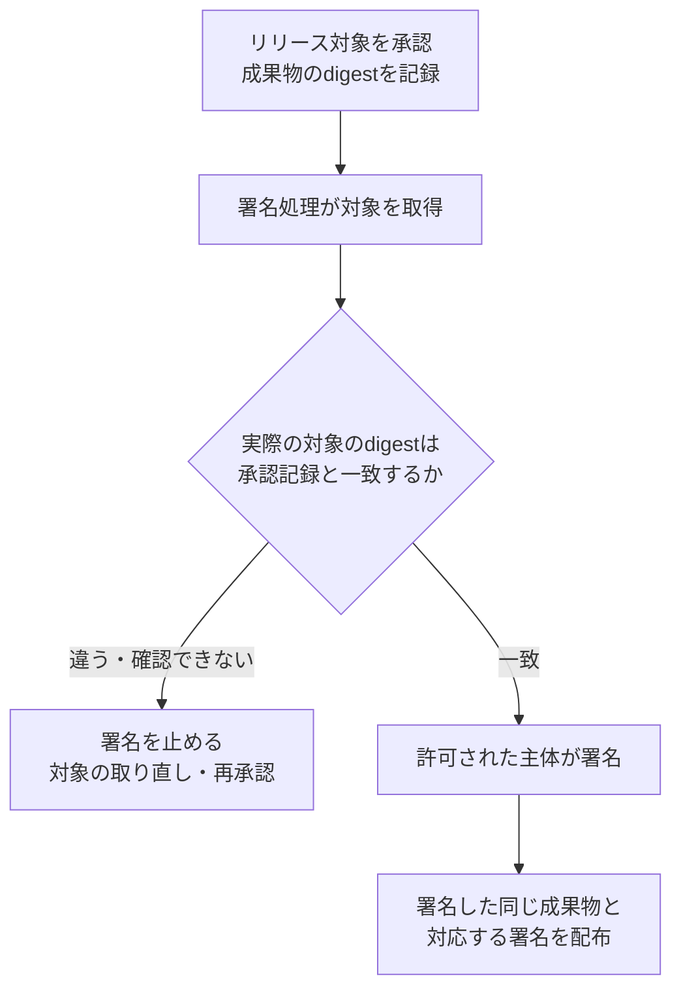

# 署名が正しくても、承認した成果物とは限らない

対応するcontrol：[PSB-REL-005 Artifact signing generation](README.md) · 設計：[Artifact signing boundary](../../../../engineering/release-integrity/artifact-signing-boundary/README.md)

## 承認した後に、タグの指す先が変わった

リリース担当者が`v2.0`を承認しました。署名ジョブは`app:latest`を取得して正規の署名鍵で署名します。その間に別のジョブが`latest`を更新すると、署名の検証が成功しても、承認した`v2.0`の中身へ署名したとは言えません。

必要なのは、承認した一つの成果物に、許可した主体が署名し、利用者がその関係を確かめられることです。変更できる名前を使う場合も、承認時にその名前が指した内容のハッシュ値（digest）を固定し、署名時・公開時の対象と照合します。ファイルなら実際の内容、OCIイメージなら採用形式が署名するマニフェストのハッシュ値など、何を署名するのかを明記します。

例えば、承認記録のハッシュ値と署名直前に取得した対象のハッシュ値が違えば、そこで署名を止めます。タグが動いた経緯を確認し、承認した成果物を取り直すか、新しい成果物を改めて承認します。今あるファイルに合わせて承認記録だけを書き換えたり、署名の成功を承認の代わりにしたりしません。

## 鍵を守ることと、署名対象を決めること

もう一つの落とし穴は、署名鍵を安全に保管すれば署名対象も安全になるという思い込みです。鍵を外へ持ち出せない鍵管理サービス（KMS）でも、権限のあるジョブが未承認の成果物のハッシュ値を渡せるなら、その成果物に正規の署名を付けられます。署名操作を誰に許すかと、今回どの成果物に署名してよいかを別に確認します。

## 図で見る：承認した中身を署名まで変えない

この構成では、署名を求める処理が承認記録を自由に書き換えたり、照合を迂回して署名器を直接呼び出したりできないことも必要です。digestを入力欄に設けただけでは、承認したものへの署名に限定できません。

実務では、リリースの承認に成果物digestを含め、署名処理へその値を渡し、実際の対象と照合します。承認は毎回の手動操作に限らず、保護されたリリース条件を満たすことによる自動判断でも構いません。どちらも、何を根拠にどのdigestを許可したかを追えるようにします。

| 主題 | 今回守る対象 |
|---|---|
| BUILD-003 | ビルド条件などを記した来歴情報の生成と署名 |
| REL-005 | 承認した成果物への署名と、その署名権限 |
| REL-001 | 受け取った署名・来歴を使う利用者側の採否判断 |

成果物への署名だけで、どのソース・手順から作ったかまで説明したことにはなりません。

## 利用者へ届くまで確認する

署名結果を作った後も、利用者が対応する署名と信頼根拠を取得できなければ意味がありません。発行時刻や透明性ログの証拠は採用した方式で必要なときに揃えます。単にJSONへ`included: true`と書いても証拠にはなりません。署名器や公開先が止まった場合は、リリースを止めて原因を確認します。

判断するときは次を順に問います。誰がその成果物を承認したか。署名器へ渡した実際の内容またはハッシュ値は何か。誰にどの範囲の署名権限があったか。署名結果を想定する利用者の条件で検証できるか。手元の成果物に対応する署名を取得できるか。この問いのどれかが未確認なら、署名が一つ存在してもリリース完了とはしません。

この例で署名するのは成果物です。ビルド条件を記した来歴情報への署名とは対象が異なります。成果物署名が成功しても来歴が生成・配布されたとは判断せず、必要な証明をそれぞれ取得します。

利用者自身の受入条件は[REL-001の教材](../psb-rel-001-signature-provenance-verification/learning.md)、来歴が取得できるかは[REL-002の教材](../psb-rel-002-provenance-distribution-availability/learning.md)、来歴の内容を誰が決めるかは[BUILD-003の教材](../../build-security/psb-build-003-platform-provenance-generation/learning.md)で続けて学べます。参照資料と採否は[REF-ARTIFACT-SIGNING-BOUNDARY-001](../../../../sources/README.md#ref-artifact-signing-boundary-001)を参照してください。

## 講義と振り返りの記録

2026-10-25、REL-004に続き、署名する成果物の承認を扱いました。承認後に`latest`が別の内容へ変わる例から、承認したdigestと署名対象を一致させる流れを図で説明しました。鍵を外へ持ち出せなくても、署名操作を悪用できれば未承認の成果物へ正規の署名が付くこと、来歴署名と成果物署名の違いも補いました。

1. 承認した成果物のdigestと、署名直前に取得した成果物のdigestが違いました。署名鍵が正規のものなら、そのまま署名してよいでしょうか。
2. 署名鍵は外へ持ち出せませんが、ビルドジョブが任意の成果物への署名を要求できます。追加で何を制限する必要がありますか。

二問の回答はまだ得ていません。実署名器の権限・承認との照合・署名拒否は未検証です。

資料整理後の再開では、利用者の回答を待たず講師が判断を説明しました。一問目は、承認したdigestと異なるため署名を止めます。二問目は、署名要求者と対象digestの承認を照合し、未承認の対象への署名要求や直接呼出しによる迂回を制限します。これは講師の説明であり、利用者の回答ではありません。次はCONTAINER-001で実行直前の使用許可を扱います。
