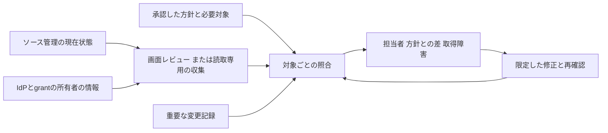

# PSB-SOURCE-006 Source organization security posture

**ソース管理の共通設定は、必要なリポジトリと利用者に実際に効いているか。**

## なぜ必要か

例えば、新規リポジトリには秘密情報の検査を既定で有効にしていても、他の組織から移管したリポジトリには適用されていないことがあります。管理画面に方針が存在するだけでは、対象すべてが守られているとは分かりません。

## 満たすべきこと

1. **対象と方針を決める。** 組織内のリポジトリ、人、チーム、外部協力者、Appを把握し、認証、アクセス、作成・公開、CI、検査機能について必要な設定を決める（ORG-POSTURE-1〜2）。既定値と、変更を拒否する強制設定を区別する。
2. **現在の適用を確かめる。** 既存・新規・移管・再開したリポジトリを対象ごとに調べ、設定の適用漏れ、個別の上書き、不要な権限を見つける（ORG-POSTURE-3〜4）。ログイン基盤で人を無効にしたことを、ソース管理側の権限が消えた証拠にしない。
3. **変更と確認漏れを追う。** 変更記録と現在の状態を照合し、対象の不足、古い結果、取得・通知の障害を「問題なし」にしない。差分や障害は期限・限定した例外とともに担当者へ渡し、修正後の実際の状態を再確認する（ORG-POSTURE-5〜7）。

## 方針を「何を変えられるか」まで決める

| 決めること | 判断例 |
|---|---|
| 対象 | 固定した組織ID、必要なrepository・主体・App。Public／private／internal、archive、移管も区別する |
| 方針の版と項目 | 認証、初期権限、作成・公開・fork、CI、検査機能。個別の意味は担当controlへリンクする |
| 適用条件 | 全対象共通か、製品・公開範囲・契約等で分かれるか。対象外には理由と確認者を残す |
| 強制と変更権限 | 上位enterpriseで制限するもの、organizationの既定値、repositoryで変更できるもの、管理者のbypass |
| 確認の期限 | 変更の影響、検知したい速さ、取得コストから決める。資料中の固定値をそのまま共通要件にしない |

確認用の方針を弱めて良好な結果を作る経路も、通常の方針変更としてレビューします。正当な用途のAppや外部協力者へ必要なwriteを許す判断はあり得ます。全Appのwriteや全forkを一律禁止することから設計を始めません。

認証情報やAppの方針を変えた場合は、変更後の申請・発行経路と、既存のtoken・承認・installationによる現在のアクセスを別に照合します。方針が既存アクセスを直ちに止めるか、認可が残るか、再有効化で戻るかは設定とproviderごとに異なります。不要な認可の失効と拒否確認は[SOURCE-004](../psb-source-004-source-access-credential-lifecycle/README.md)へ渡します。

## 現在状態と変更記録を合わせる

取得時刻、対象ID、必要なpage・項目、取得の成功・失敗を結果と結び付けます。Pageを最後まで取得しても、確認用IDに対象を見る権限がなければ全件とは限りません。必要対象の台帳や管理画面との照合を残します。取得中に移管・作成・削除が起きる場合は、時点の差を確認し、必要に応じて取得をやり直します。

前回との差分は調査を楽にしますが、合否は毎回その時点の方針と必要対象へ照合します。監査イベントは対象・主体・時刻・変更内容を調べる入力です。Providerが提供しない通番や完全な配送を仮定せず、検索条件、対象カテゴリ、取得期間、保持・exportの制限を確認します。

## 方式を選ぶ

| 方式 | 選びやすい条件 | 代償・残る確認 |
|---|---|---|
| 画面と台帳を使う定期レビュー | 対象が少なく、全件と設定の実値を人が追える | 見落とし、レビューの遅延、画面filter、変更中の時点差。個別の拒否は使い捨て対象で確認する |
| Read-only APIによる現在状態の照合 | 対象増加や確認頻度で手作業が負担になる | API権限、pagination、rate limit、取得範囲、IdP情報、機能ごとのschemaを管理する必要がある |
| Audit配送と定期照合の組合せ | 重要変更を定期レビューより早く拾いたい | 配送停止、遅延、検索条件の漏れ、保存先と通知経路の運用が増える |
| 第三者のpolicy App | 必要な項目を独自に確認でき、既存の手段より負担を減らせる | Appの読取り・書込み権限、hosting、更新、対応範囲を評価する。集約scoreや通知作成を完了にしない |

最初からcollectorと自動修正を組にする必要はありません。手動レビューでも現在状態と失敗を残せれば成立します。自動収集を選ぶ場合は設定変更と認証情報を分け、読取りに不要なmember削除・App停止・設定更新の権限を与えません。

## 結果と対応をつなぐ

- 確認できた対象の設定一致、方針からのずれ、未確認、取得障害、理由付きの対象外を別に残します。集約する場合も対象・項目と未確認範囲へ戻れるようにします。
- 適用失敗や上書きは設定の担当へ、API・IdP・配送・通知の停止は確認経路の担当へ渡します。通知の受付と担当者の対応開始を同じ結果にしません。
- 例外は[GOV-002](../../governance-operations/psb-gov-002-security-exception-lifecycle/README.md)へ接続します。例外があっても元の不一致を消さず、対象、期限、補完策と現在の判断を残します。
- 修正ticketの終了後に実値を読み直します。制限を強制する主張には、許可された使い捨て対象での拒否確認も必要です。

観測結果と変更記録は、設定を変えられる主体が自由に消せない保存経路を選びます。独立した記録はprovider上の値の真正性やIdPの正しさを保証しません。組織名・非公開repository名・個人情報・credentialを本PJの記録へ持ち込まず、組織側で必要最小限を保管します。

## 診断で確認する項目（異常時テスト）

- 新規作成だけでなく、既存・移管・再開したリポジトリにも共通設定が効いているか。個別の上書きや解除に気付けるか。
- 設定の既定値を権限の上限と誤認していないか。管理者やAppが変更・迂回できる範囲を把握しているか。
- 退職者や用途不明のチーム・App・外部協力者の権限、方針変更前からあるtokenや承認が残っていないか。
- 一覧の一部しか取得できない、確認用IDに権限がない、監査や通知が止まった場合に、全件確認済みとしていないか。
- 通知や修正ticketを閉じただけで完了とせず、対象の設定と権限を読み直しているか。

これらは確認項目であり、実際の組織設定や拒否を確かめた結果ではありません。

## フレームワークとの関係

組織設定が各リポジトリへ実際に効くかという問いについて、現行の[フレームワーク・マッピング](../../../../mappings/frameworks.yaml)に個別の関係は登録していません。GitHubの公式設定資料は具体的な判断材料ですが、設定画面を確認しただけで規格への準拠や全対象への適用を主張しません。

## このコントロールの範囲

対象は、ソース管理組織が選んだ共通方針と、リポジトリ・利用者・Appごとの実際の状態です。確認できない範囲を良好としませんが、収集の障害だけで全開発アクセスを自動停止する要件でもありません。組織設定の確認は、秘密情報の検出[SOURCE-002](../psb-source-002-secret-publication-boundary/README.md)、ソース管理用の認証情報の失効[SOURCE-004](../psb-source-004-source-access-credential-lifecycle/README.md)、CIの実際のjob権限[CICD-004](../../cicd-security/psb-cicd-004-workflow-authority-minimization/README.md)を代替しません。

手作業と自動収集の選び方は上の方式説明、GitHubで現在の設定を読む方法は[手順](../../../../engineering/implementations/github-organization-review/README.md)を参照してください。[教材](learning.md)、７つの特性と参照資料IDを残した[control.yaml](control.yaml)、資料の採否を示す[Sources](../../../../sources/README.md#ref-source-organization-posture-001)、旧項目の[移行記録](../../../../docs/MIGRATION_SOURCE_PROTECTION.md#source-organization-posture-migration)へも辿れます。

前後の工程は[開発アクセスから漏えい対応・復旧まで](../../../../engineering/developer-access-to-recovery.md)で確認できます。
