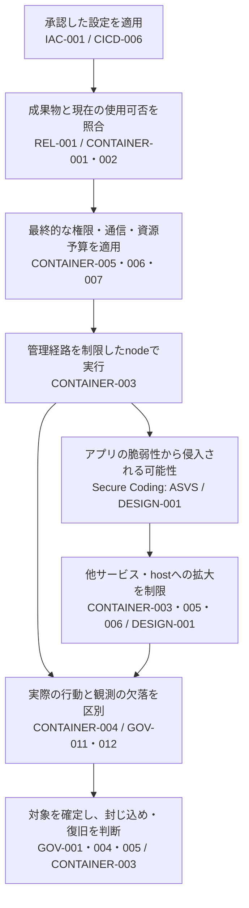

# 公開したコンテナを動かし、侵害の広がりを抑える

基盤担当者、開発者、SOCが、**実行前の確認と、侵害された後に被害を広げない制限・観測を組み合わせる**ためのガイドです。Control IDは`PSB-`を省略しています。

署名と来歴を確認した正規イメージでも、アプリケーションの脆弱性を突かれて命令を実行されることがあります。攻撃者はそこから別サービスへの接続、認証情報の利用、hostの操作を試みます。正規イメージを起動したという記録だけでは、この後半を防げません。

公開する成果物を決めるまでの設計は[ビルドから署名・公開・使用まで](release-build-to-use.md)で扱います。ここでは、実行環境へ渡した後の判断をつなぎます。

## 実行前から初動までの配置

図は担当と制御の配置を示します。攻撃が必ず検知されることや、すべての拒否機構がこの順に動くことを示すものではありません。実行前の許可と、実行時に制限が効いた証拠を分けます（CONTAINER-001・003〜007）。

## 工程を越えてそろえる対象

| 受け渡し | 次の担当者が確認すること | Control |
|---|---|---|
| 変更案 → 適用 | 承認した保存planと適用先が同じか。console等からの別変更も把握できるか | [IAC-001](../controls/records/container-cloud-iac-security/psb-iac-001-infrastructure-change-authorization-and-drift/README.md) |
| Registry → 起動判断 | 成果物のdigest、必要な証拠、現在の使用可否が同じ対象を指すか | [CONTAINER-002](../controls/records/container-cloud-iac-security/psb-container-002-container-registry-publication-boundary/README.md)、[REL-001](../controls/records/release-integrity/psb-rel-001-signature-provenance-verification/README.md) |
| 起動判断 → 実行 | Mainだけでなく追加されたinit・sidecar・debugも確認したか。実際に選ばれたmanifestを追えるか | [CONTAINER-001](../controls/records/container-cloud-iac-security/psb-container-001-deployment-artifact-admission/README.md) |
| 設定 → 実行環境 | 権限、通信、予算を、採用したruntime・network plugin・nodeが実際に強制できるか | [CONTAINER-003](../controls/records/container-cloud-iac-security/psb-container-003-container-host-daemon-boundary/README.md)、[CONTAINER-005](../controls/records/container-cloud-iac-security/psb-container-005-workload-privilege-confinement/README.md)、[CONTAINER-006](../controls/records/container-cloud-iac-security/psb-container-006-workload-network-segmentation/README.md)、[CONTAINER-007](../controls/records/container-cloud-iac-security/psb-container-007-workload-resource-consumption-bounds/README.md) |
| 実行 → 通知 | 実行中のcontainer・digest・node・担当者とイベントを結べるか。観測できなかった時間や対象も伝わるか | [CONTAINER-004](../controls/records/container-cloud-iac-security/psb-container-004-runtime-threat-detection/README.md)、[GOV-011](../controls/records/governance-operations/psb-gov-011-security-event-evidence/README.md) |
| 通知 → 対応 | 対象未確定を「影響なし」にせず、証跡・影響範囲・必要な承認をそろえて対応できるか | [GOV-001](../controls/records/governance-operations/psb-gov-001-supply-chain-impact-assessment/README.md)、[GOV-012](../controls/records/governance-operations/psb-gov-012-detection-and-response-readiness/README.md) |

## 正規イメージが侵害された場面で考える

### 1. 通信できる相手と、許可する操作を分ける（CONTAINER-006 / DESIGN-001）

Frontendからbackendへの通信が業務上必要なら、その経路はネットワーク制限を設けても残ります。侵害されたfrontendからの要求も届くため、backendでは利用者、対象データ、操作ごとの認可が必要です。[DESIGN-001](../controls/records/secure-design/psb-design-001-object-access-authorization/README.md)へつなぎ、アプリケーションの実装要件は[ASVS](../controls/records/secure-coding/README.md)で確認します。

ネットワークの許可は必要な接続先に絞ります。DNSへの通信を許しただけで、名前解決後の宛先も制限できたと考えません。通信が失敗した場合も、制限による拒否と、宛先停止・経路障害を分けます。

### 2. Workloadの権限とnodeの管理経路を一緒に見る（CONTAINER-003・005）

非root実行や読み取り専用のroot filesystemを設定しても、管理socketやhostの書込み可能領域を渡せば別の経路が残ります。Workloadへ渡すものを制限し、その外側でruntime・kubelet・plugin・hostの変更権限を管理します。

監視agentやnetwork・storageの部品にはhost機能が必要な場合があります。一般workloadと同じ広い例外にせず、専用の配置先、実行主体、許可する機能を決めます。例外には[GOV-002](../controls/records/governance-operations/psb-gov-002-security-exception-lifecycle/README.md)の対象・責任者・期限を結び付けます。

### 3. 隔離と監視を資源不足で失わない（CONTAINER-004・007 / GOV-011・012）

大量のprocessやログでnodeが圧迫されると、アプリケーションだけでなく観測にも影響が出ます。個別workloadの上限、namespaceの合計、nodeに残す余力を合わせ、イベントがない状態と、センサー・配送・収集が動いていない状態を分けます。

対象nodeが侵害された疑いがある場合、そのnode上のセンサーが正常と表示していても、それだけでは判断しません。Nodeの外へ届いた記録や管理面の証拠と照合します。観測が不完全な区間は、不完全なまま担当者へ渡します。

### 4. 再起動・再配備と、信頼の回復を分ける（CONTAINER-002・003 / GOV-004・005）

問題のあるdigestを使用停止にしても、既に動くcontainerやcache内のイメージが消えるとは限りません。新規起動の拒否と、既存の稼働先の停止・置換を分けて確認します。旧版へのrollbackも、現在の使用可否と受入条件で判断します。

Nodeまで侵害された場合は、イメージの置換だけで完了にしません。Nodeの切離し、認証情報の失効、残存状態の処理、再登録をCONTAINER-003で判断します。漏えいした権限は[GOV-004](../controls/records/governance-operations/psb-gov-004-credential-exposure-containment/README.md)、旧digestの非稼働確認は[GOV-005](../controls/records/governance-operations/psb-gov-005-deployed-artifact-recovery/README.md)へ渡します。

## 導入順序を選ぶ

| 選ぶ構成 | 向く場面と代償 | Control |
|---|---|---|
| 組込みの制限と小さな追加policy | 共通条件を低い運用負荷でそろえたい。製品が扱わない条件、対象外の経路、版の違いを別に確認する | CONTAINER-001・005・007 |
| 共有nodeとworkloadごとの制限 | 配置効率を保ちたい。共有kernel、管理経路、namespace予算の合計、監視の余力を管理する | CONTAINER-003・005・007 |
| 専用nodeやsandbox runtime | 機密度や信頼度が違うworkloadを分けたい。互換性、配置容量、更新、観測、費用の負担が増える | CONTAINER-003・005 |
| 通信を既定拒否にし、必要な経路を追加 | 相手と用途を先に説明できる。DNS、起動時、保守時、障害時の通信も選び、制限を先に準備してからworkloadを配置する | CONTAINER-006 / IAC-001 |

変更は使い捨ての対象で確かめてから段階的に適用します。新しいpolicyを入れたことを、既存workloadも再審査・修正されたという証拠にはしません（IAC-001 / CONTAINER-001・005〜007）。

## 診断で確認する項目（異常時テスト）

- 正規イメージのmain containerに、未確認のsidecar・debug・過大権限を追加して起動できないか（CONTAINER-001・005）。
- 限定した通信を許可しても、別policyや変更可能なlabelで範囲を広げられないか。許可先のAPIで別利用者の操作をできないか（CONTAINER-006 / DESIGN-001）。
- Workloadからhostのsocket・管理APIへ届き、起動前の許可を通さず操作できないか（CONTAINER-003・005）。
- Replica増加やログ消費が、個別の上限を守りながら共有容量を圧迫しないか。欠測を「異常なし」にしないか（CONTAINER-004・007）。
- 使用停止したdigestを古い許可結果やrollbackで再投入できないか。既に動いている旧版を見落とさないか（CONTAINER-001・002 / GOV-005）。
- 対象未確定の通知で破壊的対応を行わないか。Nodeの切離しだけで認証情報や再登録経路を残さないか（CONTAINER-003・004 / GOV-004・012）。

これは採用先で使う確認項目です。実際の拒否や検知を本PJで確認した結果ではありません。

## 詳細と既存の実装例

- [インフラ変更の承認から実環境の確認まで](infrastructure-plan-apply-and-drift.md)：入力、保存plan、適用権限、別経路の変更、実状態をつなぐ（IAC-001 / CICD-006）。
- [実行時の検知から初動対応まで](runtime-detection-to-triage.md)：対象照合、観測障害、通知、担当への引き渡しを設計する（CONTAINER-004 / GOV-001・011・012）。
- [権限制限](implementations/kubernetes-psa-cel/README.md)、[通信制限](implementations/kubernetes-networkpolicy/README.md)、[資源予算](implementations/kubernetes-resourcequota-cel/README.md)：既存のKubernetes実装。導入・確認・解除手順と対象版を保持しており、実クラスタでの動作は未確認（CONTAINER-005・006・007）。

既存Controlを接続した本PJの設計案です。個別の条件、資料の版、採否は各Controlと[Sources](../sources/README.md#spec-nist-sp-800-190--container-security-guidance)を正本とします。製品仕様の再検証や新しい準拠関係を追加したものではありません。
