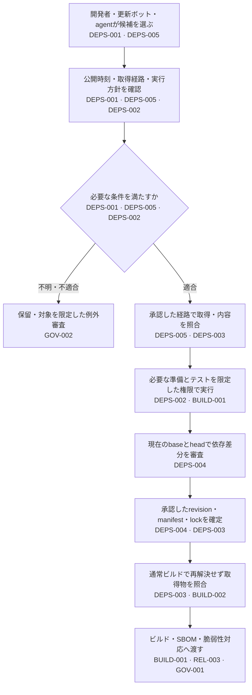

# 依存を追加・更新して、ビルドへ渡す

更新ボットは公開直後の版を避けていても、開発者が手元で直接インストールすれば、その場で準備用コードが動くことがあります。さらに、PRでレビューしたlockfileをビルドが作り直せば、承認していない依存が製品へ入ります。

このガイドは開発者と基盤担当者が、**依存を選んだときの判断を、最初の実行と通常ビルドまで途切れさせない**ためのものです。個別の条件は各Controlを正本とします。開発から本番運用までの全体は[全体ガイド](developer-to-production.md)を参照してください。

表記は`PSB-`を省略しています（例：`DEPS-001`＝`PSB-DEPS-001`）。図は主なControl、本文・表は各判断に関係するControlを示します。識別子は要件への案内であり、その要素全体への適合や導入済みを意味しません。

## どこで何を判断するか

取得前の判定だけで内容の同一性まで証明したことにはなりません。逆に、取得してから実行方針を決めると、情報収集や準備の段階でコードが動く経路に間に合いません。

| 場面・担当 | 次へ渡すもの | 対応Control |
|---|---|---|
| 候補の選択：開発者・更新ボット | 名前、版、取得元、公開時刻と待機条件の判断 | [DEPS-001](../controls/records/dependency-security/psb-deps-001-dependency-release-cooldown/README.md) |
| 取得経路の設定：基盤担当 | 対象端末・CIと利用できる経路、遮断・追跡の範囲 | [DEPS-005](../controls/records/dependency-security/psb-deps-005-dependency-acquisition-gate/README.md) |
| 初回実行前：開発者・基盤担当 | 実行を止める方針、または対象を限定した実行許可と隔離環境 | [DEPS-002](../controls/records/dependency-security/psb-deps-002-install-execution-policy/README.md) |
| PRの審査：レビュー担当・CI管理者 | 現在のbase/head、直接・推移依存の差分、判定方針と結果 | [DEPS-004](../controls/records/dependency-security/psb-deps-004-dependency-change-review/README.md) |
| 通常ビルド：ビルド基盤担当 | 承認したrevision・manifest・lockと、実際に使うファイルの照合結果 | [DEPS-003](../controls/records/dependency-security/psb-deps-003-dependency-artifact-identity/README.md) |

## 対策の間に残る穴を塞ぐ

### ボット以外からもインストールできる

関連：[DEPS-001](../controls/records/dependency-security/psb-deps-001-dependency-release-cooldown/README.md)、[DEPS-002](../controls/records/dependency-security/psb-deps-002-install-execution-policy/README.md)、[DEPS-005](../controls/records/dependency-security/psb-deps-005-dependency-acquisition-gate/README.md)。

ボットの待機設定だけでは、手動install、AI agent、別クライアント、直接URLからの取得に同じ条件が効くとは限りません。対象の経路をDEPS-005で洗い出し、それぞれの初回実行より前にDEPS-001・002の判断が届くか確認します。

管理されたレジストリ／プロキシへまとめると取得時の判断と追跡を集約できますが、対応しない配布形式や直接接続を残すと迂回できます。プロキシ障害時に公開レジストリへ自動で切り替える設計も、遮断方針を失います。Takumi Guardなどの方式・採用時の制限はDEPS-005へまとめています。

### インストールを止めると必要な機能も動かない

関連：[DEPS-002](../controls/records/dependency-security/psb-deps-002-install-execution-policy/README.md)、[BUILD-001](../controls/records/build-security/psb-build-001-build-containment/README.md)、[SOURCE-007](../controls/records/source-protection/psb-source-007-developer-local-credential-storage/README.md)。

準備処理が不要なら停止し、必要なら対象を限定して別の隔離環境で実行します。単に「失敗したので制限を外す」と、保護したかった端末やCIの認証情報へアクセスできる状態に戻ります。隔離すると、準備後の出力を固定して通常ビルドへ渡す手間も生じます。方式の比較はDEPS-002、実行環境の権限は[BUILD-001](../controls/records/build-security/psb-build-001-build-containment/README.md)で確認します。

### 審査した後に依存や判定方針が変わる

関連：[DEPS-004](../controls/records/dependency-security/psb-deps-004-dependency-change-review/README.md)、[SOURCE-006](../controls/records/source-protection/psb-source-006-source-organization-security-posture/README.md)、[GOV-009](../controls/records/governance-operations/psb-gov-009-scanner-evidence-trust-boundary/README.md)。

レビュー結果をPR番号だけに結び付けず、比較したbase/headと判定方針に結び付けます。Headやbaseが変わったら古い結果を流用しません。更新の作成者が同じPRで検査器や必須条件を弱める経路も確認します。データ不足・取消・省略は審査完了ではありません。

### レビューを通ったのにビルドが別の内容を使う

関連：[DEPS-003](../controls/records/dependency-security/psb-deps-003-dependency-artifact-identity/README.md)、[BUILD-002](../controls/records/build-security/psb-build-002-approved-consistent-build/README.md)、[CICD-009](../controls/records/cicd-security/psb-cicd-009-cache-trust-boundary/README.md)。

通常ビルドは承認した入力から始め、lockfileを再生成しません。対象OSやoptional依存、キャッシュ経由のファイルも照合対象です。取得ファイルのhashが一致しても、使い回す展開済み環境が同じとは限りません。方式と確認項目はDEPS-003を参照してください。

採用の承認、ファイルの一致、実行の許可は別の判断です。待機期間を満たすことやhashが一致することを、依存が無害である証拠に置き換えません。

## 手元へ適用する実装例

| 実装例 | 扱う部分 | この例だけでは確認できないこと | 関連Control |
|---|---|---|---|
| [npm release cooldown](implementations/npm-release-cooldown/README.md) | npmの待機設定、導入・確認・解除 | 全クライアントでの強制や設定上書きの防止 | [DEPS-001](../controls/records/dependency-security/psb-deps-001-dependency-release-cooldown/README.md) |
| [pip install policy](implementations/pip-install-policy/README.md) | wheelに限定した取得とhash不一致の拒否 | manifestとの一致や全依存の固定、後続実行の隔離 | [DEPS-002](../controls/records/dependency-security/psb-deps-002-install-execution-policy/README.md)、[DEPS-003](../controls/records/dependency-security/psb-deps-003-dependency-artifact-identity/README.md) |
| [GitHub dependency review](implementations/github-dependency-review/README.md) | 対応する依存差分と既知脆弱性の判定、必須検査への接続手順 | 全manifestの対応や実リポジトリでのマージ拒否 | [DEPS-004](../controls/records/dependency-security/psb-deps-004-dependency-change-review/README.md) |

実装例をすべて導入する必要はありません。使う言語・基盤と既存の検査を確認して選びます。導入・確認・解除方法と対象バージョンは各実装例を正本とします。

## 導入時に確認するシナリオ

無害なテスト用パッケージや使い捨てのリポジトリで確認します。診断観点の列挙だけでも本PJの成果物として成立し、ここでは実環境の成功を主張しません。

- ボットでは止まる版を手動installで取得した場合、最初の実行前に同じ判断が働くか。（[DEPS-001](../controls/records/dependency-security/psb-deps-001-dependency-release-cooldown/README.md)、[DEPS-002](../controls/records/dependency-security/psb-deps-002-install-execution-policy/README.md)、[DEPS-005](../controls/records/dependency-security/psb-deps-005-dependency-acquisition-gate/README.md)）
- プロキシ停止時や直接URLの指定時に、無検査の経路へ切り替わらないか。（[DEPS-005](../controls/records/dependency-security/psb-deps-005-dependency-acquisition-gate/README.md)）
- 未承認の準備処理が起動しないか。許可した処理では必要な機能が動くか。（[DEPS-002](../controls/records/dependency-security/psb-deps-002-install-execution-policy/README.md)）
- レビュー後のhead/base変更、検査の失敗・取消・省略で、古い承認を使えないか。（[DEPS-004](../controls/records/dependency-security/psb-deps-004-dependency-change-review/README.md)、[SOURCE-006](../controls/records/source-protection/psb-source-006-source-organization-security-posture/README.md)）
- 通常ビルドでmanifestのずれ、推移依存の差し替え、hash欠落、検証ツールの不在を検出し、再解決で修復して続行しないか。（[DEPS-003](../controls/records/dependency-security/psb-deps-003-dependency-artifact-identity/README.md)）

ビルド後は[Release SBOM](../controls/records/release-integrity/psb-rel-003-release-sbom-identity-and-analysis/README.md)へ成果物との対応を、問題が後日判明したら[影響調査](../controls/records/governance-operations/psb-gov-001-supply-chain-impact-assessment/README.md)へ利用先と不足情報を渡します。例外の承認・期限は[GOV-002](../controls/records/governance-operations/psb-gov-002-security-exception-lifecycle/README.md)で管理します。

## 根拠と確認範囲

これは既存の5 Controlと方式説明を接続した、本リポジトリの設計上の解釈です。仕様を追加したり、製品の現在の挙動を再確認したりしたものではありません。資料の版・採否は[待機期間](../sources/README.md#ref-deps-004)、[実行方針](../sources/README.md#spec-install-execution-policy)、[取得物の同一性](../sources/README.md#spec-dependency-lock-identity)、[取得経路](../sources/README.md#ref-deps-001)からたどれます。フレームワークとの関係は各Controlに保持しています。
