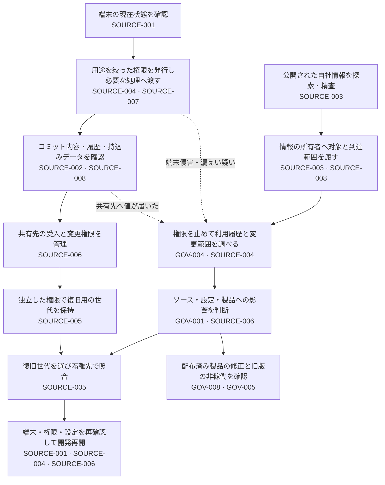

# 開発アクセスから漏えい対応・復旧まで

開発者の端末からトークンが漏れ、ソース管理サービスで使われたとします。端末を隔離しても、持ち出されたトークンが使えるなら変更は続きます。トークンを失効させても、不正なコミットや書き換えられた設定は元に戻りません。バックアップがあっても、その世代に不正変更が含まれていれば、そのまま開発を再開できません。

このガイドは、端末管理者・リポジトリ管理者・セキュリティ担当者が、**使える権限、共有する内容、発見後の停止、復旧する内容を一つの作業としてつなぐ**ためのものです。各対策の方式はControl、製品の設定は実装例を正本とします。IDは`PSB-`を省略しています。

## どこで誰が判断するか

顧客データなど認証情報以外の漏えいは、トークン失効だけで対応できません。SOURCE-008からデータの所有者と組織の情報漏えい対応担当へ直接渡します。公開検索で発見されるのを待ちません。

| 工程・担当 | 次の担当へ渡すもの | 関連Control |
|---|---|---|
| 端末管理者が業務アクセスの条件を決める | 端末ID、所有者、現在状態、観測時刻、未確認事項。状態悪化をどの資産の制限へ反映するか | [SOURCE-001](../controls/records/source-protection/psb-source-001-developer-endpoint-trust/README.md) |
| ID管理者と開発者が認証手段を選ぶ | 用途、対象リポジトリ、操作、有効期限、保管先、値を受け取る処理、失効の担当 | [SOURCE-004](../controls/records/source-protection/psb-source-004-source-access-credential-lifecycle/README.md)、[SOURCE-007](../controls/records/source-protection/psb-source-007-developer-local-credential-storage/README.md) |
| 開発者とリポジトリ管理者が共有内容を確認する | 検査したコミット・履歴、未検査形式、拒否した場所、例外の対象。顧客データの持込み可否は所有者の判断 | [SOURCE-002](../controls/records/source-protection/psb-source-002-secret-publication-boundary/README.md)、[SOURCE-008](../controls/records/source-protection/psb-source-008-sensitive-data-repository-admission/README.md) |
| 組織管理者が設定の適用を確かめる | 必要なリポジトリの一覧、現在の設定、上書き・bypass、残存するAppやtokenの権限 | [SOURCE-006](../controls/records/source-protection/psb-source-006-source-organization-security-posture/README.md) |
| 検索担当と情報の所有者が公開候補を精査する | 投稿URL、検索範囲と時点、公開してよいか、第三者が何をできるか。秘密値や本文を通知へ複製しない | [SOURCE-003](../controls/records/source-protection/psb-source-003-public-source-exposure-triage/README.md) |
| インシデント担当とID管理者が権限を停止する | 対象のtoken・鍵・セッション、拒否確認、疑わしい利用と変更、不明な範囲 | [GOV-004](../controls/records/governance-operations/psb-gov-004-credential-exposure-containment/README.md)、[SOURCE-004](../controls/records/source-protection/psb-source-004-source-access-credential-lifecycle/README.md) |
| 復旧担当と製品責任者が開発を再開する | 採用世代の根拠、復元したソース・関連データ・設定、修正とビルドの確認結果 | [SOURCE-005](../controls/records/source-protection/psb-source-005-repository-recovery-independence/README.md) |

## 対策の間に残る穴

### 端末の停止と権限の停止は別（SOURCE-001・004・007、GOV-004）

ログアウト、端末隔離、トークン失効は同じ操作ではありません。端末の外へ持ち出された値、別に登録されたSSH鍵、Appの権限、更新可能なセッションまで所有者が照合します。新しい値で正常に動くこととは別に、古い権限が拒否されることを確認します。

`.env`を消すだけではバックアップやログにある値は無効になりません。保管と受け渡しはSOURCE-007、通常時の権限管理はSOURCE-004、漏えい時の封じ込めはGOV-004へ分けて確認します。侵害疑いの端末へ新しい認証情報を渡して再開することも避けます。

### hookで止めた範囲と共有先へ届いた範囲を分ける（SOURCE-002・006・008）

GitHubへ直接送信する場合、端末側hookは送信前の気付き、GitHub側のpush protectionは対応する内容の受入拒否です。CIのマージ拒否は送信後の制御です。拒否されたという表示だけで、値がどこにも届いていないとは判断しません。

組織設定の既定値だけでなく、Web UI・API・bot・移管したリポジトリにも必要な判断が働くかSOURCE-006で確認します。Secret scannerが通ったことを、顧客データを保存してよいというSOURCE-008の判断へ置き換えません。

### 公開検索の「該当なし」を対応完了にしない（SOURCE-003、GOV-004）

同じ文字列でも、投稿先や周囲の説明が違えば影響は違います。以前の「公開可」を別の文脈へ流用せず、内容変更・再出現・判断期限を確認します。重複通知の抑制は確認作業を減らす手段であり、再評価まで止める理由にはしません。

検索結果から消えても、コピーの消去やトークン失効は証明できません。通知が届いたか、担当者が受けたか、必要な停止・調査が済んだかを分けます。認証情報ならGOV-004、顧客データなら組織の情報漏えい対応へ渡します。

### 復元できても、その世代を採用してよいとは限らない（SOURCE-005・006、GOV-005・008）

バックアップのhashが一致することは、そのコピーを壊さず戻せた根拠です。不正変更が入っていない根拠にはなりません。承認記録と侵害の時間範囲から世代を選び、隔離先でソース・必要データ・設定を確認してから開発を再開します。復元したworkflowを先に本番権限で実行しません。

ソースを戻しても配布済み製品は変わりません。製品への影響は[GOV-001](../controls/records/governance-operations/psb-gov-001-supply-chain-impact-assessment/README.md)、修正の有効性は[GOV-008](../controls/records/governance-operations/psb-gov-008-vulnerability-remedy-validation/README.md)、稼働版の置換と旧版の非稼働は[GOV-005](../controls/records/governance-operations/psb-gov-005-deployed-artifact-recovery/README.md)へ引き継ぎます。

## 選択肢と導入先

| 判断したいこと | 読む資料 | 関連Control・限界 |
|---|---|---|
| 端末の基準を実際のアクセスへ反映する | [端末の詳細設計](../controls/records/source-protection/psb-source-001-developer-endpoint-trust/design.md) | [SOURCE-001](../controls/records/source-protection/psb-source-001-developer-endpoint-trust/README.md)。MDM等の導入・拒否は未確認 |
| Gitの履歴・検査方針・例外を扱う | [共有前検査の詳細設計](../controls/records/source-protection/psb-source-002-secret-publication-boundary/design.md) | [SOURCE-002](../controls/records/source-protection/psb-source-002-secret-publication-boundary/README.md)。実装は[外部のsecret-checks](https://github.com/DharmaDoll/agent-control-plane/tree/main/skills/secret-checks)。自前受信先は参考のみ |
| GitHubの認証情報を管理する | [GitHub credential lifecycle](implementations/github-credential-lifecycle/README.md) | [SOURCE-004](../controls/records/source-protection/psb-source-004-source-access-credential-lifecycle/README.md)。実際の所有権・失効と拒否確認は採用先で行う |
| 組織の設定と上書きを確認する | [GitHub organization review](implementations/github-organization-review/README.md) | [SOURCE-006](../controls/records/source-protection/psb-source-006-source-organization-security-posture/README.md)。手動確認から始め、必要な範囲だけAPIで補う |
| 公開コード・Issue・PRから候補を探す | [GitHub indicator watch](implementations/github-indicator-watch/README.md) | [SOURCE-003](../controls/records/source-protection/psb-source-003-public-source-exposure-triage/README.md)。検索先頭100件まで。コメント、内容変更・再出現の再通知は扱わない |
| 独立した世代からソースを戻す | [保管・復元の設計](independent-repository-backup-and-restore.md)、[Git mirror例](implementations/git-mirror-recovery/README.md) | [SOURCE-005](../controls/records/source-protection/psb-source-005-repository-recovery-independence/README.md)。GitだけではLFS・Issues・権限・製品データは戻らない |

開発agentもこのアクセス経路を使う場合、秘密をモデルへ送らず、実行する処理の権限と別の鍵への到達を[AI-004](../controls/records/ai-development-security/psb-ai-004-development-agent-runtime-boundary/README.md)で確認します。端末管理済みという理由でagentへ開発者の全権限を渡しません。製品自体のAI securityはこのガイドの対象外です。

## 導入時に確認するシナリオ

以下は設計レビューと診断の観点です。実施する場合は使い捨て環境と無効なダミー値を使い、本番端末の監視停止や本物の認証情報の投稿を試験に使いません。

- 端末の状態が悪化したとき、新規ログインだけでなく既存セッションにも必要な制限が届くか（[SOURCE-001](../controls/records/source-protection/psb-source-001-developer-endpoint-trust/README.md)・004）。
- CLIに必要な値を渡したとき、関係のない子プロセス・agent・バックアップへ広がらないか（[SOURCE-007](../controls/records/source-protection/psb-source-007-developer-local-credential-storage/README.md)、[AI-004](../controls/records/ai-development-security/psb-ai-004-development-agent-runtime-boundary/README.md)）。
- hookの省略、過去コミットへの混入、Web UIからの書込み、顧客データの持込みを、担当する境界で扱えるか（[SOURCE-002](../controls/records/source-protection/psb-source-002-secret-publication-boundary/README.md)・006・008）。
- 検索の失敗・件数上限・通知失敗・投稿変更を「該当なし」「対応済み」にしないか（[SOURCE-003](../controls/records/source-protection/psb-source-003-public-source-exposure-triage/README.md)）。
- 新しいトークンが動くだけで終了せず、古い権限の拒否と変更範囲を確認できるか（[SOURCE-004](../controls/records/source-protection/psb-source-004-source-access-credential-lifecycle/README.md)、[GOV-004](../controls/records/governance-operations/psb-gov-004-credential-exposure-containment/README.md)）。
- ソース管理者を奪われても保管世代を削除できず、元サービスなしで必要な内容を戻せるか。復旧世代と実行権限を確認してから開発を再開するか（[SOURCE-005](../controls/records/source-protection/psb-source-005-repository-recovery-independence/README.md)・006）。

## 根拠と確認範囲

既存Controlと方式説明をつないだ本PJの設計上の解釈です。各ControlのSourcesとフレームワーク関係を正本とし、準拠や組織での導入済み状態を主張しません。[端末資料](../sources/README.md#ref-developer-endpoint-baseline-001)、[ローカル認証情報](../sources/README.md#ref-developer-local-credentials-001)、[Git共有前検査](../sources/README.md#ref-secret-publication-001)、[公開情報](../sources/README.md#ref-public-source-exposure-001)、[復旧](../sources/README.md#ref-repository-recovery-001)、[組織設定](../sources/README.md#ref-source-organization-posture-001)の採否を保持しています。実環境の端末隔離、失効、検索、通知、GitHub側の拒否、クラウドの保持機能は今回確認していません。
