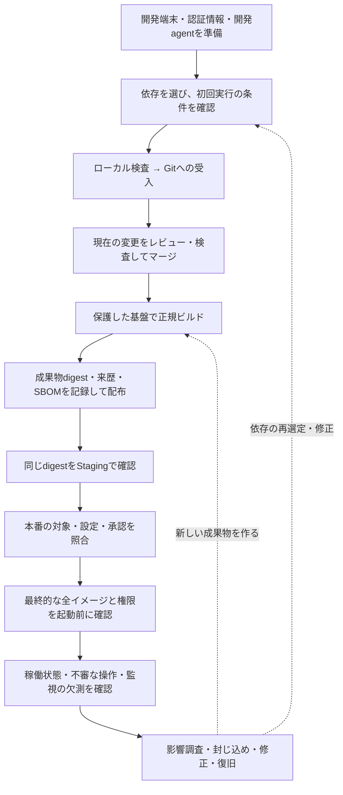

# 開発から本番運用までのセキュリティ設計

開発者・Platform・Product Security・運用担当者が、一つの変更を本番へ届ける際に、**誰が何を確認し、次の工程へ何を渡すか**を決めるための横断ガイドです。

例えば、開発者が依存パッケージを更新し、PRをマージしてコンテナを本番へ配布する場面を考えます。依存に悪意あるコードがあれば、CIへ届く前のinstallで端末の認証情報を盗むかもしれません。CIを通過しても、配布時に別のイメージへ差し替われば確認は無効です。本番稼働後に新しい脆弱性が分かることもあります。それぞれの境界で判断し、同じ対象について判断した記録を引き継ぎます。

このガイドはソフトウェア供給経路と本番運用の接続を扱います。製品全体のセキュリティを網羅するものではありません。アプリの設計・認可は[Secure Design](../controls/records/secure-design/README.md)、Webアプリの検証要件は[Secure CodingのASVS案内](../controls/records/secure-coding/README.md)へ進んでください。

GitHub・CI/CD・OCI Registry・Kubernetesを使う場合を例示します。推奨する設計例であり、このPJや利用組織の導入実績ではありません。個別の要件はControl、方式の詳細は各patternを正本とします。[資料の採否と確認日](../sources/README.md#local-developer-to-production-guide)は別に記録しています。

## 全体の流れ



新しい脆弱性情報や外部からの報告も、稼働中の検知を待たず影響調査へ渡します。復旧は単に再配布するだけでなく、古い成果物や悪用された権限が残っていないかを確かめます。

設計の中心は次の六点です。

1. **最初の実行を守る。** 依存・拡張の実行はローカルから始まるため、CIの検査だけで済ませない。
2. **早期発見と強制を分ける。** ローカルhookは早いフィードバックに使い、受入側にも独立した判断を置く。
3. **判断した対象を変えない。** 依存、PRのrevision、成果物digest、配布先、設定、方針の版を結び付ける。
4. **権限を工程の間で漏らさない。** 未信頼PR、build、署名、公開、deployの権限と実行状態を分ける。
5. **確認した成果物を昇格する。** Stagingで確認したdigestを本番でも使い、環境別の設定と秘密情報は別に管理する。
6. **不明を合格にしない。** 違反、未確認、部分的な確認、処理失敗を区別し、必要な判断ができなければ次へ進めない。

## 工程ごとに決めること

表のControlは関連する主題への案内です。並べたControlを導入しただけで、この流れ全体が成立するわけではありません。

| 工程 | 主に判断する人と内容 | 強制する場所・次へ渡すもの | 関連Control |
|---|---|---|---|
| 開発開始前 | Platformは端末の現在状態とアクセスを確認。開発者は必要な認証情報だけを使う | 端末登録だけで許可せず、現在状態をアクセス判断へ反映。認証情報は作業ファイルへ残さない | [SOURCE-001](../controls/records/source-protection/psb-source-001-developer-endpoint-trust/README.md)、[SOURCE-004](../controls/records/source-protection/psb-source-004-source-access-credential-lifecycle/README.md)、[SOURCE-007](../controls/records/source-protection/psb-source-007-developer-local-credential-storage/README.md) |
| 開発agentの利用 | 開発者・管理者は指示や拡張の変更、利用できるファイル・操作を審査 | 審査済みの拡張と実行時の権限を照合。外部文書の指示を操作権限に変えない | [AI-001](../controls/records/ai-development-security/psb-ai-001-repository-agent-guidance/README.md)、[AI-002](../controls/records/ai-development-security/psb-ai-002-agent-extension-dependency-governance/README.md)、[AI-003](../controls/records/ai-development-security/psb-ai-003-development-content-injection-boundary/README.md)、[AI-004](../controls/records/ai-development-security/psb-ai-004-development-agent-runtime-boundary/README.md) |
| 依存の候補選び | 開発者・更新Botは直接・推移依存、版、配布元、公開時刻を把握 | 初回実行前に待機期間と取得元を判断。管理Registry/Proxyを使う場合は直接取得による迂回も制限 | [DEPS-001](../controls/records/dependency-security/psb-deps-001-dependency-release-cooldown/README.md)、[DEPS-005](../controls/records/dependency-security/psb-deps-005-dependency-acquisition-gate/README.md) |
| 初回install・試験 | 開発者は承認したlock/hashと照合し、install scriptやソースビルドの実行を別に許可 | 不要な秘密情報、home、Docker socket、cloud権限を渡さない隔離環境。取得内容の一致だけで実行を許可しない | [DEPS-002](../controls/records/dependency-security/psb-deps-002-install-execution-policy/README.md)、[DEPS-003](../controls/records/dependency-security/psb-deps-003-dependency-artifact-identity/README.md)、[SOURCE-007](../controls/records/source-protection/psb-source-007-developer-local-credential-storage/README.md) |
| commit・push | 開発者は秘密情報・顧客データを送信前に検査。SCM管理者は受入側を管理 | hookに加え受入側の検査。履歴、タグ、LFSなどの検査範囲・対象外・例外を確認 | [SOURCE-002](../controls/records/source-protection/psb-source-002-secret-publication-boundary/README.md)、[SOURCE-008](../controls/records/source-protection/psb-source-008-sensitive-data-repository-admission/README.md)、[SOURCE-006](../controls/records/source-protection/psb-source-006-source-organization-security-posture/README.md) |
| PR・マージ | Reviewerはコード・依存・workflow・方針の変更をレビュー。CIは未信頼PRを低権限で検査 | 現在のbase/head、検査内容、実行主体、方針の版に判断を結ぶ。直接push、bypass、評価処理の改変を制御 | [DEPS-004](../controls/records/dependency-security/psb-deps-004-dependency-change-review/README.md)、[CICD-001](../controls/records/cicd-security/psb-cicd-001-workflow-dependency-identity/README.md)、[CICD-002](../controls/records/cicd-security/psb-cicd-002-workflow-input-handling/README.md)、[CICD-004](../controls/records/cicd-security/psb-cicd-004-workflow-authority-minimization/README.md)、[CICD-005](../controls/records/cicd-security/psb-cicd-005-untrusted-pr-boundary/README.md)、[SOURCE-006](../controls/records/source-protection/psb-source-006-source-organization-security-posture/README.md) |
| 正規build | Platformは承認したrevision・builder・手順・入力を使う | 短命runnerと制限した通信。buildコードへ本番deploy・署名権限を渡さず、前jobや未信頼cacheの状態も分離 | [BUILD-001](../controls/records/build-security/psb-build-001-build-containment/README.md)、[BUILD-002](../controls/records/build-security/psb-build-002-approved-consistent-build/README.md)、[CICD-007](../controls/records/cicd-security/psb-cicd-007-runner-lifecycle-isolation/README.md)、[CICD-009](../controls/records/cicd-security/psb-cicd-009-cache-trust-boundary/README.md) |
| 来歴・SBOMの生成 | Build基盤は出力digestと来歴を記録。SBOM担当は取得地点と把握範囲を記録 | 来歴の各項目が基盤由来かjobの申告かを区別。最終成果物の観測をbuild時の情報などで補い、見えていない部品を残す | [BUILD-003](../controls/records/build-security/psb-build-003-platform-provenance-generation/README.md)、[REL-003](../controls/records/release-integrity/psb-rel-003-release-sbom-identity-and-analysis/README.md) |
| Registryへの格納・配布 | Release担当は公開・上書き・削除権限を制限し、利用者の取得を確認 | digestから必要な来歴を取得・検証できる状態にする。来歴の生成元を証明する署名と、本番昇格の承認は別に扱う | [CONTAINER-002](../controls/records/container-cloud-iac-security/psb-container-002-container-registry-publication-boundary/README.md)、[REL-002](../controls/records/release-integrity/psb-rel-002-provenance-distribution-availability/README.md)、[REL-005](../controls/records/release-integrity/psb-rel-005-artifact-signing-generation/README.md) |
| Staging | QA・Release担当は取得した成果物の出所・生成条件を照合し、稼働試験 | 利用者側の受入条件を満たすdigestを使用。結果をdigestと試験環境・設定へ結び付ける | [REL-001](../controls/records/release-integrity/psb-rel-001-signature-provenance-verification/README.md)、[CONTAINER-001](../controls/records/container-cloud-iac-security/psb-container-001-deployment-artifact-admission/README.md) |
| 本番昇格 | Release担当は対象digest、Staging結果、本番設定、承認・例外の有効性を確認 | 署名要求自体を認可。本番承認は別の承認記録でもよい。Deployには用途限定の短命権限を渡し、tagを再解決しない | [REL-005](../controls/records/release-integrity/psb-rel-005-artifact-signing-generation/README.md)、[CICD-006](../controls/records/cicd-security/psb-cicd-006-workload-federation-boundary/README.md)、[GOV-002](../controls/records/governance-operations/psb-gov-002-security-exception-lifecycle/README.md)、[IAC-001](../controls/records/container-cloud-iac-security/psb-iac-001-infrastructure-change-authorization-and-drift/README.md) |
| 起動前 | Platformは最終的なapp・init・sidecar等の全イメージと権限を確認 | CIを経由しない作成・更新も実行基盤で検査。後から追加するデバッグ用コンテナも対象にする | [CONTAINER-001](../controls/records/container-cloud-iac-security/psb-container-001-deployment-artifact-admission/README.md)、[CONTAINER-003](../controls/records/container-cloud-iac-security/psb-container-003-container-host-daemon-boundary/README.md)、[CONTAINER-005](../controls/records/container-cloud-iac-security/psb-container-005-workload-privilege-confinement/README.md) |
| 稼働中 | Platformは通信・資源を制限。アプリは操作ごとに認可。SOCは不審な動きと監視の欠測を確認 | 通信・認可の実効性、稼働digestと台帳を照合。観測できない範囲を「異常なし」に変えない | [CONTAINER-004](../controls/records/container-cloud-iac-security/psb-container-004-runtime-threat-detection/README.md)、[CONTAINER-006](../controls/records/container-cloud-iac-security/psb-container-006-workload-network-segmentation/README.md)、[CONTAINER-007](../controls/records/container-cloud-iac-security/psb-container-007-workload-resource-consumption-bounds/README.md)、[DESIGN-001](../controls/records/secure-design/psb-design-001-object-access-authorization/README.md)、[GOV-011](../controls/records/governance-operations/psb-gov-011-security-event-evidence/README.md)、[GOV-012](../controls/records/governance-operations/psb-gov-012-detection-and-response-readiness/README.md) |
| 影響調査・復旧 | PSIRTは新規脆弱性・悪用情報と稼働先を照合し、担当・期限を決定。SOC・Platformは封じ込めを実施 | 修正の有効性と旧版の非稼働を別に確認。漏えい権限を失効。Rollback先にも現在の受入条件を適用 | [GOV-001](../controls/records/governance-operations/psb-gov-001-supply-chain-impact-assessment/README.md)、[GOV-003](../controls/records/governance-operations/psb-gov-003-vulnerability-priority-decision/README.md)、[GOV-004](../controls/records/governance-operations/psb-gov-004-credential-exposure-containment/README.md)、[GOV-005](../controls/records/governance-operations/psb-gov-005-deployed-artifact-recovery/README.md)、[GOV-008](../controls/records/governance-operations/psb-gov-008-vulnerability-remedy-validation/README.md)、[GOV-009](../controls/records/governance-operations/psb-gov-009-scanner-evidence-trust-boundary/README.md) |

役割名は組織に合わせて兼任できます。ただし、重要な変更では、変更する人が自分で検査や承認を無効化できる構成を避けます。PSIRTの脆弱性判断とSOCの侵入検知・封じ込めは連携しますが、同じ作業ではありません。外部報告と利用者への告知は[GOV-006](../controls/records/governance-operations/psb-gov-006-vulnerability-report-intake/README.md)・[GOV-007](../controls/records/governance-operations/psb-gov-007-vulnerability-advisory-and-notification/README.md)へつなぎます。

### ローカルと中央の責任

ローカルのlint、unit test、秘密情報検査は、開発者が早く修正するために使います。中央側では、必須検査、独立レビュー、依存取得経路、正規build、公開・実行の許可をそれぞれ強制します。中央の保護があっても、ローカルで先に悪意あるコードを実行する問題は残ります。

秘密情報のpush protectionには検出対象とbypassの限界があります。受入拒否と「サービス側へ値を送信していない」は別です。実際に公開・閲覧されたかも別に調べ、受入拒否だけを根拠に漏えい対応を省略しません。方式の違いは[秘密情報を共有前に検査する設計](source-protection/secret-checks-before-publication/README.md)で確認します。

### GitHub・Kubernetesで具体化する場合

- GitHubではCODEOWNERSを置くだけでなく、必要なレビューとcheckをruleset等で要求します。条件でskipされたjobは成功扱いになり得るため、必須checkという名前だけに頼らず、必要な評価の完了と対象revisionを確認する判定を置きます。Merge queueを使う場合も、その評価対象で検査が動くかを確認します。
- KubernetesのPod Security Admission（PSA）はPodの権限等を制限するもので、イメージ署名・来歴を検証する仕組みとは別です。`enforce: restricted`を採用する場合は対象版と例外を管理します。`warn`・`audit`だけでは拒否しません。
- イメージの検証は、mutation後の対象、作成・更新・後からのコンテナ追加を含む対象経路を確認します。評価サービスの障害時に許可する設定や、適用除外による迂回も確認します。詳細は[起動前の成果物確認](container-cloud-iac-security/deployment-artifact-admission-boundary/README.md)へ進みます。
- NetworkPolicyは対応するnetwork pluginで強制します。設定の存在だけで通信拒否を確認したことにはなりません。必要なDNS・取得先などの許可と、許可しない通信の拒否を確かめます。通信を許した後のアプリ操作は、別途認可が必要です。

これらの製品挙動の根拠は[参照資料記録](../sources/README.md#local-developer-to-production-guide)からたどれます。

## 何が変わったら確認をやり直すか

| 変更 | 再評価すること | 引き継げるものと限界 |
|---|---|---|
| 新しい依存版を選ぶ | 待機期間、直接・推移依存の差分、取得物、実行許可 | 変えていない版の待機期間を毎build最初から数え直す必要はない。新しい脆弱性・侵害情報の確認は継続する |
| PRのhead・baseが変わる | 差分、必須検査、レビューの有効性 | 異なるrevisionの成功をそのまま今回の判断にしない |
| builder・ツールチェーン・build引数が変わる | 入力・手順・生成条件とその承認 | sourceが同じでもbuild条件の承認は自動継承しない。ベースimageのdigest固定だけでAPTや追加downloadは固定されない |
| 成果物digestが変わる | 来歴・署名・SBOM・Staging結果・公開承認の対象 | 同じ名前やtagでは代替できない |
| 配布先・設定・sidecar・方針が変わる | 全イメージの集合、環境別の受入条件、権限、通信 | 同じapp imageでも構成全体の挙動は変わる。設定変更もレビュー対象にする |
| 新しいCVE・悪用・侵害情報が届く | 稼働先、影響、優先度、承認の取消、修復 | リリースがなくても再評価する。旧digestへのRollbackも無条件に許可しない |

この判断には三つの時間軸があります。**パッケージ公開から採用まで**の待機時間、**変更のレビューから成果物生成まで**の履歴、**配布後に脅威情報が変わる**運用の時間です。採用時の合格を、将来の利用許可として固定しないことが共通点です。

## 工程間で渡す記録

記録を同じJSONやYAMLへ詰めるだけでは証拠になりません。誰が作り、誰が変更でき、利用側が何を根拠に検証するかを決めます。信頼するrepository、builder、配布先、方針、承認者は、評価されるjobやPRが自由に書き換えられない場所で管理します。

| 記録 | 作成・管理する主体 | 利用側が確認すること |
|---|---|---|
| Source・レビュー | SCMとレビュー基盤 | repository、base/head、マージrevision、必須検査の完了と実行主体 |
| Build・来歴 | 保護されたbuild基盤 | builder、定義の版、入力、成果物digest。jobの自己申告と基盤の観測を分ける |
| SBOM | 指定した収集・生成処理 | 対象digest、取得地点、部品の把握範囲、収集・分析の完了状態 |
| Staging結果 | 指定した試験基盤 | 検査対象digest、環境・設定、検査内容、結果、時点 |
| 本番承認・例外 | Releaseの判断主体 | 全イメージのdigest、配布先、設定・方針の版、承認者、有効期限、取消状態 |
| 稼働記録 | 実行基盤と監視基盤 | 実際の稼働先とimage、観測時点、観測できなかった範囲 |

以下は接続を考えるための概念例です。共通仕様やそのまま使える検証器ではありません。記録へのリンクだけでは出所や内容の正しさを証明できません。

```yaml
source:
  repository: <approved-repository>
  revision: <exact-merge-commit>
  review_reference: <protected-review-and-check-record>
build:
  provenance_reference: <authenticated-provenance-bound-to-artifacts>
release:
  artifacts:
    - role: app
      digest: sha256:<app-image-digest>
      sbom_reference: <sbom-with-observation-scope>
    - role: sidecar
      digest: sha256:<sidecar-image-digest>
  staging_result_reference: <trusted-result-for-this-artifact-set>
approval:
  issuer: <authorized-decision-maker>
  target: <cluster-and-namespace>
  configuration_revision: <reviewed-configuration>
  policy_revision: <reviewed-policy>
  expires_at: <expiry-time>
  revocation_reference: <trusted-current-revocation-state>
deployment:
  decision: <ALLOW-or-DENY-or-ERROR>
  observation_reference: <actual-running-artifacts-and-collection-state>
```

複数architectureのimageでは、indexのdigestと実際に選ばれるimageとの関係も保持します。Stagingで一つのarchitectureを試したことを、全architectureの試験済み状態へ広げません。

## 導入順を選ぶ

優先順位は現在の露出、権限、想定被害、既存の対策で変えます。次の三段階は成熟度の認定ではなく、作業を分ける例です。

| 進め方 | 優先する内容 | 順番を早める条件 |
|---|---|---|
| まず現在の侵害経路を閉じる | 端末・認証情報、初回依存実行、Git受入、レビュー、未信頼PRと公開・deploy権限の分離 | 公開サービスには監視と初動対応を最初から用意。特権jobがcacheやrunnerを再利用するなら、その分離もここで行う |
| 成果物と判断を結び付ける | 正規build、来歴、署名、SBOM、配布時の取得確認、同じdigestの昇格、起動前の強制、設定drift・例外期限 | 本番へ未確認のimageや過大権限で起動できるなら、Admissionや権限制限を後回しにしない |
| 継続して確かめ、必要な保証を強める | 検知・復旧訓練、記録の欠測確認、失効の伝播、必要に応じたより強いrunner隔離やbuild通信制限 | 被害や脅威に応じて初期段階へ前倒し。Reproducible/Hermetic Buildは必要性と入力固定の条件を見て選ぶ |

費用を抑える場合も、無効な設定を大量に置くより、一つの重要な経路で「許可されない操作が通らず、担当者が対応できる」ことを確かめます。再現可能なbuildであっても、入力の無害性は保証しません。

## 診断で確認する項目（異常時テスト）

この一覧は設計レビューや導入時の確認に使えます。テストコードの作成・実行は本ガイドの完成条件ではありません。実施する場合は隔離した検証対象と無効な検査用データを使い、本物の秘密情報・顧客情報・本番tokenを混入させません。

- hookを省略して検査用の秘密情報形式を含む履歴を送った場合、受入側の検査範囲で拒否されるか。対象外の形式を万能に検出できると扱っていないか。漏えい疑いの対応手順も別に確認する。
- 推移依存だけの追加、公開直後の依存、hashが違う取得物について、それぞれを担当する境界が初回実行・採用・build前に止めるか。
- 未信頼PRから検証用の公開・deploy権限へ到達できないか。別job、共有volume、cache、後続scriptを通じた迂回も確認する。
- 必須jobのskip、取消、評価処理の失敗を、必要な検査が完了した状態へ変換していないか。
- 未承認のdigest・builder・build引数で署名や本番昇格を要求した場合に拒否するか。期限切れ・取消済み承認も拒否するか。
- 未確認sidecarの追加や過大なPod権限を、直接操作や更新も含めて拒否するか。検証サービスの停止で許可へ切り替わらないか。
- 通信制御が未反映、監視センサーが停止、台帳の収集が失敗した場合に「適用済み」「異常なし」「旧版は非稼働」と表示しないか。
- 復旧先のdigestに現在の問題がある場合、過去に承認済みという理由だけでRollbackを許可しないか。

「項目を書いた」「設定した」「実際に拒否を確認した」は別の状態です。実環境での結果は[assessments](../assessments/README.md)の役割に従い、対象・時点・未確認範囲とともに記録します。本ガイドでは実環境の拒否・稼働・復旧を確認していません。
