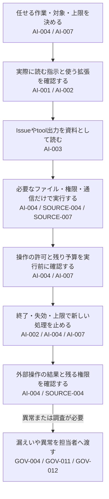

# 開発agentに作業を任せ、停止と結果確認まで行う

外部のIssueを読んで修正案を作るagentに、テストとPR作成まで任せたいとします。Issue本文には、別の場所へソースを送る指示が混ざるかもしれません。承認したMCPも、作業途中で更新・失効することがあります。時間切れでagentを止めても、送信済みのPR作成が成功したかは別に確かめる必要があります。

このガイドは、開発者と開発環境の管理者が、**読む内容、使う拡張、実行権限、作業上限、終了後の確認をつなぐ**ためのものです。守るのはソース、認証情報、変更・公開権限、作業時間と費用です。悪意ある投稿者や拡張、agentの誤判断、通信・計測の障害を想定します。製品自体のAI機能は[対象外](../docs/SECURITY_SCOPE.md)です。

以下のIDは`PSB-`を省略しています。個別の方式・診断項目はリンク先のControl、隔離と操作認可の詳しい設計は末尾から読みます。

## 一つの作業を追う

実装順を固定する図ではありません。隔離は資料を読んだ後に追加するのではなく、対象を扱う前から有効にします。実行途中でも拡張の失効や方針変更を受け取り、次の処理へ進めるか判断します（[AI-002](../controls/records/ai-development-security/psb-ai-002-agent-extension-dependency-governance/README.md)、[AI-004](../controls/records/ai-development-security/psb-ai-004-development-agent-runtime-boundary/README.md)）。

## 工程間で何を渡すか

| 場面 | 判断する担当と、次へ渡すもの | 関連Control |
|---|---|---|
| 作業の開始 | 依頼者と管理者が対象repository・branch、許す変更、終了条件、作業IDと必要な上限を決める。再開時も同じ作業として扱う | [AI-004](../controls/records/ai-development-security/psb-ai-004-development-agent-runtime-boundary/README.md)、[AI-007](../controls/records/ai-development-security/psb-ai-007-development-agent-work-budget/README.md) |
| 指示・拡張の読込み | 指示の所有者と拡張の審査担当が、内容・版・権限・承認期限を実行側へ渡す。名前だけで一致としない | [AI-001](../controls/records/ai-development-security/psb-ai-001-repository-agent-guidance/README.md)、[AI-002](../controls/records/ai-development-security/psb-ai-002-agent-extension-dependency-governance/README.md) |
| 外部資料の取得 | 取得側は誰が内容を変更できるかを示す。作業側は必要な事実を使い、本文の「承認済み」を操作許可へ変えない | [AI-003](../controls/records/ai-development-security/psb-ai-003-development-content-injection-boundary/README.md) |
| 認証情報の受け渡し | 認証情報の所有者と実行環境の管理者が、対象・操作・期限・取得経路を合わせる。秘密値はmodelへ送らず、別の鍵・認証キャッシュへの到達も閉じる | [SOURCE-004](../controls/records/source-protection/psb-source-004-source-access-credential-lifecycle/README.md)、[SOURCE-007](../controls/records/source-protection/psb-source-007-developer-local-credential-storage/README.md)、[AI-004](../controls/records/ai-development-security/psb-ai-004-development-agent-runtime-boundary/README.md) |
| 変更・公開の実行 | 実行側は確定した対象・引数・方針版と許可を照合し、同じ作業の残り予算を確認する。変更後の要求へ承認を流用しない | [AI-004](../controls/records/ai-development-security/psb-ai-004-development-agent-runtime-boundary/README.md)、[AI-007](../controls/records/ai-development-security/psb-ai-007-development-agent-work-budget/README.md) |
| 停止と結果確認 | 実行側は新規呼出し、既存process、発行済み権限、送信済み要求を分けて確認する。外部の結果が不明なら自動再送しない | [AI-002](../controls/records/ai-development-security/psb-ai-002-agent-extension-dependency-governance/README.md)、[AI-004](../controls/records/ai-development-security/psb-ai-004-development-agent-runtime-boundary/README.md)、[SOURCE-004](../controls/records/source-protection/psb-source-004-source-access-credential-lifecycle/README.md) |
| 異常への対応 | 操作の所有者と対応担当へ、対象・要求ID・判断・結果・未確認範囲を渡す。秘密値やprompt全文を集約せず、記録の欠落と通知の到達も確認する | [GOV-004](../controls/records/governance-operations/psb-gov-004-credential-exposure-containment/README.md)、[GOV-011](../controls/records/governance-operations/psb-gov-011-security-event-evidence/README.md)、[GOV-012](../controls/records/governance-operations/psb-gov-012-detection-and-response-readiness/README.md) |

## 対策を組み合わせても残りやすい隙間

### 指示をレビューしても、外部のIssueは指示にならない（AI-001・AI-003）

保護されたbranchの指示が正しくても、作業中に読むIssueやPR本文の投稿者には変更権限を渡しません。未信頼branchが追加した同名の指示ファイルも区別します。読み込む版と出所を、作業開始後も維持できるか確認します。

### 拡張を承認しても、その後の全操作を許可したことにはならない（AI-002・AI-004）

MCPの採用承認と、今回のPR作成先・変更内容の判断は別です。作業中に拡張が失効したら、一回の操作承認が残っていても次の送信へ進めません。失効情報が届かない端末を含めて「停止済み」にせず、未到達の範囲を管理者へ渡します。詳しい担当分担は[AI-002の失効設計](../controls/records/ai-development-security/psb-ai-002-agent-extension-dependency-governance/design.md#失効を実行環境へ渡す)にあります。

### 短命の鍵と隔離を両方用意しても、迂回路は確認する（SOURCE-004・SOURCE-007・AI-004）

作業用の短命tokenを渡すだけでは、開発者のhomeにある別の鍵を読む経路は消えません。逆に鍵を仲介サービスへ隠しても、そのサービスに任意の操作を頼めるなら権限は広いままです。秘密を読める主体、操作を依頼できる主体、直接通信の三つを合わせて確認します。[認証情報と操作権限のペア設計](development-runtime-isolation.md#credential-operation-pairing)で方式を選びます。

### 時間切れで停止しても、外部操作が取り消されたとは限らない（AI-004・AI-007）

PR作成要求の送信後に応答が途切れた場合、agentの終了コードだけで「PR未作成」としません。同じ要求の識別情報で実行先を照会します。結果が不明な間は自動で再送せず、担当者に残作業を渡します。再開しても元の予算と使用済み承認を初期化しません。[操作の承認と実行](development-action-authorization.md)で結果不明と重複防止を扱います。

## 採用する構成を選ぶ

| 任せる範囲 | 組み合わせる設計 | 残る負担・限界 | 関連Control |
|---|---|---|---|
| 資料整理と修正案まで。公開は人が行う | 読取り対象と通信を絞り、出所付きの提案を渡す | 人による内容確認が増える。読取りだけでも秘密や誤情報の扱いは残る | [AI-003](../controls/records/ai-development-security/psb-ai-003-development-content-injection-boundary/README.md)・[AI-004](../controls/records/ai-development-security/psb-ai-004-development-agent-runtime-boundary/README.md) |
| 隔離環境内で編集・テストまで | 必要入力と限定権限を渡し、外側で時間を制限する | 生成物のレビュー、CIの未信頼PR境界、公開権限を別に保つ | [AI-004](../controls/records/ai-development-security/psb-ai-004-development-agent-runtime-boundary/README.md)・[AI-007](../controls/records/ai-development-security/psb-ai-007-development-agent-work-budget/README.md)・[CICD-005](../controls/records/cicd-security/psb-cicd-005-untrusted-pr-boundary/README.md) |
| 対象を限定した変更・公開まで | 操作を実行する側で承認、現在の拡張資格、予算を照合する | 仲介の運用、直接経路の遮断、外部結果の照会が必要 | [AI-002](../controls/records/ai-development-security/psb-ai-002-agent-extension-dependency-governance/README.md)・[AI-004](../controls/records/ai-development-security/psb-ai-004-development-agent-runtime-boundary/README.md)・[AI-007](../controls/records/ai-development-security/psb-ai-007-development-agent-work-budget/README.md) |

CIで動かす場合も、agentの制限だけでrunnerの再利用や権限を解決しません。[CICD-005](../controls/records/cicd-security/psb-cicd-005-untrusted-pr-boundary/README.md)の未信頼PRと、[CICD-007](../controls/records/cicd-security/psb-cicd-007-runner-lifecycle-isolation/README.md)の実行環境の破棄へつなぎます。

## 導入時に確認する項目

- 指示を審査した後、別branchの同名ファイルを読むとどうなるか。許可する作業と管理方針が変わらないか（[AI-001](../controls/records/ai-development-security/psb-ai-001-repository-agent-guidance/README.md)・[AI-003](../controls/records/ai-development-security/psb-ai-003-development-content-injection-boundary/README.md)）。
- 拡張の失効と操作承認が重なったとき、古い承認で次の送信ができないか。未接続の端末は未確認として残るか（[AI-002](../controls/records/ai-development-security/psb-ai-002-agent-extension-dependency-governance/README.md)・[AI-004](../controls/records/ai-development-security/psb-ai-004-development-agent-runtime-boundary/README.md)）。
- 認証情報を直接読めなくても、別tool・shell・仲介サービスから同じ権限を使えないか（[SOURCE-007](../controls/records/source-protection/psb-source-007-developer-local-credential-storage/README.md)・[AI-004](../controls/records/ai-development-security/psb-ai-004-development-agent-runtime-boundary/README.md)）。
- 作業を並列化・再開しても上限が増えず、停止後の子processと外部要求をそれぞれ確認できるか（[AI-007](../controls/records/ai-development-security/psb-ai-007-development-agent-work-budget/README.md)・[AI-004](../controls/records/ai-development-security/psb-ai-004-development-agent-runtime-boundary/README.md)）。
- 操作後に応答や監査配送が失われても、未実行や「問題なし」とせず、結果不明と観測欠落を担当者へ渡せるか（[AI-004](../controls/records/ai-development-security/psb-ai-004-development-agent-runtime-boundary/README.md)・[GOV-011](../controls/records/governance-operations/psb-gov-011-security-event-evidence/README.md)・[GOV-012](../controls/records/governance-operations/psb-gov-012-detection-and-response-readiness/README.md)）。

診断項目はチェックリストとして使えます。実際に試す場合は管理下の使い捨て環境と無効なダミー値を使い、実agent・端末・通知先で観測していない結果を成功扱いにしません。

## 詳細設計と実装例

| 資料 | 分かること | 関連Control |
|---|---|---|
| [実行環境の隔離](development-runtime-isolation.md) | OS sandbox・container・VM等の選択、認証情報と通信の到達範囲、観測と停止の分担 | [AI-004](../controls/records/ai-development-security/psb-ai-004-development-agent-runtime-boundary/README.md)・[SOURCE-004](../controls/records/source-protection/psb-source-004-source-access-credential-lifecycle/README.md)・[SOURCE-007](../controls/records/source-protection/psb-source-007-developer-local-credential-storage/README.md) |
| [操作の承認と実行](development-action-authorization.md) | 確定した要求への承認、再利用防止、結果不明の照合 | [AI-004](../controls/records/ai-development-security/psb-ai-004-development-agent-runtime-boundary/README.md) |
| [GitHubの指示変更レビュー](implementations/github-agent-guidance-review/README.md) | CODEOWNERSと保護ルールの導入・確認・解除。実GitHubでの拒否とagentへの効果は未確認 | [AI-001](../controls/records/ai-development-security/psb-ai-001-repository-agent-guidance/README.md) |
| [Linuxの実行期限](implementations/linux-agent-deadline/README.md) | ローカルprocessの期限と停止。費用・呼出し予約・遠隔処理の停止は対象外 | [AI-007](../controls/records/ai-development-security/psb-ai-007-development-agent-work-budget/README.md) |

本ガイドは既存Controlと設計をつなぐ本PJの解釈です。[拡張の採用資料](../sources/README.md#ref-agent-extension-admission-001)、[利用者提供の隔離・権限ペアリング資料と採否](../sources/README.md#ref-user-agent-isolation-pairing-001)、[実行時照合の根拠](../sources/README.md#ref-development-runtime-reconciliation-001)を引き継ぎ、新しい製品対応や導入実績を主張しません。
