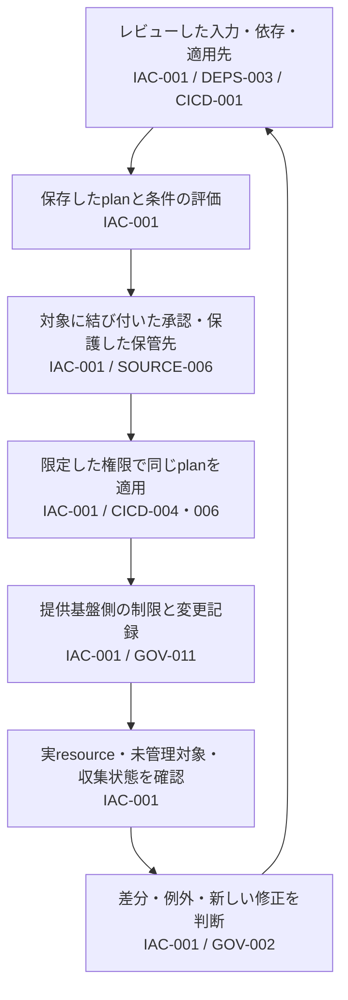

# インフラ変更の承認から実環境の確認まで

設計ID: `ENG-CONTAINER-007`。主なControlは[IAC-001](../controls/records/container-cloud-iac-security/psb-iac-001-infrastructure-change-authorization-and-drift/README.md)です。Control IDは`PSB-`を省略しています。

## レビューした変更が、そのまま適用されたか

PRで確認したplanと、適用時に作り直したplanが違えば、レビューを通していない変更が実行されます。さらに適用後にconsoleから変更されると、ソースやIaC stateだけを見ても現在の状態が分かりません。

基盤担当者が、**変更の入力・承認・適用権限・実環境の観測を一つの変更として追える構成**を選びます。標準のmoduleやworkflow（Golden Path）は作業の入口にし、そこを通らない変更にも拒否または観測を置きます。

個々のresourceの安全な値は、このガイドから一律に決めません。コンテナを配置する場合は[実行・権限・通信・監視の接続](container-deployment-to-response.md)へ渡します。

## 1. 標準の作り方を入口にする（IAC-001）

Platform teamは、review済みmodule、狭いinput、provider設定、policy bundle、reusable workflow、例を一つの入口として提供できます。ここでの目的は、各teamが暗号化やnetwork等を毎回作り直さなくても、正しい変更を作りやすくすることです。

入口には、対象resource・provider・version、変更できるinput、安全のため固定する部分、owner、update方法、利用側が別途判断する事項を書きます。複数cloudを一つの抽象へ押し込んでprovider固有の制御を隠しません。Golden Pathを使わない経路は、禁止、例外、同等の独立評価のどれかへ明示的に接続します。

## 2. ソース・依存・適用先を特定する（IAC-001 / DEPS-003 / CICD-001）

Planを再現する入力を列挙します。典型的にはsource revision、root・child module sourceとversion、provider source・version・checksum、tool version、variable、policy bundle、state backend・workspace、account／project／subscription、regionです。

固定方法はtoolごとに異なります。Terraformの`.terraform.lock.hcl`はprovider selectionとchecksumを記録しますが、remote moduleの選択を現在は記録しません。Moduleはregistryのexact version、VCS commit等、採用toolが実際に解決するidentityを使います。最初の取得元を信頼してよいかという判断は、lock fileの有無とは別に残します。

## 3. 展開された変更案を評価する（IAC-001）

Policyは「approved moduleから来たか」だけでなく、最終的なresource address、type、provider、create・update・delete・replace action、before／after、security-relevant valueを見ます。Ruleは「暗号化必須」のような一般語から始めず、守るdata、到達可能性、管理主体、provider semanticsを持つcontrolから受け取ります。

Plan policyには限界があります。Unknown、dynamic evaluation、provider default、apply時に決まる値、toolが表現しない実状態は、planだけでは判断できません。各ruleについて次のいずれかを選びます。

- Planで値が確定しなければ拒否する。
- 人の明示判断へ送り、判断対象と理由をplanへ結び付ける。
- Provider側の最終強制点へ渡し、そのdecisionまたは拒否を取得する。
- Apply後の観測へ渡す。予防できなかったriskとして時間と対応ownerを決める。

Policy engine error、input生成失敗、schema未対応、対象0件、timeoutはallowと分けます。

## 4. 承認したplanだけを適用する（IAC-001 / SOURCE-006）

Preview用のspeculative planと、applyする保存planを区別します。Human reviewとpolicy decisionは、source revisionだけでなく、保存plan、入力identity、target、policy versionへ結び付けます。Apply jobは承認記録と保存plan・targetの対応を検証してからそのplanを消費し、設定から無断で新しいplanを作りません。Terraformでは保存planを指定すると追加の対話承認なしで実行されるため、jobがplanを取得できることだけを承認条件にしません。Driftや競合でplanを作り直す必要があれば、新しい判断へ戻します。

Saved planとJSONには平文の機微値が含まれ得ます。Artifact storeのread／write主体、暗号化、retention、cache、log、download、削除後の複製を設計します。Plan hashだけでは、誰がそのhashを承認し、どのtargetへ適用できるかまでは示さないため、approval recordとapply receiptも必要です。

## 5. 適用する権限を分ける（IAC-001 / CICD-004・006）

Plan生成は可能ならread中心とし、apply credentialを持たせません。Applyはprotected environmentや別jobで行い、承認されたrepository／workflow／revision／environment等から来たidentityを、exact account・project・subscription、resource、action、sessionへ限定します。

Identity tokenの発行・交換条件は[Workload federation boundary](../controls/records/cicd-security/psb-cicd-006-workload-federation-boundary/README.md)へ委ねます。この設計は、そのidentityがInfrastructure targetで何を変更できるか、plan外操作を許さないか、失効・audit・break-glassをどう扱うかを決めます。

## 6. CI以外の変更も拒否・観測につなぐ（IAC-001 / GOV-011）

Provider-side policy、organization policy、service control、resource policy、admission hook等は、CIを通らない変更を止める強制点になり得ます。ただし製品ごとに対象resource、operation、API、deployment system、failure modeが違います。Createとupdateだけ、特定provisionerだけ、既存resourceは対象外というcoverageを「全経路」と書き換えません。

拒否できない経路は、auditとinventoryへ接続し、許容時間、response owner、緊急変更の正当化を決めます。Break-glassはGolden Pathの外ですが、記録されない例外にはしません。

## 7. 期待する状態と実環境を照合する（IAC-001）

Applyが成功した場合も途中失敗した場合も、provider上で何が変更されたかを確認します。Terraformは途中失敗を自動rollbackしないため、失敗を「変更なし」と記録しません。Drift観測はstate fileだけを比較して終えず、provider APIから対象scopeのinventoryと実効値を取得します。IaC管理下、未管理、import待ち、削除済み、権限不足、取得失敗を区別し、account、region、resource type、pagination、eventual consistency、rate limit、collector identity、last successful observationを証拠に含めます。

Terraformのrefresh-only plan等は管理resourceの差分確認に使えますが、未管理resourceの完全なinventoryではありません。Provider inventoryや別のasset inventoryと組み合わせます。収集healthがない`0 drift`を合格にしません。

## 8. 意図しない差分を、新しい変更判断へ戻す（IAC-001 / GOV-002）

差分を見つけたら、resource・property・expected・actual・source revision・観測時刻・owner・原因候補を一つの記録へ結びます。緊急変更、provider側の正規化、attack、IaCの欠陥、import漏れを判別する前に自動で戻しません。

安全に自動化できる修正は、対象が狭く、可逆で、状態競合を検出でき、失敗時に停止できるものへ限定します。それ以外はdesired sourceを修正し、新しいplan、review、applyを通します。Availabilityを壊す操作と調査証拠を消す操作は人のimpact判断へ送ります。

## 構成の選択と代償（IAC-001 / CICD-006 / GOV-011）

| 選択 | 向く場面 | 主な注意点 |
|---|---|---|
| 標準module + CI plan policy | 開発者へ早いfeedbackと安全な既定値を提供したい | Module利用だけでは最終状態・迂回経路・driftを保証しない |
| Managed IaC platformのrun／policy | Plan・approval・apply・stateを一つのcontrol planeで結びたい | Platform管理者、agent、workspace、policy override、外部API経路が新しい信頼境界になる |
| Repository CI + 保存plan | 既存CIで構成し、review対象を明確にしたい | Artifactの機密性、差替え防止、target binding、credential分離を自分で設計する |
| Provider-side guardrail | Console・API・別toolも作成時に止めたい | Resource・operation・provisioner coverageとfailure modeがprovider固有 |
| 定期drift reconciliation | Apply後の変更と未管理resourceを見つけたい | Snapshot間の時間差、collector blind spot、修正の安全性が残る |

## 工程の間で見落としやすいこと（IAC-001）

- Standard moduleの名前だけを確認し、resolved resource valueを評価しない。
- Provider lock fileをremote moduleのcontent固定として説明する。
- PRへ表示したplanと、merge後にapplyするplanが異なる。
- 保存planを渡す前の承認gateがなく、取得できたjobがそのまま実行する。Apply途中失敗後の一部変更を見落とす。
- Policy engineのerrorやunknownをempty findingsへ変換する。
- Plan artifactを公開logまたは広いartifact readerへ渡す。
- Plan生成jobがstate writeとproduction apply credentialを持つ。
- 一つのprovider hookをconsole、API、SDK、全IaC toolへ効くと扱う。
- Terraform state内のresourceだけをinventory全体と扱う。
- Drift collectorの権限不足やstale resultをcompliantへ変換する。
- 自動修正が削除や遮断を行い、outageまたは証拠消失を起こす。

## 実装を作る開始条件

この設計の実装例は、次を一組として選べる時に作ります。

1. Terraform／OpenTofu等のtoolとexact version、policy engineとversion。
2. 一つのprovider、使い捨てaccount／project／subscription、具体的なresource type。
3. 「public到達禁止」等、providerの実効値で確認できるsecurity invariant。
4. Module・provider identity、保存plan、policy decision、protected applyを結ぶ実workflow。
5. ConsoleまたはAPIの迂回を拒否するprovider側強制、または確実に検知するinventory。
6. 正常apply、plan差替え、unknown／error、迂回変更、drift、修正の確認方法とcleanup。

この条件がないmulti-cloud JSON checkerは、resource、provider、plan、apply、live stateを実行せず、自己申告したfield同士を比較するだけになります。そのため本移行ではimplementationとして採用しません。

## この設計の範囲

[PSB-IAC-001](../controls/records/container-cloud-iac-security/psb-iac-001-infrastructure-change-authorization-and-drift/README.md)の`IAC-CHANGE-1`〜`8`を、source／dependency identity、resolved plan、decision、apply、provider guardrail、actual state、remediationへ配置します。

対象provider、resource、policy rule、IaC platform、identity providerは未選定です。Live plan、policy、apply、cloud API、drift、remediationを実行しておらず、組織への導入済み状態も示しません。

## 根拠

- [REF-IAC-CHANGE-BOUNDARY-001](../sources/README.md#ref-iac-change-boundary-001)
- [移行判断](../docs/MIGRATION_CONTAINER_CLOUD_IAC.md#iac-change-boundary-migration)

権限交換の詳細は[CICD-006](../controls/records/cicd-security/psb-cicd-006-workload-federation-boundary/README.md)、記録の保存と調査は[GOV-011](../controls/records/governance-operations/psb-gov-011-security-event-evidence/README.md)、例外の責任者と期限は[GOV-002](../controls/records/governance-operations/psb-gov-002-security-exception-lifecycle/README.md)で確認できます。
