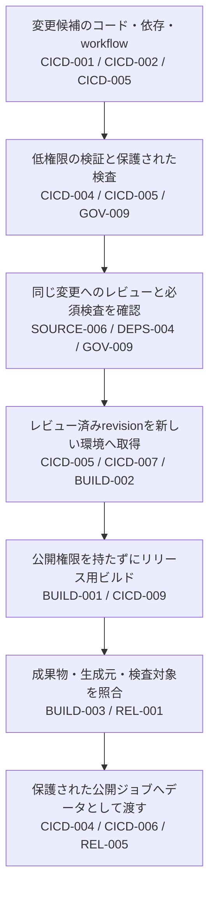

# PRの検証からリリース用ビルド・公開への引き渡しまで

外部PRのテストは成功しました。その実行で作ったファイルを後続の公開ジョブへ渡し、そこに含まれるスクリプトを実行すると、PRへ直接tokenを渡していなくても公開権限を使われます。別のジョブに分けただけでは、この経路は切れません。

このガイドは、CIの設計者とリポジトリ・リリースの管理者が、**誰が変えられる内容を、どの権限で実行し、何を次へ渡すか**を決めるためのものです。守るのはソース、CIの認証情報、ビルド結果、公開・deploy権限です。悪意あるPR、外部Actionの差し替え、検査の省略、前ジョブの残存状態を想定します。

以下のIDは`PSB-`を省略しています。個別の方式・診断項目は各Controlへ、開発端末や本番運用までの全体像は[開発から本番運用まで](developer-to-production.md)へ進んでください。

## 信頼の違う処理を分ける

レビュー済みの変更にも欠陥はあり得ます。マージはビルド隔離や成果物の受入判断を省く理由にはしません。PR検証の作業領域・実行済み依存・cacheを、公開用の実行環境へ持ち込まないことが、この流れの前提です（[CICD-005](../controls/records/cicd-security/psb-cicd-005-untrusted-pr-boundary/README.md)・[BUILD-001](../controls/records/build-security/psb-build-001-build-containment/README.md)）。

## 工程の間で何を確認するか

| 受け渡し | 判断する担当と確認内容 | 関連Control |
|---|---|---|
| 外部コード・入力から検証へ | CI設計者が外部Actionの版と追加取得を確認する。題名や本文は固定した処理へデータとして渡す。SHA固定と入力処理は別の確認 | [CICD-001](../controls/records/cicd-security/psb-cicd-001-workflow-dependency-identity/README.md)・[CICD-002](../controls/records/cicd-security/psb-cicd-002-workflow-input-handling/README.md) |
| 検証ジョブへ権限を渡す前 | CI管理者が標準tokenに加え、PAT・App・secret・OIDC・host・内部通信への到達を確認する。必要な権限と開始条件を対応させる | [CICD-004](../controls/records/cicd-security/psb-cicd-004-workflow-authority-minimization/README.md)・[CICD-005](../controls/records/cicd-security/psb-cicd-005-untrusted-pr-boundary/README.md) |
| 検査結果からマージ判断へ | リポジトリ管理者が対象revision・検査範囲・完了状態・例外を照合する。検査を消せるPRが同じcheck名で成功する経路を残さない | [GOV-009](../controls/records/governance-operations/psb-gov-009-scanner-evidence-trust-boundary/README.md)・[SOURCE-006](../controls/records/source-protection/psb-source-006-source-organization-security-posture/README.md) |
| レビューからリリース用ビルドへ | ビルド管理者が対象revisionを新しく取得する。PRのheadや比較元が変わったら、以前の差分判断を無条件に流用しない。正規ビルドの定義と開始条件も確認 | [DEPS-004](../controls/records/dependency-security/psb-deps-004-dependency-change-review/README.md)・[CICD-005](../controls/records/cicd-security/psb-cicd-005-untrusted-pr-boundary/README.md)・[BUILD-002](../controls/records/build-security/psb-build-002-approved-consistent-build/README.md) |
| cache・runnerから次の実行へ | 実行基盤の担当者が、再利用してよい取得ファイルと破棄するprocess・保存領域を分ける。新しいrunnerでも復元ファイルの同一性は再確認 | [CICD-007](../controls/records/cicd-security/psb-cicd-007-runner-lifecycle-isolation/README.md)・[CICD-009](../controls/records/cicd-security/psb-cicd-009-cache-trust-boundary/README.md)・[DEPS-003](../controls/records/dependency-security/psb-deps-003-dependency-artifact-identity/README.md) |
| ビルドから公開へ | 公開担当者が対象成果物と生成元・検査結果を照合する。ビルド側のコマンドや送信先を公開設定へ取り込まない | [BUILD-003](../controls/records/build-security/psb-build-003-platform-provenance-generation/README.md)・[REL-001](../controls/records/release-integrity/psb-rel-001-signature-provenance-verification/README.md)・[CICD-006](../controls/records/cicd-security/psb-cicd-006-workload-federation-boundary/README.md) |
| クラウド権限の取得から操作へ | CI側の発行許可、受入側の交換条件、交換後の対象・操作を別々に限定する。短命tokenであることだけでは許可しない | [CICD-004](../controls/records/cicd-security/psb-cicd-004-workflow-authority-minimization/README.md)・[CICD-006](../controls/records/cicd-security/psb-cicd-006-workload-federation-boundary/README.md) |

## 対策の間に残りやすい隙間

### Actionを固定しても、その内側の取得は別（CICD-001・DEPS-003）

固定したActionが動くたびに可変URLからツールを取得するなら、直接参照の検査だけでは実行内容が固定されません。更新レビューでは出所、差分、追加取得、必要権限を次の担当へ渡します。形式検査と内容の審査を分ける判断は[CICD-001の方式](../controls/records/cicd-security/psb-cicd-001-workflow-dependency-identity/README.md)にあります。

### PRの題名を読む処理でも、権限を使われることがある（CICD-002・CICD-004・CICD-005）

コードをcheckoutしないメタデータ処理でも、題名をshellへ埋め込めば命令になります。環境変数へ移した後も、呼出先で再評価したり任意の操作を選べたりすれば別の経路が残ります。入力の流れと、その処理の権限を一緒にレビューします。

### 緑のcheckと、マージを許可する根拠は別（GOV-009・SOURCE-006）

結果のupload成功、空の検査対象、skipされたジョブを、検査完了へ読み替えません。検査定義を誰が変えられるか、どのrevisionの何を検査したか、結果が受入条件へ接続されているかを確かめます。[検査・マージ条件・結果表示の設計](workflow-analysis-gate-and-reporting.md)で構成を選べます。

### ジョブを分けても、実行するものを渡せば権限がつながる（CICD-005・CICD-007・CICD-009）

権限付きのジョブが、PRで生成したスクリプトや依存環境を実行する構成を避けます。レポートなどのデータを渡す場合も、対象の版、形式、許可する値、使い道を受け取る側で確認します。保存者が書いた「成功」は、公開を承認する根拠にはなりません。外部cacheとhost上の残存状態は[再利用と破棄の設計](ci-state-and-runner-lifecycle.md)で別々に扱います。

## ビルドしたものを公開ジョブへ渡すとき（BUILD-001・BUILD-003・REL-001・CICD-006）

レビュー後の変更をビルドし、その成果物を公開する場面を考えます。公開先の権限を取得できるからといって、ビルドと公開を同じ環境で動かす必要はありません。依存パッケージやビルド用スクリプトの実行には、公開用の権限を渡さない構成を選びます。

公開ジョブでは、管理された公開処理が、承認した成果物をデータとして送ります。成果物に含まれるスクリプトを実行したり、ビルド側が指定したコマンドや送信先をそのまま採用したりすると、ビルド側から公開権限を使う経路ができます。

| 渡すもの | 公開側で判断すること | 関連Control |
|---|---|---|
| 配布する成果物 | 対象の変更・生成元・digestと対応しているか。公開するものとして受け入れてよいか | [BUILD-003](../controls/records/build-security/psb-build-003-platform-provenance-generation/README.md)・[REL-001](../controls/records/release-integrity/psb-rel-001-signature-provenance-verification/README.md) |
| 検査結果 | どの版を誰が検査したか。ビルド側の「成功」という自己申告だけで公開を決めていないか | [GOV-009](../controls/records/governance-operations/psb-gov-009-scanner-evidence-trust-boundary/README.md)・[REL-001](../controls/records/release-integrity/psb-rel-001-signature-provenance-verification/README.md) |
| 公開先や実行方法 | 保護された公開設定で決めているか。受け取ったファイルで勝手に変えられないか | [CICD-004](../controls/records/cicd-security/psb-cicd-004-workflow-authority-minimization/README.md)・[CICD-006](../controls/records/cicd-security/psb-cicd-006-workload-federation-boundary/README.md) |

OIDCは権限を取得する処理を限定しますが、渡された成果物の妥当性は判断しません。Digestの一致も内容の無害性を示しません。ビルドの実行制限はBUILD-001、生成元の証拠はBUILD-003、成果物の受入判断はREL-001、署名する権限と対象の結合はREL-005へ渡します。

## 必要な構成を選ぶ

| 構成 | 選ぶ場面と残る負担 | 関連Control |
|---|---|---|
| PRでは低権限の検証だけ、レビュー後に新しい実行を開始 | 権限への経路を分けやすい。マージ前の統合試験は限定され、直接push・bypassの確認が必要 | [CICD-004](../controls/records/cicd-security/psb-cicd-004-workflow-authority-minimization/README.md)・[CICD-005](../controls/records/cicd-security/psb-cicd-005-untrusted-pr-boundary/README.md)・[SOURCE-006](../controls/records/source-protection/psb-source-006-source-organization-security-posture/README.md) |
| PRのメタデータ処理だけを別に許可 | ラベル・コメント等が必要。PRコードは実行せず、本文の命令化と不要な権限を防ぐ | [CICD-002](../controls/records/cicd-security/psb-cicd-002-workflow-input-handling/README.md)・[CICD-004](../controls/records/cicd-security/psb-cicd-004-workflow-authority-minimization/README.md)・[CICD-005](../controls/records/cicd-security/psb-cicd-005-untrusted-pr-boundary/README.md) |
| 一時的な外部サービスで統合試験 | 接続が必要な試験向け。用途限定の権限、通信先、後片付けを別に管理する | [CICD-004](../controls/records/cicd-security/psb-cicd-004-workflow-authority-minimization/README.md)・[CICD-005](../controls/records/cicd-security/psb-cicd-005-untrusted-pr-boundary/README.md)・[CICD-007](../controls/records/cicd-security/psb-cicd-007-runner-lifecycle-isolation/README.md) |
| 共通workflowや別repositoryで公開 | 変更権限と実行権限を分けたい。呼出元・呼出先の固定、入力検証、秘密情報の配送、更新責任を持つ | [CICD-001](../controls/records/cicd-security/psb-cicd-001-workflow-dependency-identity/README.md)・[CICD-004](../controls/records/cicd-security/psb-cicd-004-workflow-authority-minimization/README.md)・[CICD-006](../controls/records/cicd-security/psb-cicd-006-workload-federation-boundary/README.md) |

## 導入時に確認する項目

- PRで検査script・設定・ignoreを変えても、必要な検査を省いたまま同じcheck名で通らないか（[GOV-009](../controls/records/governance-operations/psb-gov-009-scanner-evidence-trust-boundary/README.md)・[SOURCE-006](../controls/records/source-protection/psb-source-006-source-organization-security-posture/README.md)）。
- 題名・本文を変えても、メタデータ処理から追加命令や許可外の操作を実行できないか（[CICD-002](../controls/records/cicd-security/psb-cicd-002-workflow-input-handling/README.md)・[CICD-004](../controls/records/cicd-security/psb-cicd-004-workflow-authority-minimization/README.md)）。
- PR由来のスクリプト・レポート・cacheを後続へ渡したとき、コード実行や公開承認へ無条件に昇格しないか（[CICD-005](../controls/records/cicd-security/psb-cicd-005-untrusted-pr-boundary/README.md)・[CICD-009](../controls/records/cicd-security/psb-cicd-009-cache-trust-boundary/README.md)・[REL-001](../controls/records/release-integrity/psb-rel-001-signature-provenance-verification/README.md)）。
- job取消・破棄失敗・ログ配送失敗の後、同じrunner世代を再利用しないか。新しいrunnerへ不正なcacheを戻さないか（[CICD-007](../controls/records/cicd-security/psb-cicd-007-runner-lifecycle-isolation/README.md)・[CICD-009](../controls/records/cicd-security/psb-cicd-009-cache-trust-boundary/README.md)）。
- 別repository・branch・環境のtokenがクラウド権限へ交換できず、正常な交換後も不要な操作をできないか（[CICD-004](../controls/records/cicd-security/psb-cicd-004-workflow-authority-minimization/README.md)・[CICD-006](../controls/records/cicd-security/psb-cicd-006-workload-federation-boundary/README.md)）。
- ビルド側が公開先や実行コマンドを差し替えても、公開側がその指定を採用しないか（[BUILD-001](../controls/records/build-security/psb-build-001-build-containment/README.md)・[CICD-006](../controls/records/cicd-security/psb-cicd-006-workload-federation-boundary/README.md)・[REL-001](../controls/records/release-integrity/psb-rel-001-signature-provenance-verification/README.md)）。

診断項目は設計レビューのチェックリストとして使えます。実際に試す場合は使い捨ての対象と無害な入力を使います。外部サービスの拒否、runnerの破棄、公開・署名は本ガイドによる実施結果ではありません。

## 実装例へ進む

| 実装例 | 対象と限界 | 関連Control |
|---|---|---|
| [Pythonによるworkflow参照検査](implementations/python-workflow-refs/README.md) | 直接参照の形式をローカルで検査。Action内部の追加取得と実GitHubのマージ拒否は別 | [CICD-001](../controls/records/cicd-security/psb-cicd-001-workflow-dependency-identity/README.md) |
| [GitHubのjob権限と開始条件](implementations/github-job-authority/README.md) | 設定・無権限markerでの確認手順。実付与とEnvironment拒否は未確認 | [CICD-004](../controls/records/cicd-security/psb-cicd-004-workflow-authority-minimization/README.md) |
| [GitHubのPR検証と新しいmain run](implementations/github-untrusted-pr/README.md) | PRと後続runを分離する例。実GitHubの設定・実行・拒否は未確認 | [CICD-005](../controls/records/cicd-security/psb-cicd-005-untrusted-pr-boundary/README.md) |
| [GitHubからAWSへの権限交換](implementations/github-aws-federation/README.md) | 限定したtrustの例。交換と操作の最小性・旧鍵失効は採用先で確認 | [CICD-006](../controls/records/cicd-security/psb-cicd-006-workload-federation-boundary/README.md) |

このガイドは既存Controlと設計の受け渡しをまとめた本PJの解釈です。[CIの権限と入力・参照の仕様](../sources/README.md#spec-github-workflow-authority)、[未信頼PRの資料と採否](../sources/README.md#ref-cicd-010)、[検査結果と受入の資料](../sources/README.md#ref-workflow-analysis-001)を引き継ぎ、新しい製品対応や導入実績を主張しません。
