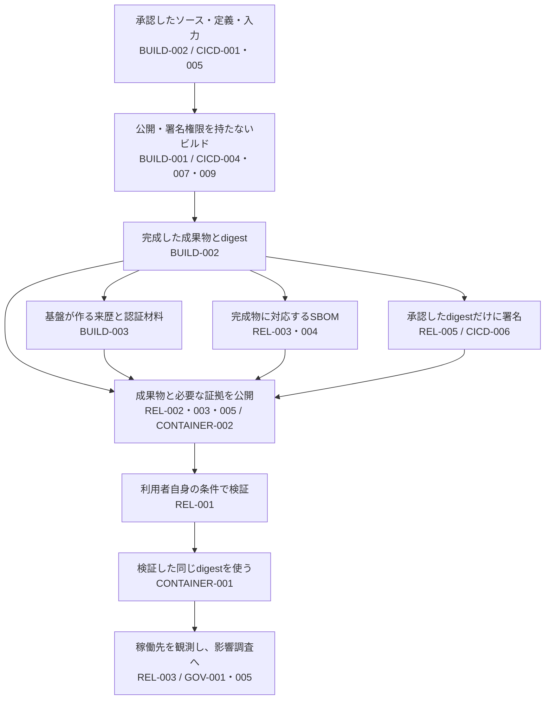

# ビルドした成果物を署名・公開し、使用するまで

リリース担当者と基盤担当者が、**レビューした作り方、完成したファイル、署名、配布先、実際の使用対象が途中で入れ替わらない構成**を選ぶためのガイドです。Control IDは`PSB-`を省略しています。

例えば、承認したビルドが成功し、署名も付いたのに、本番では別のイメージが動いていることがあります。署名対象を`latest`で指定した、公開処理が作り直した、使用直前にtagを引き直した、といった工程間の変更が原因になり得ます。各処理の成功を並べるだけでは、この取り違えを防げません。

PRの検証と公開権限の分離は[PRからリリース用ビルドへの引き渡し](pull-request-to-release-build.md)、全体の配置は[開発から本番運用まで](developer-to-production.md)から読めます。

## 何を、誰から次へ渡すか

図は受け渡しの関係です。来歴の生成、SBOMの生成、署名に一律の実行順を要求するものではありません。採用するリリース方針で必要な結果が揃い、すべて同じ対象を指すことを確かめます（REL-002・003・005）。

| 境界 | 次へ渡すもの | 受取側が確かめること | Control |
|---|---|---|---|
| 変更承認 → ビルド開始 | ソースとビルド定義のrevision、許可した入力・起動条件 | 正規の基盤でも、未承認の定義やdebug用入力を使っていないか | [BUILD-002](../controls/records/build-security/psb-build-002-approved-consistent-build/README.md) |
| ビルド → 記録・公開処理 | 完成した内容とdigest、基盤の実行記録 | 成果物内のscriptを公開権限で動かしていないか。記録のどこを基盤が確認したか | [BUILD-001](../controls/records/build-security/psb-build-001-build-containment/README.md)、[BUILD-003](../controls/records/build-security/psb-build-003-platform-provenance-generation/README.md) |
| リリース承認 → 署名 | 対象digestに結び付いた承認と署名条件 | 接続を許可したjobでも、任意の成果物へ署名できないか | [REL-005](../controls/records/release-integrity/psb-rel-005-artifact-signing-generation/README.md)、[CICD-006](../controls/records/cicd-security/psb-cicd-006-workload-federation-boundary/README.md) |
| 公開処理 → 利用者 | 成果物、対応する来歴・署名・SBOMと取得先 | 管理者だけでなく、想定利用者が必要な証拠を探して取得できるか | [REL-002](../controls/records/release-integrity/psb-rel-002-provenance-distribution-availability/README.md)、[REL-003](../controls/records/release-integrity/psb-rel-003-release-sbom-identity-and-analysis/README.md)、REL-005 |
| 検証 → 使用 | 対象digest、適用した方針と信頼根拠の版、判断時点 | 検証後の差し替えや、別環境・古い方針への結果流用がないか | [REL-001](../controls/records/release-integrity/psb-rel-001-signature-provenance-verification/README.md)、[CONTAINER-001](../controls/records/container-cloud-iac-security/psb-container-001-deployment-artifact-admission/README.md) |
| 使用 → 影響調査・復旧 | 実際に動くdigest、環境、観測時点、担当者 | 新しい脆弱性が分かったとき稼働先を探せるか。修復後に旧版が残っていないか | REL-003、[GOV-001](../controls/records/governance-operations/psb-gov-001-supply-chain-impact-assessment/README.md)、[GOV-005](../controls/records/governance-operations/psb-gov-005-deployed-artifact-recovery/README.md) |

## 工程の間に残りやすい四つの隙間

### 作り方の承認と、出来上がったものの承認（BUILD-002・003 / REL-005）

同じソースからでも、別のビルド定義、外部入力、追加取得で出力は変わります。ソースの承認をそのまま署名許可にせず、今回の実行記録と完成したdigestを照合します。基盤が入力を正確に記録していても、その入力がリリース用に承認済みかは別の判断です。

署名鍵をビルドから離しても、署名サービスが要求されたdigestを無条件に署名するなら、改ざんした成果物にも正規の署名が付きます。署名サービスへ接続する主体と、署名してよい対象を両方制限します。

### 一部だけ公開できた状態（REL-002・003・005）

成果物のアップロードに成功しても、必要な来歴や署名、SBOMの公開に失敗することがあります。準備用の領域からまとめて公開するか、証拠が揃うまで利用者側で使用を止めるかを選びます。公開ページ上の「準備中」という表示だけでは直接URLからの使用を防げません。

再試行では、同じrelease名に対する古い成功結果を使わず、今回のdigestと必要な証拠の対応を再確認します。配布元の管理者権限で取得できたことを、利用者が取得できる証拠にしません。

### 検証した後の差し替え（REL-001 / CONTAINER-001）

Stagingで確認したものを本番へ渡すなら、再ビルドや可変tagの再解決を挟まず、同じdigestを使います。検証結果を別処理へ渡す場合は、その結果も成果物側から書き換えられないようにします。渡す先の環境や受入方針が変われば、同じdigestでも再評価が必要です。

複数イメージを使う構成では、主イメージの検証成功を追加されたsidecar等へ流用しません。実行直前に決まった対象全体を確認します。

### 公開したものと、稼働しているものの違い（REL-003・004 / GOV-001・005）

配布時のSBOMだけでは、どこでその成果物が使われているか分かりません。稼働先の観測をdigestでつなぎます。供給者や共通基盤のSBOMを受け入れる判断と、自分たちが追加した部品を含む最終成果物の観測も分けます。具体的な接続は[SBOMから脆弱性の影響調査へつなぐ](sbom-to-vulnerability-response.md)で扱います。

## 構成を選ぶときの比較

| 判断 | 選択肢と代償 | Control |
|---|---|---|
| 取得と実行をどこで分けるか | 入力を揃えて通信を閉じると境界は単純になる。動的取得が必要なら、限定proxy・取得権限と実行権限の分離・迂回経路の確認が必要 | BUILD-001、[DEPS-002](../controls/records/dependency-security/psb-deps-002-install-execution-policy/README.md) |
| 来歴を誰が作るか | 基盤の標準機能は運用を減らせるが、情報源と取得方法に依存する。外部の生成処理を使うなら、jobからの隔離、基盤API、障害と再試行の管理が増える | BUILD-003 |
| 検証をどこに置くか | Registry登録時の検証は共通化できるが、その後の再配布や使用時の差し替えは残る。使用時にも確認するなら、検証器と方針の配布・更新が必要 | REL-001、CONTAINER-001 |
| 署名・配布をどう確認するか | Producerが想定利用者の条件で確認してから公開を完了する。Consumerも独立した期待値で使用を判断する。両者は同じ成功通知で代用しない | REL-001・002・005 |

## 診断で確認する項目（異常時テスト）

- 承認済みソースを使い、ビルド定義や重要な入力だけ変えた成果物が通常公開へ進まないか（BUILD-002・003）。
- 署名直前にtagの参照先を変える、または署名可能なjobから未承認digestを要求しても署名されないか（REL-005）。
- 来歴やSBOMだけ公開に失敗したとき、成果物の公開成功で全体を完了扱いにしないか（REL-002・003）。
- 正しい署名でも、別のソース・入力・環境向けの成果物や、古い方針による許可結果を使用できないか（REL-001 / CONTAINER-001）。
- 署名・来歴・SBOMを別digestへ付け替えたとき、各検査の成功を寄せ集めて使用許可しないか（BUILD-003 / REL-001・003・005）。
- 修復版を公開・配備した後も旧digestが残る、または稼働情報が取得できない状態を復旧完了としないか（REL-003 / GOV-005）。

これらは設計レビューや導入時の確認項目です。本PJで実配布先・署名サービス・本番環境を試した結果ではありません。既存の[CycloneDX実装](implementations/cyclonedx-artifact-binding/README.md)は、実ファイルとSBOM内のhashなどの限定検査を担います。

## 根拠と使い方

これは既存Controlを工程間の受け渡しから読み直した本PJの設計案です。個別の条件と資料の採否は各Controlを正本とします。[ビルド手順](../sources/README.md#spec-consistent-build-producer)、[来歴生成](../sources/README.md#spec-platform-provenance-generation)、[配布](../sources/README.md#spec-provenance-distribution)、[利用者の検証](../sources/README.md#spec-consumer-artifact-verification)、[成果物署名](../sources/README.md#ref-artifact-signing-boundary-001)、[利用者提供のSBOM資料](../sources/README.md#ref-release-sbom-lifecycle-001)に、参照版と未確認事項を残しています。

使用を許可した後の権限・通信・資源制限と監視は[コンテナの実行から初動まで](container-deployment-to-response.md)へ続きます（CONTAINER-003〜007 / GOV-011・012）。
