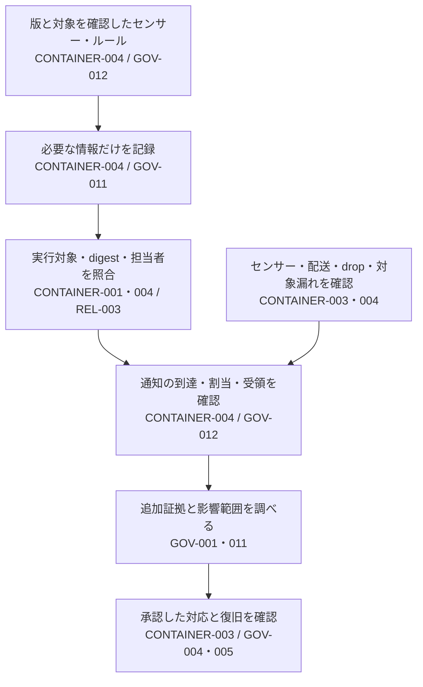

# 実行時の検知から初動対応まで

設計ID: `ENG-RUNTIME-001`。稼働中のcontainerを対象に、センサー・対象照合・通知・担当者の判断をつなぎます。Control IDは`PSB-`を省略しています。

## 通知の対象と、見えていない範囲を一緒に渡す

不審なprocessを検知しても、どの製品のどのcontainerか分からなければ、担当者は対象を絞れません。逆にセンサーが停止している間の通知0件を「異常なし」にすると、調査が始まりません。

基盤担当者とSOCが、**イベントを実行中の対象へ結び、欠測と通知不達も担当者へ渡し、対応は別に判断できる構成**を選ぶための設計です。

起動を許可した時点の情報だけでは、実行中のcontainer ID等が確定しない場合があります。
Deployment・runtime inventoryを使って許可したdigestと実際のcontainerを関連付け、名前だけで対応しません。
識別子が欠けていても調査は続けます。対象未確定として記録し、対象を確認できるまで破壊的操作を止めます。
Image index、選択されたmanifest、runtimeの報告値が異なる形式なら、[admissionの設計](../controls/records/container-cloud-iac-security/psb-container-001-deployment-artifact-admission/README.md)から対応関係を受け取ります。Eventにimage digestが含まれる前提にせず、取得できない場合は稼働inventoryへ照会し、照合不能を残します。

製品・開発基盤に共通するルールの変更・試験・配備・改善は[Detection Engineering](detection-engineering-lifecycle.md)、調査記録の保存・検索は[記録の設計](security-event-collection-and-investigation.md)を参照してください。この設計はコンテナ固有のセンサーと実行対象の照合を扱います。

## 責任と確認方法（CONTAINER-003・004 / GOV-001・011・012）

| 境界・担当 | 採用先で行う確認 | 失敗したとき |
|---|---|---|
| Platform: sensor・driver | 固定版・integrity、kernel対応、最小権限、node coverage、更新canary。Node管理面からの保護はCONTAINER-003と確認 | 未対応範囲を明示し、health障害として通知。Node侵害が疑われる場合はsensor自身の正常表示を独立した証拠にしない |
| Security: rule | 検証用workloadで無害なprocess・file・通信の試験。期待するruleと対象で照合 | Rule欠落と不検知の理由を調査。広いignoreへ切り替えない |
| Operations: 観測・配送 | 同じ区間のdrop・queue・connection・鮮度と試験通知の到達を確認 | 既存検知を保ち、観測障害も別に記録 |
| Product owner: triage | Deployment ID・image digest・製品ownerを照合し、追加証跡で正当な行動か判断 | Unknown owner・inventory不完全を該当なしにしない |
| Incident owner: 対応 | 証跡保全、対象限定、独立承認、復旧条件、事後確認を演習 | Fixtureやseverityだけでkill・delete・隔離・失効しない |

検証用環境を使い、本番sensorを無断で停止せず、実credential・保護ファイルの内容を試験へ使いません。
通知成功のHTTP応答だけではownerが処理できる証拠にならないため、receiver記録・割当・acknowledgementまで確認します。試験eventの署名やtransport方式を製品非依存の必須条件にせず、採用先で認証と完全性を選びます。

## 選択肢と運用費（CONTAINER-004 / GOV-011・012）

Host sensorはkernel対応と実行権限の管理が必要です。Managedな転送・分析を使う場合も、license・coverage・retention・配送・障害の責任を確認します。
最初はauditとbaselineでruleを調整し、workload単位の誤検知・drop・配送遅延・未処理時間を見ます。
失われたeventを完全に復元できるとは限りません。観測不完全な区間と、追加調査・risk判断を記録します。

## 影響調査と復旧への受け渡し（GOV-001・004・005 / CONTAINER-003）

Runtimeの対象は、一つのcontainer・deploymentです。Packageに侵害疑いがある場合は、
[PSB-GOV-001](../controls/records/governance-operations/psb-gov-001-supply-chain-impact-assessment/README.md)のSBOM→build→artifact→deploymentの逆引きへ渡します。
Package一致は侵害確定ではなく調査対象の抽出です。Inventory、pagination、鮮度が不完全なら、全製品の該当なしとは判断しません。
問題がartifactに及び置換が必要なら[GOV-005](deployed-artifact-recovery.md)へ旧・新digestと稼働範囲を渡します。Node自体が侵害された場合は、[CONTAINER-003](../controls/records/container-cloud-iac-security/psb-container-003-container-host-daemon-boundary/design.md)の隔離・credential失効・再登録判断も必要です。Artifactを置き換えただけでnodeの信頼は回復しません。
FIRSTのPSIRT能力評価は、受付・分析・修復・開示・連絡等の組織証拠が必要であり、この設計だけでは満たしません。

## 未実装・参照資料

今回はlive installer、vendor API、normalizerの移植、通知system、自動対応を追加していません。
旧fixtureはschemaの学習・試験材料として保留します。製品のevent・health contractと導入・確認の実効性を再評価した場合にだけ限定実装を検討します。
Sysdigの`13.0.0-fixture`は合成値であり推奨versionではありません。

- [Control](../controls/records/container-cloud-iac-security/psb-container-004-runtime-threat-detection/README.md)、[教材](../controls/records/container-cloud-iac-security/psb-container-004-runtime-threat-detection/learning.md)
- [Falco参照](../sources/README.md#ref-container-003)、[Sysdig参照](../sources/README.md#ref-container-004)、[初動・PSIRT資料](../sources/README.md#ref-runtime-response-handoff-001)
- [Build boundary](../controls/records/build-security/psb-build-001-build-containment/README.md): 短命CIの観測と本番の継続監視は運用条件が異なる

侵入から横展開を制限する全体の構成は[公開したコンテナを動かし、侵害の広がりを抑える](container-deployment-to-response.md)で確認できます。
