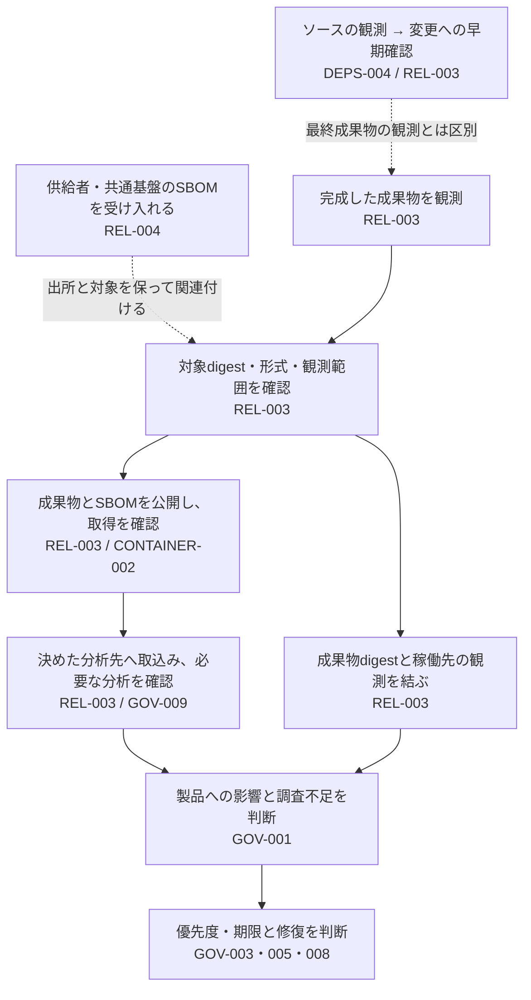

# SBOMから脆弱性の影響調査へつなぐ

設計ID: `ENG-REL-003`。SBOMを作る地点、配布する成果物、分析先、稼働先をつなぐ設計です。Control IDは`PSB-`を省略しています。

## 完成した製品のどこに影響があるかを探す

依存部品の脆弱性が公表されても、PRで作った部品一覧しかなければ、ビルドで追加された部品や実際の稼働先を見落とします。リリース担当者とPSIRTが、**どの成果物の何を観測したSBOMかを保ち、分析結果から影響する稼働先をたどれる構成**を選びます（REL-003 / GOV-001）。

供給者のSBOMは受領時にREL-004で確認し、自組織の最終成果物の観測と関連付けます。分析できたことと、その脆弱性が製品に影響するか、いつ直すかは分けます。公開から使用までの全体の接続は[ビルドした成果物を署名・公開し、使用するまで](release-build-to-use.md)で確認できます。

## 1. どこで取得した情報かを分ける（REL-003・004）

| どこで採取・生成するか | 何を観測するか | 主な用途 | Releaseの正本にするか |
|---|---|---|---|
| PR・push時などのsource tree | Lockfileや依存関係定義、採用を意図したcomponent。Commitへ結ぶ | 変更への早期feedback | しない。後のbuildで加わるcomponentは見えない |
| Image build・package組立の後、公開前のfinal artifact | 完成したimage・archive・binaryの実bytes、含まれるOS packageやbinary等。Artifact digestへ結ぶ | 配布物のinventory | する。ただしgeneratorが観測できた範囲に限る |
| Deployment時と稼働中の環境 | 実際に配置されたartifact digestと、環境で追加観測したcomponent。Deployment IDへ結ぶ | 稼働影響の検索 | しない。Build時の記録と別の観測としてつなぐ |

これは[利用者提供のSBOM lifecycle資料](../sources/README.md#ref-release-sbom-lifecycle-001)にある三つの取得地点を、release判断へ落としたものです。PR・push、image build直後、deployment・稼働中は代表例であり、全製品に固定するtriggerではありません。新しいartifactが生成・変化する箇所を洗い出し、その後のどのbytesを観測したかを決めます。

資料にはsupplierから調達時に受け取るSBOMと、platform teamが作る共通base imageのSBOMもあります。これらはfinal artifactの観測を代用しません。出所と対象digestを保って関係付け、supplierの署名・受入判断は別の境界で扱います。

例えばbase imageへアプリケーションや追加packageを載せた後は、完成したimageを対象に情報を取得します。Base imageの部品が削除・更新される場合もあるため、二つの一覧を単純に足して完全としません。供給者・共通基盤からの受領時点の確認は[Supplier SBOM intake boundary](../controls/records/release-integrity/psb-rel-004-supplier-sbom-intake-trust/README.md)へ分けます。

同じcatalogへ入れる場合も、document identity、取得時刻、tool・version・設定、subject、authorityを保持します。Source SBOMへOS packageを後付けしてbuild SBOMに見せたり、operations observationでrelease inventoryを上書きしたりしません。稼働中のmemory上のcomponentをすべて観測できたとも仮定しません。

## 2. 完成した成果物とSBOMを結ぶ（REL-003）

SBOM generatorは対象artifactの組立後に実行し、可能ならartifact自体をscanします。Ecosystem manifest、lockfile、container filesystem、archive、native binary、static link、vendor directory、plugin、download等、artifact typeごとのsurfaceを列挙し、採用toolが観測できる範囲と除外を記録します。

Binding recordには少なくとも次を含めます。

- Artifactのimmutable identityとcryptographic digest。
- SBOM bytesのdigest、format・version、serial、document version。
- Root component identityと、artifact digestを表すhash。
- Observation phase、generator identity・version・設定identity。
- Composition／coverage claimと既知の除外。
- 生成・検証result。失敗時はreleaseを止める状態。

ArtifactとSBOMを同じworkspaceで検査しても、その後別bytesへ置き換えられればbindingは切れます。検査したdigestをpublication requestとrelease manifestへ渡し、後段で再計算します。

`post-build`やroot hashを後から書くだけでは、観測元は変わりません。生成ツールへ渡した入力、対象digest、実行結果と既知の除外を生成経路で確認します。完成物を直接読む方式だけでなく、ビルド時の記録を完成物と照合する方式でも、実際に含まれた部品と対応付ける必要があります。

## 3. 形式の正しさと観測範囲を分ける（REL-003 / GOV-009）

Version-pinned schema validatorでformatを検査します。その後、組織のcontractとしてroot identity、versioned PURL等のcomponent identity、`bom-ref`の一意性、dependency・assemblyの参照整合性、composition stateを確認します。

Schema validationとrelationship consistencyは自動化できます。一方、`complete`の正当性は、generator方式、対象surface、除外、build recipe、比較対象で判断します。Toolが観測しないsurfaceがあれば`incomplete`や`unknown`を保ち、警告を消すために`complete`へ変えません。

## 4. 成果物とSBOMを一緒に公開する（REL-003 / CONTAINER-002）

ArtifactとSBOMが別APIで公開されるなら、両方とbinding relationがintended consumerから取得可能になるまでreleaseを`preparing`または`incomplete`にします。Filenameの近接だけに頼らず、artifact digestからSBOM digest・locationを決められるmanifest、registry relation、metadata API等を使います。

保持期間は固定日数ではなく、artifactの取得、support、稼働、監査、incident調査の期間に合わせます。訂正は同じSBOM identityの内容を黙って上書きせず、新しいversionまたはidentityとsupersedes／withdrawn関係で示します。

## 5. 分析先と取込権限を決める（REL-003）

Analysis platformのprojectをproduct nameだけで自動作成すると、似た名前やmutable versionへSBOMが混ざります。Exact project IDとrelease versionを先に決め、upload専用identityは必要なprojectと操作だけへ限定します。Portfolio検索、policy変更、system設定、project作成は別のauthorityにします。

SBOMはuntrusted inputです。Transport認証、size・timeout、schema、parser isolation、logの値最小化を設定します。API key、Authorization header、SBOM本文、internal endpoint、全findingを処理receiptへ複製しません。

## 6. 受付と分析完了を分ける（REL-003 / GOV-009）

Provider固有の状態を次の共通意味へ正規化します。

| 状態 | 意味 | Release／判断での扱い |
|---|---|---|
| `ACCEPTED` | Transportがrequestを受け付けた | 完了ではない |
| `VALIDATED` | Formatとproviderの入力検査を通過 | Analysis完了ではない |
| `INGESTED` | 対象projectへのSBOM取込が完了 | SBOMとprojectを照合する。脆弱性分析の完了とは分ける |
| `ANALYZED` | 必要な分析の完了を対象SBOM・projectへ結び付けて確認した | データ鮮度と結果取得範囲も確認して判断へ渡す。脆弱性なしという意味ではない |
| `REJECTED` | Validationまたはpolicy違反 | Release／analysisを止める |
| `ERROR` | Processing failure、timeout、collector・analyzer・data障害、結果不完全 | Cleanにせず再試行・調査へ渡す |

Dependency-Track 4.14 documentationでは`BOM_CONSUMED`と`BOM_PROCESSED`が区別され、processing／validation failure eventもあります。実装時は対象releaseのOpenAPI、permission、notification schemaを再確認し、event名だけでなくSBOM・project identityを照合します。

4.14.3の[BomUploadProcessingTask](https://github.com/DependencyTrack/dependency-track/blob/4.14.3/src/main/java/org/dependencytrack/tasks/BomUploadProcessingTask.java)では、脆弱性分析イベントを後続処理へ登録してから`BOM_PROCESSED`を通知し、その後にイベントを配送します。この通知を`ANALYZED`へ対応付けません。必要な分析の完了を取得できない構成では未確認として残します。上表は本PJの状態の意味であり、製品APIの状態名ではありません。

## 7. 分析の動作状況と結果を分ける（REL-003 / GOV-009）

検出0件は、対象の部品が正しく識別され、必要な脆弱性情報が新しく、結果を全件取得でき、解析・分析処理が正常だった場合にだけ結果として扱えます。PURL、CPE、alias、version rangeの品質によるfalse positive／negativeも残ります。

処理記録には、SBOMのdigest・serial、分析先のID・版、処理結果と時刻、使用した製品・APIの版、収集範囲、必要な情報源の動作状況だけを残します。状態を取得できないときに、正常だったことにしません。

## 8. 稼働先と製品への影響を調べる（REL-003 / GOV-001・003）

稼働先の記録には、環境、配備の識別子、実際に観測した成果物のdigest、観測時点、収集した主体と動作状況を残します。リリースSBOMとdigestで結び、部品から成果物、稼働先、担当者をたどれるようにします。

稼働中に新しい部品を見つけても、配布時のSBOMを上書きせず、追加の観測として関連付けます。収集対象の不足、権限不足、古い観測、取得漏れは「該当する稼働先なし」ではなく評価不能です。

## 接続方法を選ぶ（REL-003・004 / GOV-001・009）

| 判断 | 選択肢 | 主な代償 |
|---|---|---|
| 生成時点 | Source、build中、post-build scan、複数の併用 | 早期feedbackとfinal bytesのcoverageは同じではない |
| Format | CycloneDX、SPDX | Parser、schema、identity、relationship、consumer対応をformat・versionごとに検証する |
| Binding | Root component hash、release manifest、registry attachment、外部index | SBOM内のhashだけではpublication後の関係やauthenticityを保証しない |
| Publication | Release sidecar、package／OCI registry、metadata API | Consumer discovery、immutability、retention、accessが製品ごとに変わる |
| Analysis | Dependency-Track等のportfolio platform、ecosystem service、独自index | Project identity、非同期state、権限、data source healthのadapterが必要 |
| Operations join | Deployment inventory、CMDB、orchestrator、runtime collector | Collector coverageとartifact digestの取得可能性が制約になる |

## 工程の間で見落としやすいこと（REL-003・004 / GOV-009）

- Source manifestから作ったSBOMをfinal binaryやimageの正本にする。
- Product version、filename、`latest`だけでartifactとSBOMを結ぶ。
- CycloneDX／SPDXとしてparseできることを、component coverageの証明にする。
- `complete`をgeneratorの観測能力・除外と照合しない。
- Artifactを先に公開し、SBOM失敗時もrelease completeにする。
- Publisher credentialからだけdownloadできる状態をconsumer availabilityとする。
- Analysis projectをauto-createし、似た名前やmutable versionへ混ぜる。
- Upload tokenまたは`BOM_CONSUMED`をanalysis完了にする。
- Processing failure、stale data、page欠落を0 findingsへ変える。
- Source、build、operationsのserialを再利用・上書きする。

## 手元で確認できる実装（REL-003）

[CycloneDX 1.7 artifact binding](implementations/cyclonedx-artifact-binding/README.md)は、実artifact bytesのSHA-256とSBOM root hashを照合し、build／post-build phase、serial・version、versioned PURL、`bom-ref`、dependency relation、明示されたcomposition stateを検査します。標準libraryだけで動き、手元のrepositoryへ導入できます。

この実装はCycloneDX schema全体、generator coverage、publication、Dependency-Track、deployment catalogを実装しません。採用時は公式schema validatorや既存の製品連携を含め、これらを確認する方法を別に選びます。

Phaseとhashの申告が一致することと、その成果物からSBOMを生成したことは別です。実装の成功を`SBOM-REL-1`全体への合格にせず、生成経路と観測範囲の確認へ戻します。追加adapterは既存製品で不足する接続・確認に実効性がある場合だけ選びます。

## 診断で確認する項目の正本

製品非依存の項目は[PSB-REL-003](../controls/records/release-integrity/psb-rel-003-release-sbom-identity-and-analysis/README.md#failure-checks)にあります。具体実装ではartifact変更、phase違い、dangling reference、unknown composition、malformed JSONをローカルで確認します。Storageとanalysis platformでは、consumer access、部分公開、誤project、processing failure、timeout、stale data、pagination不足をlive environmentで追加します。

## この設計の範囲

[PSB-REL-003](../controls/records/release-integrity/psb-rel-003-release-sbom-identity-and-analysis/README.md)の`SBOM-REL-1`〜`8`を、observation、binding、format、coverage、publication、analysis intake、processing health、deployment joinへ配置します。

この文書自体はSBOMを生成・公開せず、分析基盤へ接続しません。実装例が確認するのはartifact bindingとCycloneDX文書内の限定contractです。[Supplier SBOMの受入れ](../controls/records/release-integrity/psb-rel-004-supplier-sbom-intake-trust/README.md)はREL-004、vulnerability priorityはGOV-003、impact responseはGOV-001、scanner自身の証拠はGOV-009が別に扱います。

## 根拠

- [REF-RELEASE-SBOM-LIFECYCLE-001](../sources/README.md#ref-release-sbom-lifecycle-001)
- [移行記録](../docs/MIGRATION_RELEASE.md#release-sbom-migration)

影響候補・対象外と判断できた範囲・調査不能は[GOV-001](../controls/records/governance-operations/psb-gov-001-supply-chain-impact-assessment/README.md)へ、修復の優先度と期限は[GOV-003](../controls/records/governance-operations/psb-gov-003-vulnerability-priority-decision/README.md)へ渡します。分析処理や情報源の証拠は[GOV-009](../controls/records/governance-operations/psb-gov-009-scanner-evidence-trust-boundary/README.md)で確かめます。
