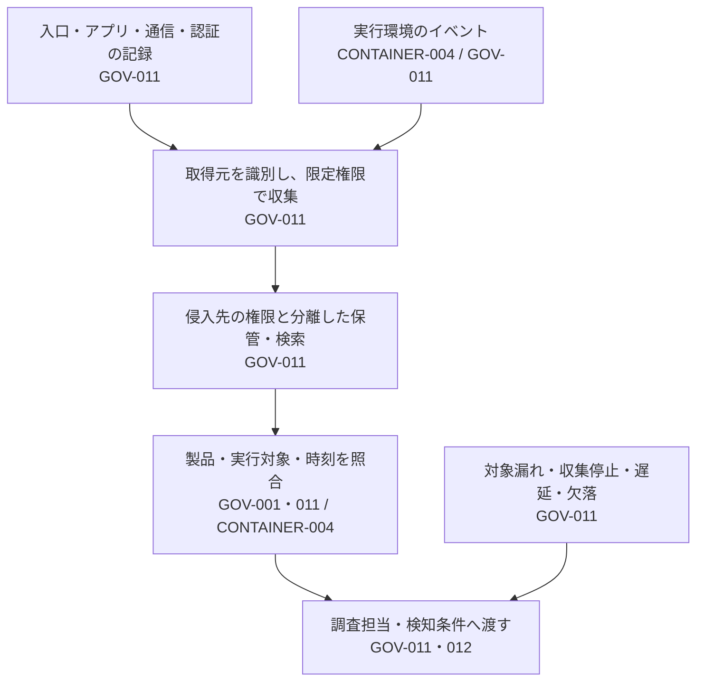

# 調査に使う記録を集め、守り、検索する

設計ID: `ENG-GOV-008`。Control IDは`PSB-`を省略しています。

公開アプリへの攻撃から内部操作まで、異なる場所の記録を使って調べる設計です。担当はアプリ・基盤・SOCです。すべてのログを集める前に、調べたい操作と必要な取得元を決めます。

## 記録が調査へ届く構造（GOV-011・012 / CONTAINER-004）

取得元の内容は攻撃者が操作した値を含み得ます。検索画面や通知で実行させず、構造化・エスケープして扱います。取得元が名乗るユーザー名や時刻だけを信用せず、認証された配送元や基盤の識別情報と照合します。別保存先で守れるのは受信した記録であり、取得前の改ざんや記録停止を完全に防ぐものではありません。

## 一つのサービスから決める（GOV-001・011 / CONTAINER-004）

| 調査する問い | 必要な取得元の例 | 選ぶ際の確認 |
|---|---|---|
| 入口を通ったか | リバースプロキシ、WAF、アプリ受付 | 拒否理由、経路、request識別子の取得可否。WAFがない構成もある |
| 何をされたか | アプリの操作記録、実行環境のイベント | 業務上の操作とプロセス等の行動は別。コンテナ・VM・サーバーレスで取得可能な情報が異なる |
| 内部へ広がったか | 接続の記録、移動先の認証・操作記録、管理API | 接続と認証と操作を分ける。許可済み通信の悪用も対象 |
| どの製品に及ぶか | 資産台帳、稼働情報、CI実行と成果物の記録 | 名前や可変tagだけで照合しない。短命な対象の世代も追う |

取得元ごとに、対象、担当者、必要項目、取得方法、保存期間、通常の遅延、障害の確認方法、閲覧者を決めます。サービスの追加・削除や権限変更時に、実際の収集対象との差を確認します。採用サービスの契約やAPI権限によって取得できない場合は、代替の観測方法または残る空白を示します。

## 保存と検索の選択（GOV-011）

| 方式 | 向く場面 | 代償・失敗しやすい点 |
|---|---|---|
| 各サービスで保存・検索 | 小さな範囲から始める。移送する機微情報を抑えたい | 保存期限や権限がばらばら。調査時に消えている・取得不能の恐れ。重要な記録は事前の保全方法が必要 |
| 共通の保護された保存先＋必要な範囲の検索 | 取得元をまたぐ調査や長期保全 | 収集・検索費用と運用責任が増える。保存先への権限集中を避ける |
| 重要イベントは検知基盤、他の必要記録は別保存 | 通知の速さと保存費用を分けて選びたい | 再調査時の取得時間、変換・除外で失う情報、別保存先との対応を管理する |

保存期間は調査に必要な期間と組織の義務・費用から決め、固定の推奨日数を置きません。大量通知用の検索と事後調査用の検索を分ける場合は、それぞれの担当者が必要な記録へ到達できるか確認します。標準機能で足りるなら独自collectorを作りません。

アプリの実行権限にログ保管先の削除権限を渡さず、配送・保管・閲覧を保護します。削除や保持設定を変える管理操作も追跡します。必要な場合は変更不能な保管を選びますが、費用や削除義務との調整が必要です。通常の調査結果は参照先と要点で共有し、token、認証ヘッダー、不要な本文を複製しません。

## 0件を解釈する前に（GOV-001・011・012）

検索条件・対象・期間・権限・取得完了を確認します。収集側の最終成功時刻とイベントの発生時刻を分け、遅延や時計のずれを記録します。通知の順番だけで攻撃の順序を作らないようにします。

静かなサービスでは「最近のイベントなし」だけで障害と判断できません。取得処理の成功、対象一覧、利用できるhealth情報、無害な試験イベントを組み合わせます。意図的なイベント送信も送信箇所から先だけの確認で、アプリ全体が記録できる証明ではありません。

保存や検索の一部が失敗した場合は、調べられた範囲と未確認範囲を渡します。遅れた記録を再取得するときは重複を識別し、新しい操作を既存の一件へ潰さないようにします。復旧不能な欠落は欠落として残します。

## 導入と確認（GOV-011・012）

一つの非本番サービスで、正常な操作の記録を生成し、別の担当者が検索して対象を照合します。収集停止、項目欠落、対象外、検索権限不足、短命な実行環境の破棄を安全な範囲で確かめてから対象を広げます。試験記録を検索できた結果と本番の全対象・全期間の状態は区別します。

診断項目の正本は[GOV-011](../controls/records/governance-operations/psb-gov-011-security-event-evidence/README.md#failure-checks)です。[教材](../controls/records/governance-operations/psb-gov-011-security-event-evidence/learning.md)で入口から内部までの読み方を確認できます。記録を使う条件は[Detection Engineering](detection-engineering-lifecycle.md)、コンテナ固有のセンサーは[既存runtime設計](runtime-detection-to-triage.md)へ渡します。

根拠は[共同ガイダンス](../sources/README.md#ref-security-event-logging-001)。方式の選択と試験の組合せは本PJの設計判断です。今回はガイダンスで完了とし、製品固有の実装例は追加しません。実際の収集・保存・検索は未確認です。

調査と処置の全体は[問題の発見から対応・再開まで](security-signal-to-response.md)で確認できます。
