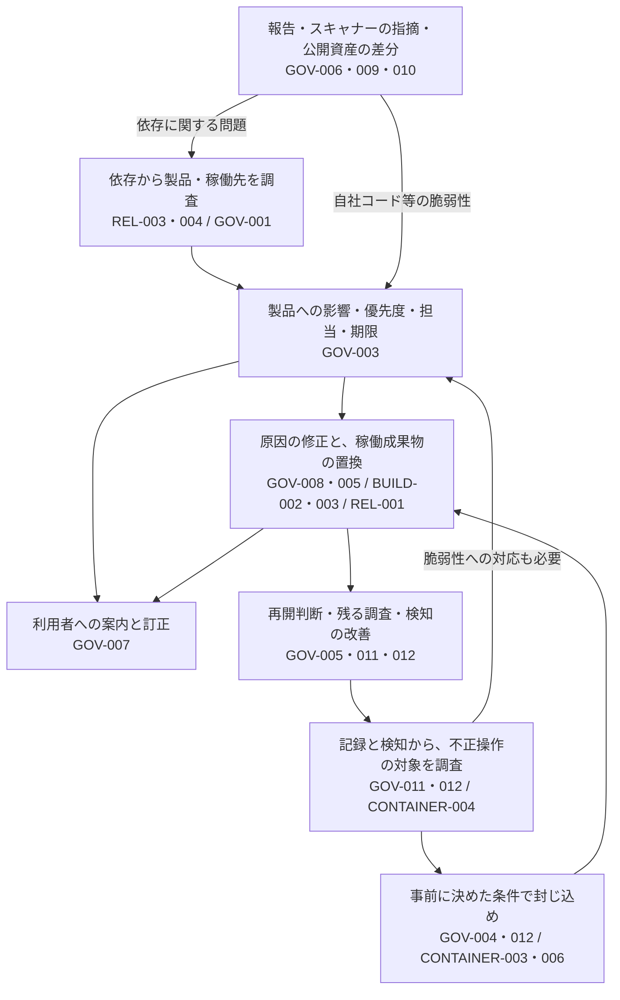

# 問題の発見から対応・再開まで

設計ID: `ENG-GOV-001`。PSIRT、SOC、開発・基盤・運用担当が、影響調査と実際の処置をつなぐための設計です。Control IDは`PSB-`を省略しています。

公開アプリが内部の管理APIを呼び出したという通知が届いたとします。同時に、そのアプリが使う依存部品の脆弱性情報も見つかりました。部品を含むだけでは侵害されたとは言えず、通知が来ただけでも停止する対象は確定しません。一方、内部操作が続いているなら、全製品の調査完了を待つ間に被害が広がります。

この場面では、**影響する製品を探す作業と、進行中の被害を止める作業を並行し、根拠・対象・未確認範囲を共有する**構成を選びます。通知の重大度だけを広範囲の停止権限へ変えません。

## 二つの入口と、担当者間の受け渡し

[GOV-001](../controls/records/governance-operations/psb-gov-001-supply-chain-impact-assessment/README.md)は依存に関する影響調査のControlです。アプリへの侵入全般をSBOM検索で調べるものではありません。不正操作から始める場合は、下の[封じ込めと再開](#intrusion-containment)へ進みます。認証情報の漏えいが分かった場合は、[GOV-004](../controls/records/governance-operations/psb-gov-004-credential-exposure-containment/README.md)の停止と調査を並行します。

公開資産の差分は、まず管理責任と意図した公開かを確認します。すべてを脆弱性や侵害として扱うのではなく、台帳の更新、公開設定の是正、追加調査へ振り分けます。図は問題に応じて選ぶ経路であり、全案件を全工程へ通す手順ではありません。

| 受け渡し | 次の担当が判断するために渡すもの | 取り違えやすいこと | Control |
|---|---|---|---|
| 発見 → 調査 | 報告・観測元、対象候補、時刻、調査できた範囲と失敗 | 重複という理由で、新しい影響版や移動先を捨てる | [GOV-006](../controls/records/governance-operations/psb-gov-006-vulnerability-report-intake/README.md)・[GOV-009](../controls/records/governance-operations/psb-gov-009-scanner-evidence-trust-boundary/README.md)・[GOV-010](../controls/records/governance-operations/psb-gov-010-external-attack-surface-reconciliation/README.md)・[GOV-012](../controls/records/governance-operations/psb-gov-012-detection-and-response-readiness/README.md) |
| 調査 → 対応担当 | 正確な製品・版・成果物・稼働先、影響根拠、不明点、担当者と期限 | 検索0件を全製品の非該当にする | [GOV-001](../controls/records/governance-operations/psb-gov-001-supply-chain-impact-assessment/README.md)・[GOV-003](../controls/records/governance-operations/psb-gov-003-vulnerability-priority-decision/README.md)・[GOV-011](../controls/records/governance-operations/psb-gov-011-security-event-evidence/README.md) |
| 初動 → 復旧担当 | 止めた権限・通信・公開物、残る接続や移動先、通常業務への影響 | 元のアプリを止めただけで、別環境の権限も止まったとする | [GOV-004](../controls/records/governance-operations/psb-gov-004-credential-exposure-containment/README.md)・[GOV-012](../controls/records/governance-operations/psb-gov-012-detection-and-response-readiness/README.md) |
| 修正 → 配布・置換 | 確認した悪用条件、対象版、修正を含む成果物のdigest、未確認版 | 主ブランチのテスト成功を、配布版すべての修正とする | [GOV-008](../controls/records/governance-operations/psb-gov-008-vulnerability-remedy-validation/README.md)・[GOV-005](../controls/records/governance-operations/psb-gov-005-deployed-artifact-recovery/README.md) |
| 対応 → 利用者 | 影響版、回避・更新方法、提供状態、連絡の成功と未到達先 | 修正版の公開を通知完了とする | [GOV-007](../controls/records/governance-operations/psb-gov-007-vulnerability-advisory-and-notification/README.md)・[GOV-008](../controls/records/governance-operations/psb-gov-008-vulnerability-remedy-validation/README.md) |
| 再開 → 継続監視 | 再開した範囲、残る調査、必要な記録・検知、次の確認担当 | 成果物の置換完了をインシデント全体の復旧とする | [GOV-005](../controls/records/governance-operations/psb-gov-005-deployed-artifact-recovery/README.md)・[GOV-011](../controls/records/governance-operations/psb-gov-011-security-event-evidence/README.md)・[GOV-012](../controls/records/governance-operations/psb-gov-012-detection-and-response-readiness/README.md) |

調査担当は検索条件と範囲、ビルド担当は成果物との対応、運用担当は実際の稼働、対応責任者は処置の権限と影響を確認します。収集・分析基盤が示す識別子も、元の記録と照合してから使います。

## 検索0件を判定する前に（GOV-001 / REL-003・004）

「一致なし」は検索APIの返答です。製品についての「該当なし」に進める前に、次の範囲を同じ調査時点で確認します。

| 確認する範囲 | 欠けている場合 |
|---|---|
| 対象製品・版とSBOMの取得地点、収集対象、除外条件 | ソースSBOMにない部品を、完成物にもないとは言えない |
| 成果物digestとSBOMの対応、分析基盤での取込と必要な分析の完了 | 別成果物や処理途中の結果を使う恐れがある |
| 対象projectへの閲覧権限、全ページ、検索条件と結果時刻 | 見えていない製品・結果が残る |
| 稼働環境の観測範囲、時刻、成果物digestとの対応 | リリース済みと稼働中、未観測と非稼働を区別できない |

各条件が満たされても「該当なし」は示した製品・環境・時点・収集範囲に限ります。一部だけ確認できた場合は、その部分の非該当と残る調査不能を併記します。SBOMの生成と分析状態の確認方法は[REL-003の設計](sbom-to-vulnerability-response.md)、供給者SBOMの訂正・撤回は[REL-004](../controls/records/release-integrity/psb-rel-004-supplier-sbom-intake-trust/README.md)を参照します。

GOV-003へは、影響候補、範囲付き非該当、調査不能のどれかに加え、対象・観測時刻・根拠・不足情報・再確認担当を渡します。GOV-003が露出、深刻度、悪用情報、組織方針を合わせて優先度を決めます。調査不能は担当者を置いて再調査または暫定対応を選ぶ材料であり、自動的な低優先度や最高優先度ではありません。

## 影響調査の方式を選ぶ（GOV-001・009・011）

| 方式 | 向く状況 | 代償・確認事項 |
|---|---|---|
| 手元に保全した台帳を検索 | 管理範囲が限られ、調査時点の台帳を保全できる | 更新漏れ、対象漏れ、異なるパッケージ体系の名前・版の違いを管理する |
| 分析基盤で検索し、元の証拠と照合 | 製品をまたいで部品や脆弱性情報を検索したい | 閲覧権限、全ページの取得、分析完了、情報の鮮度、API仕様を確認する。分析基盤だけを正本にしない |
| 稼働状況の収集結果と照合 | 実際に動いているサービス・環境を特定したい | Cluster・namespace・短命な処理の観測範囲、時点、収集停止を明示する |

Dependency-Trackは二番目の方式の候補であり必須製品ではありません。旧4.14.3向けの模擬データや想定した応答形式を、現行APIの保証として使いません。
検索の読取り権限をSBOM登録や対応操作の権限から分け、秘密情報や取得した本文を共有レポートへ持ち込みません。

## 処置の条件と権限を決める（GOV-004・005・012）

証拠保全、配布停止、認証情報の失効、成果物・cacheの隔離、承認した入力での再ビルド、関係者への連絡について、
対象、担当者、承認、実行条件、通常業務への影響、確認方法を決めます。危険な操作を検索結果から自動実行しません。
緊急封じ込めと保全を並行する条件も事前に決めます。復旧後の監視と再侵入確認は別の手順です。

## 工程の間で確認すること（GOV-001・005・009・011・012）

閲覧権限で製品が欠ける、次ページを取得しない、別のSBOMを使う、tagで同一性を判断する、収集停止を0件とする、承認条件なしで削除する、といった失敗を確認します。
組織での演習では既知の対象を含む非本番調査を行い、独立した資産一覧と照合し、権限不足・収集停止が未解決として担当者へ届くことを確認します。
模擬データでの成功だけで、本番の調査範囲や対応能力を判定しません。実対応の演習は別の承認・範囲で行います。

## 公開サービスへの侵入から、横展開の封じ込めへ（GOV-004・005・011・012）

ここからは依存部品の検索とは異なり、侵入後の操作を観測した場合の対応設計です。[GOV-012](../controls/records/governance-operations/psb-gov-012-detection-and-response-readiness/README.md)から対象・根拠・未確認範囲を受け取り、SOC、アプリ、基盤、認証基盤の担当者で処置を決めます。既存のSBOM検索で全被害を把握できるとは扱いません。

| 判断 | 処置の選択と代償 | 効果の確認 |
|---|---|---|
| 侵入先が内部へアクセスしている | 対象の通信制限・隔離・停止を選ぶ。停止は通常業務や揮発する証拠に影響する。証拠保全と緊急封じ込めを並行し、全調査を待たない | 設定の受理だけでなく、問題の経路が止まったか、迂回先・既存接続が残らないかを見る |
| 認証情報が悪用された疑いがある | GOV-004へ権限・利用先・時刻を渡す。ネットワーク隔離だけでは別環境から使える権限を止められない | 古い権限と派生セッションの利用拒否、新しい権限で必要な処理が動くかを確認する |
| VMや管理APIへ広がった | 移動先のログ、追加された鍵・アカウント・ロール・定期処理等を調査する。VMなら信頼できる状態からの再構築も選ぶ。管理APIでは実行元の隔離と権限の失効を別々に判断する | 元の侵入先だけでなく移動先と残存アクセス経路の処置結果を確認する |
| 公開物や配備先が変えられた | 公開・配備を制限し、GOV-005へ影響する成果物を渡す | 正しい置換先の稼働、旧版の非稼働、再配布・切り戻し経路を確認する |

処置ごとに対象、判断者、実行者、許可範囲、通常業務への影響、確認方法、解除条件を決めます。既に承認された緊急対応の条件内なら、毎回新たな承認を待つ運用にはしません。逆に対象を特定できない通知だけで、広範囲を自動停止しません。操作権限や連絡先が使えない場合の引き継ぎも決めます。

再開前には、入口の修正、移動先の調査、追加された権限・不正な処理の除去、必要なサービスの正常動作を確認します。データの持ち出し・改変が疑われれば、データ所有者と組織のインシデント対応へ渡します。復旧は漏えいの取消しではありません。未観測の対象は担当者と次の行動を残し、全体を復旧済みにしません。[成果物の復旧設計](deployed-artifact-recovery.md#incident-recovery-boundary)が扱う範囲も区別します。

机上演習では、隔離権限なし、移動先ログの欠落、token失効失敗、一部環境だけ復旧、隔離による監視断を取り上げ、誰が判断を引き継ぐか確認します。実操作を試す場合は許可された非本番対象に限定し、処置の効果と解除を別に確かめます。

根拠は[NISTの封じ込め・除去・復旧のガイダンス](../sources/README.md#ref-security-operations-lifecycle-001)です。上の具体的な分担は本PJの設計判断で、実操作は未確認です。この追記は既存GOV-001を全インシデント対応のControlへ拡張するものではありません。VM・管理APIを含む独立した封じ込めControlは今回追加せず、設計ガイダンスと診断観点で扱います。

## 再開の条件を一つの「完了」へまとめない（GOV-002・005・007・008）

修正の検証、古い成果物の非稼働、残存アクセスの除去、利用者への到達は別の結果です。たとえば修正版を配置しても、移動先の調査が終わっていないなら、成果物の置換状況と未解決の侵入経路を分けて残します。修正がまだでも、利用者に必要な回避策を知らせる判断はできます。

期限付きの例外は[GOV-002](../controls/records/governance-operations/psb-gov-002-security-exception-lifecycle/README.md)で対象と期限を絞ります。例外の承認で元の検査結果や対応期限を消さず、期限切れのときにどの担当が元の拒否・是正へ戻すかを決めます。

[記録の収集・保護・検索](security-event-collection-and-investigation.md)、[検知の検証・配備・改善](detection-engineering-lifecycle.md)、[再ビルドから稼働成果物の置換まで](deployed-artifact-recovery.md)はそれぞれの設計へ進みます。各Controlの条件を重ねて実行しただけで全被害を把握できるとはせず、未確認の対象と次の行動を残します。

## 関連資料と未移植範囲

[Control](../controls/records/governance-operations/psb-gov-001-supply-chain-impact-assessment/README.md)、
[教材](../controls/records/governance-operations/psb-gov-001-supply-chain-impact-assessment/learning.md)、[仕様・採否](../sources/README.md#ref-supply-chain-impact-001)を参照してください。
旧JSON検査・対応手順の生成器は移植しません。文書と診断項目でこの主題の範囲は完了です。分析基盤への実接続、稼働状況の収集、実対応は未検証であり、採用先で導入・確認に役立つ場合だけ具体化します。
