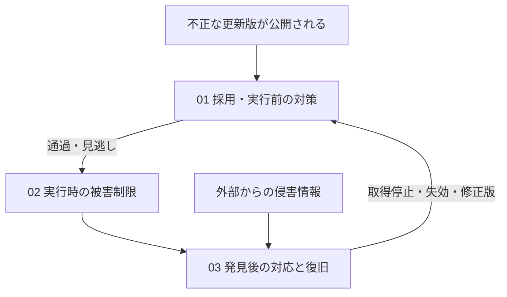

# 依存プログラムのマルウェア化に備える多層防御

普段使っている依存パッケージを更新したところ、その版に認証情報を盗む処理が混ざっていたとします。開発端末でのinstall、CIのテスト、本番のアプリ実行のどこで動くかによって、盗まれる情報と被害は変わります。これは設計を考えるための想定例です。

このガイドは、開発者・Platform・Product Security・運用担当者が、**信頼して使っていた依存プログラムが突然マルウェア化することに、複数のControlを組み合わせて備える**ためのものです。

一つ一つの対策を完璧にすることは難しいため、採用・実行を防ぐ対策、実行されても被害を抑える対策、判明後に回復する対策を重ねます。対策の数を増やすだけでは足りません。ある対策を通過したときに何が残るか、同じ迂回経路で複数の対策が無効にならないかを確かめます。

出発点は[七つの実装原則](../sources/guidance/supply-chain-principles.md)です。以下は現行Controlに合わせた本PJの設計上の解釈であり、七原則の導入による完全な防御や準拠を示しません。[原資料の採否](../sources/README.md#local-supply-chain-principles)も参照してください。

## 七つの原則を組み合わせる

取得先の管理とクールダウンは、どちらも原則2に含みます。管理されたRegistry・Proxyは取得経路と配布可否を制御し、クールダウンは公開直後の採用を遅らせます。役割が異なるため、片方だけで両方を満たしたとは扱いません。

| 原則 | どこで何を防ぐか | 通過してしまう条件 | 補う対策・関連Control |
|---|---|---|---|
| 1. インストール時のコード実行を制限する | 端末とCIで、不要なinstall scriptやソースビルドを実行させない | テスト・ビルド・アプリ実行で読み込まれる不正コードは残る | 実行時の隔離と権限制限へつなぐ。[DEPS-002](../controls/records/dependency-security/psb-deps-002-install-execution-policy/README.md)、[BUILD-001](../controls/records/build-security/psb-build-001-build-containment/README.md) |
| 2. 取得経路を管理し、公開直後の採用を待つ | 管理されたRegistry・Proxyと待機期間を使い、未許可の取得や公開直後の更新を抑える | 手動取得の迂回、待機後も発見されない不正コード、既に取得した版の利用 | 取得物の一致、変更レビュー、実行制限を重ねる。[DEPS-001](../controls/records/dependency-security/psb-deps-001-dependency-release-cooldown/README.md)、[DEPS-005](../controls/records/dependency-security/psb-deps-005-dependency-acquisition-gate/README.md) |
| 3. 承認した依存と取得物を一致させる | 通常installでlockfileと直接・推移依存、取得物のhashを照合する | 承認した版自体が悪意あるものならhashは一致する | 変更時の審査と、通過後の隔離が必要。[DEPS-003](../controls/records/dependency-security/psb-deps-003-dependency-artifact-identity/README.md)、[DEPS-004](../controls/records/dependency-security/psb-deps-004-dependency-change-review/README.md) |
| 4. 依存の変更をレビューする | 更新時に直接・推移依存、取得元、差分、利用できる検査情報を確認する | 難読化、情報不足、検査対象外などで見逃す | レビュー済みでも権限を絞り、判明後に追跡できるようにする。[DEPS-004](../controls/records/dependency-security/psb-deps-004-dependency-change-review/README.md)、[BUILD-001](../controls/records/build-security/psb-build-001-build-containment/README.md)、[REL-003](../controls/records/release-integrity/psb-rel-003-release-sbom-identity-and-analysis/README.md) |
| 5. 署名と来歴を確認する | 利用側で出所・生成条件・対象成果物を期待値へ照合する | 正規の発行者や承認したビルド経路から、不正な版が配布されることもある | 正当な出所と無害性を区別し、実行制限と影響調査を残す。[REL-001](../controls/records/release-integrity/psb-rel-001-signature-provenance-verification/README.md)、[BUILD-003](../controls/records/build-security/psb-build-003-platform-provenance-generation/README.md) |
| 6. 権限・認証情報・通信を絞る | 端末・ビルド・本番で、不正コードが秘密や公開・配備権限へ到達する範囲を減らす | 必要な権限の悪用、許可された通信先への送信、共有状態を経由する迂回 | 不審な操作の検知と、認証情報の失効を用意する。[SOURCE-007](../controls/records/source-protection/psb-source-007-developer-local-credential-storage/README.md)、[BUILD-001](../controls/records/build-security/psb-build-001-build-containment/README.md)、[CICD-004](../controls/records/cicd-security/psb-cicd-004-workflow-authority-minimization/README.md)、[CONTAINER-006](../controls/records/container-cloud-iac-security/psb-container-006-workload-network-segmentation/README.md)、[GOV-011](../controls/records/governance-operations/psb-gov-011-security-event-evidence/README.md) |
| 7. 利用箇所を把握して対応する | 判明後に依存・成果物・稼働先を結び、停止・失効・修正・復旧する | 台帳の欠測、SBOMの収集範囲外、把握していない端末や稼働先がある | 不明を解消し、旧版の停止と失効を別々に確認する。[REL-003](../controls/records/release-integrity/psb-rel-003-release-sbom-identity-and-analysis/README.md)、[GOV-001](../controls/records/governance-operations/psb-gov-001-supply-chain-impact-assessment/README.md)、[GOV-004](../controls/records/governance-operations/psb-gov-004-credential-exposure-containment/README.md)、[GOV-005](../controls/records/governance-operations/psb-gov-005-deployed-artifact-recovery/README.md) |

クールダウンの経過、正しいhash、署名、SCAの指摘なしは、いずれも無害性の保証ではありません。これらは判断材料や個別の境界であり、互いの限界を補うために使います。

## 同じ不正な更新を、どこで止めるか

この図は一本道の検査順序ではありません。取得の制御、実行の制限、監視は各環境で働き、外部情報から先に侵害が判明する場合もあります。

### 01 採用・実行前：更新Botを通らない取得も守る

更新Botが待機条件を守っても、開発者が公開Registryから手動installすれば迂回できます。管理された取得経路を端末とCIの両方に適用し、直接取得や別の設定による迂回を確認します。取得済みのcacheについても利用を続けてよいか判断します。

変更の審査後にlockfileを変更できるなら、承認した依存を使ったことになりません。更新と通常installを分け、通常installでは承認済みの入力を使います。詳細は[依存を追加・更新して、ビルドへ渡す](dependency-update-to-build.md)へ進みます。（[DEPS-001](../controls/records/dependency-security/psb-deps-001-dependency-release-cooldown/README.md)、[DEPS-003](../controls/records/dependency-security/psb-deps-003-dependency-artifact-identity/README.md)、[DEPS-004](../controls/records/dependency-security/psb-deps-004-dependency-change-review/README.md)、[DEPS-005](../controls/records/dependency-security/psb-deps-005-dependency-acquisition-gate/README.md)）

### 02 実行時：installを止めても終わりではない

install scriptを止めても、テストが依存を読み込めば不正コードが動く可能性があります。開発端末の認証情報を読める状態や、公開tokenを持つビルドjobでは、そこで被害が発生します。

実行に不要な認証情報を渡さず、ビルドと公開・配備の権限を分けます。job名だけを分けても、同じrunner、volume、cache、後続スクリプトで状態を引き継ぐなら境界は残りません。[PRからビルド・公開への引き渡し](pull-request-to-release-build.md)と[cacheとrunnerの設計](ci-state-and-runner-lifecycle.md)で接続を確認します。（[SOURCE-007](../controls/records/source-protection/psb-source-007-developer-local-credential-storage/README.md)、[BUILD-001](../controls/records/build-security/psb-build-001-build-containment/README.md)、[CICD-004](../controls/records/cicd-security/psb-cicd-004-workflow-authority-minimization/README.md)、[CICD-007](../controls/records/cicd-security/psb-cicd-007-runner-lifecycle-isolation/README.md)、[CICD-009](../controls/records/cicd-security/psb-cicd-009-cache-trust-boundary/README.md)）

本番まで到達した場合も、正規に配布されたイメージだから無害とは扱いません。[コンテナの実行から初動まで](container-deployment-to-response.md)で権限・通信・監視を組み合わせます。（[CONTAINER-004](../controls/records/container-cloud-iac-security/psb-container-004-runtime-threat-detection/README.md)、[CONTAINER-005](../controls/records/container-cloud-iac-security/psb-container-005-workload-privilege-confinement/README.md)、[CONTAINER-006](../controls/records/container-cloud-iac-security/psb-container-006-workload-network-segmentation/README.md)）

### 03 判明後：差し替えだけで復旧にしない

既に採用した版の侵害が後日判明したら、取得停止に加えて、どの端末・ビルド・成果物・稼働先で使ったかを調べます。SBOMは取得地点ごとに見える範囲が異なり、Build SBOMだけで全対象を把握したとはいえません。不明な範囲を残したまま「影響なし」にしないことが重要です。（[REL-003](../controls/records/release-integrity/psb-rel-003-release-sbom-identity-and-analysis/README.md)、[GOV-001](../controls/records/governance-operations/psb-gov-001-supply-chain-impact-assessment/README.md)）

不正コードが認証情報へアクセスできたなら、修正版への置換とは別に失効と利用履歴の調査が必要です。進行中の被害を止める措置と証拠保全を並行し、保全完了を一律に待って封じ込めを遅らせません。停止した操作、判断理由、取得できた記録と不足を残します。（[GOV-004](../controls/records/governance-operations/psb-gov-004-credential-exposure-containment/README.md)、[GOV-011](../controls/records/governance-operations/psb-gov-011-security-event-evidence/README.md)）

[SBOMから影響調査へ](sbom-to-vulnerability-response.md)、[問題の発見から対応・再開まで](security-signal-to-response.md)、[稼働成果物の置換](deployed-artifact-recovery.md)を使い、修正版の確認、旧版の非稼働、漏えい権限の失効をそれぞれ確かめます。（[GOV-005](../controls/records/governance-operations/psb-gov-005-deployed-artifact-recovery/README.md)、[GOV-008](../controls/records/governance-operations/psb-gov-008-vulnerability-remedy-validation/README.md)）

## 設計レビューで確かめること

- 更新Botを使わない手動取得でも、取得先と待機条件が適用されるか。
- install時の実行を止めた後、テストやビルドが動かすコードには何の権限があるか。
- 正しいhashと署名を持つ不正な版が通った場合、秘密の取得・公開権限の悪用・外部送信をどこで抑えるか。
- 同じrunnerやcacheを経由して、複数の対策がまとめて迂回されないか。
- 不審な操作を検知できるか。監視停止や記録の欠測を「異常なし」と扱わないか。
- 後から侵害が判明した場合、対象を探し、停止・失効・置換の担当者へ渡せるか。把握できない範囲を明示できるか。

これらは診断で確認する項目であり、テストコードの作成は必須ではありません。本ガイドは設計判断を示すもので、実環境の拒否・検知・復旧を確認した記録ではありません。
