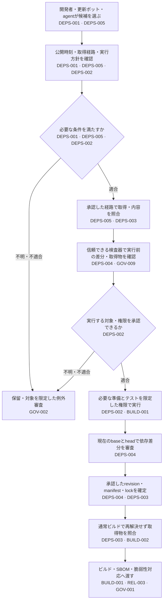

# 依存を追加・更新して、ビルドへ渡す

[サプライチェーン対策の入口](README.md)

更新ボットは公開直後の版を避けていても、開発者が手元で直接インストールすれば、その場で準備用コードが動くことがあります。さらに、PRでレビューしたlockfileをビルドが作り直せば、承認していない依存が製品へ入ります。

このガイドは開発者と基盤担当者が、**依存を選んだときの判断を、最初の実行と通常ビルドまで途切れさせない**ためのものです。個別の条件は各Controlを正本とします。開発から本番運用までの全体は[全体ガイド](../developer-to-production.md)を参照してください。

表記は`PSB-`を省略しています（例：`DEPS-001`＝`PSB-DEPS-001`）。図は主なControl、本文・表は各判断に関係するControlを示します。識別子は要件への案内であり、その要素全体への適合や導入済みを意味しません。

## どこで何を判断するか



取得前の判定だけで内容の同一性まで証明したことにはなりません。逆に、取得してから実行方針を決めると、情報収集や準備の段階でコードが動く経路に間に合いません。

| 場面・担当 | 次へ渡すもの | 対応Control |
|---|---|---|
| 候補の選択：開発者・更新ボット | 名前、版、取得元、公開時刻と待機条件の判断 | [DEPS-001](../../controls/records/dependency-security/psb-deps-001-dependency-release-cooldown/README.md) |
| 取得経路の設定：基盤担当 | 対象端末・CIと利用できる経路、遮断・追跡の範囲 | [DEPS-005](../../controls/records/dependency-security/psb-deps-005-dependency-acquisition-gate/README.md) |
| 初回実行前：開発者・基盤担当 | 対象を実行せずに調べた結果と未評価の範囲、実行を止める方針、または対象を限定した実行許可と隔離環境 | [DEPS-002](../../controls/records/dependency-security/psb-deps-002-install-execution-policy/README.md)、[GOV-009](../../controls/records/governance-operations/psb-gov-009-scanner-evidence-trust-boundary/README.md) |
| PRの審査：レビュー担当・CI管理者 | 現在のbase/head、直接・推移依存の差分、取得先・hash・準備処理の変更、重点レビューと判定の結果 | [DEPS-004](../../controls/records/dependency-security/psb-deps-004-dependency-change-review/README.md) |
| 通常ビルド：ビルド基盤担当 | 承認したrevision・manifest・lockと、実際に使うファイルの照合結果 | [DEPS-003](../../controls/records/dependency-security/psb-deps-003-dependency-artifact-identity/README.md) |

## 対策の間に残る穴を塞ぐ

<a id="external-install-routes"></a>

### npm・APT・GitHub Releases・直接ダウンロードを棚卸しする

例えば、同じCIジョブが `npm ci` でアプリの依存を入れ、DockerfileでAPTリポジトリからコンパイラを入れ、セットアップスクリプトでGitHub ReleasesからCLIを取るとします。CLIは製品に同梱されなくても、ビルド時にはソースと生成物を書き換えられます。npmのlockfileで照合できるのは、このうちnpmが管理する入力です。

| 取得経路 | 更新時にレビューして固定するもの | 通常の導入で、どこで確かめるか |
|---|---|---|
| npmレジストリのtarball | 対象OSで使う直接・推移依存、取得元、`package-lock.json` の各tarballの `integrity`（例：SHA-512） | `npm ci` でmanifestとの不一致を拒否し、lockを更新せず取得物を照合する。install scriptが別途取得するバイナリは直接ダウンロードの行でも扱う。 |
| APTリポジトリのパッケージ | リポジトリと信頼するアーカイブ鍵を対応付ける。ビルド入力を固定するには、承認した索引のスナップショットと解決結果、または推移依存を含む版・architecture・パッケージごとのハッシュを記録する。 | `Signed-By` で各リポジトリに使える鍵を絞る。APTは署名済みRelease情報からPackages索引、その索引から取得した `.deb` までを照合する。署名が有効でも索引の更新で選ばれる版は変わり得るので、承認した入力との一致も確認する。 |
| GitHub Releasesのasset | 期待するowner/repository、リリース、OS・architecture別のasset名とSHA-256を記録する。発行元・生成元も要件なら、期待する署名者やworkflowを先に決める。 | ダウンロードしたassetそのものを展開前に照合する。GitHub artifact attestationを使う場合は、そのファイルに対して期待するrepository・署名workflowを指定して検証する。タグや `latest` URLだけでは使うファイルを特定できない。 |
| 任意のURLからの直接取得（curl、wgetなど） | スクリプト、アーカイブ、単体バイナリ、直接配布の `.deb` ごとに、取得元と期待ハッシュをレビュー対象にする。初回の期待値は、事前に信頼した鍵で署名を検証したチェックサム一覧など、根拠をたどれるものを使う。 | 一旦ファイルに保存し、照合できた同じファイルだけを展開・インストール・実行する。curlの出力をそのままシェルへ渡すと照合が間に合わない。単体で受け取った `.deb` にもAPT索引の検証結果を流用できない。 |

HTTPSは接続先との通信を保護します。配布物とチェックサムを同じ可変URL群から毎回取り直すと、配布元で両方が差し替わった場合にも一致します。更新担当が根拠とともに承認した期待値を保護されたリポジトリに残し、通常ビルドはそれを読み取ります。検証に必要な鍵やツールも事前に用意します。[製品仕様と採否](../../sources/README.md#external-install-route-specs)

**推奨設定例（Debian trixie のAPT）**

Debian trixieの使い捨て環境で、配布済みの `debian-archive-keyring` を使う場合は、既存のAPTソースを確認し、対象リポジトリの `.sources` に次の対応を設定します。同じリポジトリを別の設定ファイルから重複登録しないよう確認し、既存のセキュリティ更新用ソースも保持します。

```text
Types: deb
URIs: https://deb.debian.org/debian
Suites: trixie
Components: main
Signed-By: /usr/share/keyrings/debian-archive-keyring.gpg
```

```sh
apt-get update
apt-get install --yes --no-install-recommends ca-certificates
```

APTでは、信頼するアーカイブ鍵とリポジトリを `Signed-By` で結び付ければ、通常の `apt-get update`・`apt-get install` が署名済みRelease情報、Packages索引、取得した `.deb` のハッシュの連鎖を検証します。このため、リポジトリ経由の各 `.deb` に個別のダウンロード・ハッシュ照合スクリプトを用意する作業が少なくなります。上の例が固定するのは取得元と鍵です。更新された索引から選ぶ版や推移依存までレビュー済みの入力へ固定するには、承認したスナップショットと解決結果を別途使います。APTの署名確認を無効化するオプションは加えません。[APTの仕様と採否](../../sources/README.md#external-install-route-specs)

使い捨て環境での確認では、`apt-get update` が署名検証に失敗したら終了すること、`apt-get install` が失敗したらビルドを止めることを確かめます。設定を戻すときは追加した `.sources` だけを取り除き、元のソース設定を復元します。既存の本番ホストの設定ファイルをこの例で上書きしません。

**推奨コード例（GitHub Releasesを含む直接ダウンロード）**

単体の実行ファイルを導入する例です。URL、期待するSHA-256、配置先を引数で渡します。期待値とasset名・OS・architectureは更新レビューで承認しておきます。

```sh
set -eu
url="$1"
expected_sha256="$2"
destination="$3"
artifact="$(mktemp)"
trap 'rm -f "$artifact"' 0

curl --fail --location --silent --show-error \
  --proto '=https' --tlsv1.2 --output "$artifact" "$url"
printf '%s  %s\n' "$expected_sha256" "$artifact" | sha256sum --check --status
install -m 0755 -- "$artifact" "$destination"
```

この例はPOSIX shell、curl、GNU `sha256sum`・`install` を使い、配置先への書き込み権限を前提とします。使い捨ての無害なファイルをHTTPSで配布したテスト先で、承認したSHA-256なら指定先へ配置され、1桁変えた値なら配置されないことを確認します。試験後は配置したファイルを取り除きます。発行者や生成workflowの確認が必要なGitHub Releases assetには、承認した署名者・workflowによるattestation検証も配置前に追加し、その失敗時も使用を止めます。[GitHub CLIの検証仕様](../../sources/README.md#external-install-route-specs)

**経路を見つけて強制点を決める手順**

1. **導入する場所から逆引きする。** 開発端末のセットアップ手順、CI workflowとそこから呼ぶAction、Dockerfileの各stage、Makefile、install hookをたどる。呼び出したインストーラがOSを判定して別のファイルを取るなら、その取得をもう一行にする。手動導入やキャッシュからの復元も含める。
2. **申告と観測を突き合わせる。** 経路ごとに「利用環境・呼出元 → 配布元・対象ファイル → 承認済みの期待値 → 初回使用前の検証箇所 → 担当」を一行にする。対象OS・architectureを明記し、キャッシュのない検証用ビルドの取得ログやプロキシ記録と照合する。記録にだけ現れた取得は担当を特定し、観測できなかった端末や条件分岐は未確認として残す。
3. **未登録の取得を止める。** 外部取得を専用工程に集約できる場合は、そこで検証したファイルをハッシュで取り出せる保管先へ置き、通常ビルドの外向き通信を閉じる。直接取得が必要なら、対象と取得先を限定し、利用直前に同じ期待値を強制する。ハッシュ欠落・不一致、必要な署名の検証失敗、保管先の停止時は導入を止める。新しい取得が必要になったら更新レビューへ戻す。

設計レビューでは、例えば「npm依存はそのままで、セットアップスクリプトが取るCLIだけが変わった」場合を一件たどります。**どの記録に変更が現れ、どの工程がCLIの起動を止めるか**を指せれば、その経路の対策を説明できます。取得経路の制限は[DEPS-005](../../controls/records/dependency-security/psb-deps-005-dependency-acquisition-gate/README.md)、一致したファイルをどの権限で動かすかは[DEPS-002](../../controls/records/dependency-security/psb-deps-002-install-execution-policy/README.md)で判断します。

### ボット以外からもインストールできる

関連：[DEPS-001](../../controls/records/dependency-security/psb-deps-001-dependency-release-cooldown/README.md)、[DEPS-002](../../controls/records/dependency-security/psb-deps-002-install-execution-policy/README.md)、[DEPS-005](../../controls/records/dependency-security/psb-deps-005-dependency-acquisition-gate/README.md)。

ボットの待機設定だけでは、手動install、AI agent、別クライアント、直接URLからの取得に同じ条件が効くとは限りません。対象の経路をDEPS-005で洗い出し、それぞれの初回実行より前にDEPS-001・002の判断が届くか確認します。

管理されたレジストリ／プロキシへまとめると取得時の判断と追跡を集約できますが、対応しない配布形式や直接接続を残すと迂回できます。プロキシ障害時に公開レジストリへ自動で切り替える設計も、遮断方針を失います。Takumi Guardなどの方式・採用時の制限はDEPS-005へまとめています。

### 検査の準備で、対象コードが先に動く

監査やmetadata収集という名前でも、内部の依存解決・source buildがコードを実行する場合があります。対象を動かさずに調べられる範囲を先に確認し、実行が必要な解析には、対象を限定した許可と隔離を適用します。マージ直前の審査は、既に動いた準備処理の代わりにはなりません。

検査器は、未審査の依存ツリーからその場でinstallせず、出所と版を審査したものを独立して用意します。PRが変更した検査スクリプトやpolicyを、そのPR自身の合格根拠にしません。解析対象のbytes、検査器・policyの版、結果と対象外の範囲を後続の担当へ渡します。具体的な製品差は[24章改訂案の一次資料照合](../../sources/reviews/supply-chain-countermeasures.md)、実行条件と検査の成立条件は[DEPS-002](../../controls/records/dependency-security/psb-deps-002-install-execution-policy/README.md)・[GOV-009](../../controls/records/governance-operations/psb-gov-009-scanner-evidence-trust-boundary/README.md)を参照します。

### インストールを止めると必要な機能も動かない

関連：[DEPS-002](../../controls/records/dependency-security/psb-deps-002-install-execution-policy/README.md)、[BUILD-001](../../controls/records/build-security/psb-build-001-build-containment/README.md)、[SOURCE-007](../../controls/records/source-protection/psb-source-007-developer-local-credential-storage/README.md)。

準備処理が不要なら停止し、必要なら対象を限定して別の隔離環境で実行します。単に「失敗したので制限を外す」と、保護したかった端末やCIの認証情報へアクセスできる状態に戻ります。隔離すると、準備後の出力を固定して通常ビルドへ渡す手間も生じます。方式の比較はDEPS-002、実行環境の権限は[BUILD-001](../../controls/records/build-security/psb-build-001-build-containment/README.md)で確認します。

### 審査した後に依存や判定方針が変わる

関連：[DEPS-004](../../controls/records/dependency-security/psb-deps-004-dependency-change-review/README.md)、[SOURCE-006](../../controls/records/source-protection/psb-source-006-source-organization-security-posture/README.md)、[GOV-009](../../controls/records/governance-operations/psb-gov-009-scanner-evidence-trust-boundary/README.md)。

レビュー結果をPR番号だけに結び付けず、比較したbase/headと判定方針に結び付けます。Headやbaseが変わったら古い結果を流用しません。更新の作成者が同じPRで検査器や必須条件を弱める経路も確認します。データ不足・取消・省略は審査完了ではありません。

取得先と期待hashが同時に変わると、照合に成功しても以前とは別の取得物を使えます。新規の推移依存、既存依存の準備処理追加、取得元の変更を構造的な差分として示し、どの変更を誰が重点レビューするか決めます。開発依存も端末・CIで動くため対象です。検知した変更、確認した根拠、残る不明点を採用審査へ渡し、フラグや行検索で見つからなかったことを変更なしと扱いません。

### レビューを通ったのにビルドが別の内容を使う

関連：[DEPS-003](../../controls/records/dependency-security/psb-deps-003-dependency-artifact-identity/README.md)、[BUILD-002](../../controls/records/build-security/psb-build-002-approved-consistent-build/README.md)、[CICD-009](../../controls/records/cicd-security/psb-cicd-009-cache-trust-boundary/README.md)。

通常ビルドは承認した入力から始め、lockfileを再生成しません。対象OSやoptional依存、キャッシュ経由のファイルも照合対象です。取得ファイルのhashが一致しても、使い回す展開済み環境が同じとは限りません。方式と確認項目はDEPS-003を参照してください。

採用の承認、ファイルの一致、実行の許可は別の判断です。待機期間を満たすことやhashが一致することを、依存が無害である証拠に置き換えません。

## 手元へ適用する実装例

| 実装例 | 扱う部分 | この例だけでは確認できないこと | 関連Control |
|---|---|---|---|
| [npm release cooldown](../implementations/npm-release-cooldown/README.md) | npmの待機設定、導入・確認・解除 | 全クライアントでの強制や設定上書きの防止 | [DEPS-001](../../controls/records/dependency-security/psb-deps-001-dependency-release-cooldown/README.md) |
| [pip install policy](../implementations/pip-install-policy/README.md) | wheelに限定した取得とhash不一致の拒否 | manifestとの一致や全依存の固定、後続実行の隔離 | [DEPS-002](../../controls/records/dependency-security/psb-deps-002-install-execution-policy/README.md)、[DEPS-003](../../controls/records/dependency-security/psb-deps-003-dependency-artifact-identity/README.md) |
| [GitHub dependency review](../implementations/github-dependency-review/README.md) | 対応する依存差分と既知脆弱性の判定、必須検査への接続手順 | 全manifestの対応や実リポジトリでのマージ拒否 | [DEPS-004](../../controls/records/dependency-security/psb-deps-004-dependency-change-review/README.md) |

実装例をすべて導入する必要はありません。使う言語・基盤と既存の検査を確認して選びます。導入・確認・解除方法と対象バージョンは各実装例を正本とします。

## 導入時に確認するシナリオ

無害なテスト用パッケージや使い捨てのリポジトリで確認します。診断観点の列挙だけでも本PJの成果物として成立し、ここでは実環境の成功を主張しません。

- ボットでは止まる版を手動installで取得した場合、最初の実行前に同じ判断が働くか。（[DEPS-001](../../controls/records/dependency-security/psb-deps-001-dependency-release-cooldown/README.md)、[DEPS-002](../../controls/records/dependency-security/psb-deps-002-install-execution-policy/README.md)、[DEPS-005](../../controls/records/dependency-security/psb-deps-005-dependency-acquisition-gate/README.md)）
- プロキシ停止時や直接URLの指定時に、無検査の経路へ切り替わらないか。（[DEPS-005](../../controls/records/dependency-security/psb-deps-005-dependency-acquisition-gate/README.md)）
- 未承認の準備処理が起動しないか。許可した処理では必要な機能が動くか。（[DEPS-002](../../controls/records/dependency-security/psb-deps-002-install-execution-policy/README.md)）
- 監査・metadata収集や検査器の導入が、対象依存を検査より先に実行しないか。検査器をPR側から差し替えられないか。（[DEPS-002](../../controls/records/dependency-security/psb-deps-002-install-execution-policy/README.md)、[GOV-009](../../controls/records/governance-operations/psb-gov-009-scanner-evidence-trust-boundary/README.md)）
- 取得先とhashの同時変更、新規の推移依存、既存依存への準備処理追加が重点レビューへ届くか。開発依存だけの変更も含めるか。（[DEPS-004](../../controls/records/dependency-security/psb-deps-004-dependency-change-review/README.md)）
- レビュー後のhead/base変更、検査の失敗・取消・省略で、古い承認を使えないか。（[DEPS-004](../../controls/records/dependency-security/psb-deps-004-dependency-change-review/README.md)、[SOURCE-006](../../controls/records/source-protection/psb-source-006-source-organization-security-posture/README.md)）
- 通常ビルドでmanifestのずれ、推移依存の差し替え、hash欠落、検証ツールの不在を検出し、再解決で修復して続行しないか。（[DEPS-003](../../controls/records/dependency-security/psb-deps-003-dependency-artifact-identity/README.md)）

ビルド後は[Release SBOM](../../controls/records/release-integrity/psb-rel-003-release-sbom-identity-and-analysis/README.md)へ成果物との対応を、問題が後日判明したら[影響調査](../../controls/records/governance-operations/psb-gov-001-supply-chain-impact-assessment/README.md)へ利用先と不足情報を渡します。例外の承認・期限は[GOV-002](../../controls/records/governance-operations/psb-gov-002-security-exception-lifecycle/README.md)で管理します。

## 根拠と確認範囲

これは既存の5 Controlと方式説明を接続した、本リポジトリの設計上の解釈です。2026-11-01の[外部資料の改訂レビュー](../../sources/README.md#ref-supply-chain-countermeasures-001)で、実行前検査と重点レビューへの受け渡しを補強しました。製品仕様の確認範囲は改訂案の一次資料に限り、実環境での拒否や既存実装例の全対応版を確認したものではありません。資料の版・採否は[待機期間](../../sources/README.md#ref-deps-004)、[実行方針](../../sources/README.md#spec-install-execution-policy)、[取得物の同一性](../../sources/README.md#spec-dependency-lock-identity)、[取得経路](../../sources/README.md#ref-deps-001)からたどれます。フレームワークとの関係は各Controlに保持しています。
