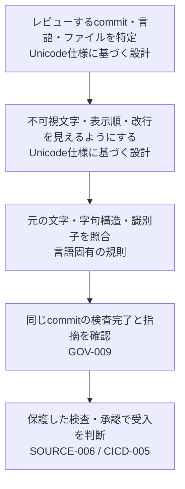

# Unicode source review：見た目が紛らわしいソースをレビューする

設計ID: `ENG-CODE-001`。独立Controlを持たない技術資料です。

入口：[Secure Coding / ASVS](../controls/records/secure-coding/README.md) · 学ぶ：[教材](unicode-source-review-learning.md) · 試す：[Pythonの限定実装](implementations/python-unicode-source-review/README.md)

レビュー画面で見えるコードと、言語処理系が解釈するコードが食い違うとき、どこで気付けるようにするかを設計します。たとえばPythonの`pаyload`（2文字目だけキリル文字）は別の名前でも、フォントによって`payload`に見えます。投稿者、表示器、処理系、受入側を別の主体として扱います。

この主題は個別技術の設計・学習資料です。Secure Codingの要件の入口はASVSへ統一し、Unicodeの全観点がASVSに含まれるとは主張しません。直接の根拠には下記のUnicode仕様とPythonの字句規則を使います。

## 表示・文字の解釈・受入をつなぐ

まずレビュー対象のcommit、言語、ファイルを決めます。レビュー画面やエディターでは、不可視文字、双方向表示の影響、処理系と異なる改行を見えるようにし、字句構造に沿う表示を選びます。静的検査は元のソースを読み、言語のトークンと元の綴りを照合します。

CIを受入条件にする場合は、同じcommitを検査したことに加え、投稿者が検査スクリプト・対象ファイル・例外方針を変更して弱められないか確認します。ローカルhookは早期発見に使えますが、投稿者の端末にあるため、共有先の受入条件の代わりにはなりません。

| 受け渡し | 担う資料・Control | この主題で確認する範囲 |
|---|---|---|
| 表示 → 言語の解釈 | 下記のUnicode仕様・言語仕様 | 表示上の順序や改行と、元の文字・トークン・識別子が食い違わないか。独立Controlは設けない |
| 検査 → 結果の利用 | [GOV-009](../controls/records/governance-operations/psb-gov-009-scanner-evidence-trust-boundary/README.md) | 対象commitと範囲、解析失敗、指摘を区別する。文字の検出条件自体を定義するControlではない |
| PR → 共有先の受入 | [SOURCE-006](../controls/records/source-protection/psb-source-006-source-organization-security-posture/README.md)・[CICD-005](../controls/records/cicd-security/psb-cicd-005-untrusted-pr-boundary/README.md) | 保護した必須検査とレビュー、未信頼PRの実行境界を使う。これらだけではUnicodeの解釈は検査できない |

## 選択肢と代償

| 方式 | 向く状況 | 限界 |
|---|---|---|
| エディター・レビュー画面で字句構造と不可視文字を表示 | 多言語のコメント・文字列・識別子を使う | 全員の表示環境と差分経路に適用する必要がある |
| 言語に合わせた検査と命名規則 | 受入時に機械的な拒否を置きたい | 言語の字句規則、文字コード、生成物、例外を管理する必要がある |
| ASCII識別子など対象を絞った規則 | 識別子に多言語名を必要としないPython等のプロジェクト | 正当な多言語識別子を拒否する。文字列・コメントも一律禁止する理由にはならない |

紛らわしい識別子（confusable）の判定はUnicode UTS #39／#55を参照して設計できます。ただし複数の文字体系の混在だけを拒否しても、同じ文字体系の紛らわしい名前を見落とします。PythonのNFKC判定も、その言語の意味に基づく限定策です。他言語へ同じ規則を移しません。

## 失敗経路と確認

- 見える差分だけを審査し、元のコードポイントを表示しない。
- コメント内の表示上の改行を、処理系も行末とみなすと思い込む。
- ソースをテキストとして読む検査が、実際の文字コードや字句規則と食い違う。
- 構文エラーや対象ゼロ件を`PASS`にする。
- PRが検査スクリプトやCI設定を変更し、同じPRでその弱い検査を合格させる。
- 厳格な拒否条件をすべての言語と多言語テキストへ一律に適用する。

診断の確認観点は[下記](#failure-checks)にあります。[Python例](implementations/python-unicode-source-review/README.md)は実ファイルを読む局所的な検出を実装します。CI設定の保護とレビュー画面の表示は採用先で接続・確認します。

## 診断で確認する項目（異常時テスト）

- コメントや文字列の双方向制御文字、不可視文字、表示だけで改行に見える文字を見落とさないか。
- 似た別文字や正規化によって識別子の意味が変わる場合、採用した言語・命名方針で評価できるか。
- 検査対象外のファイル、読めない文字コード、構文エラー、検査ツールの障害を成功として報告しないか。
- 投稿者が同じ変更で検査設定を弱めたとき、受入側が気付けるか。

これは設計レビューや診断で使う項目であり、各repositoryで試験した記録ではありません。

## 根拠

- [Unicode Source Code Handling](../sources/README.md#spec-unicode-source-handling-2)
- [Unicode Security Mechanisms](../sources/README.md#spec-unicode-security-mechanisms)
- [Pythonの字句規則](../sources/README.md#spec-python-source-lexical-3-10)
- [移行記録](../docs/UNICODE_SOURCE_MIGRATION.md)
